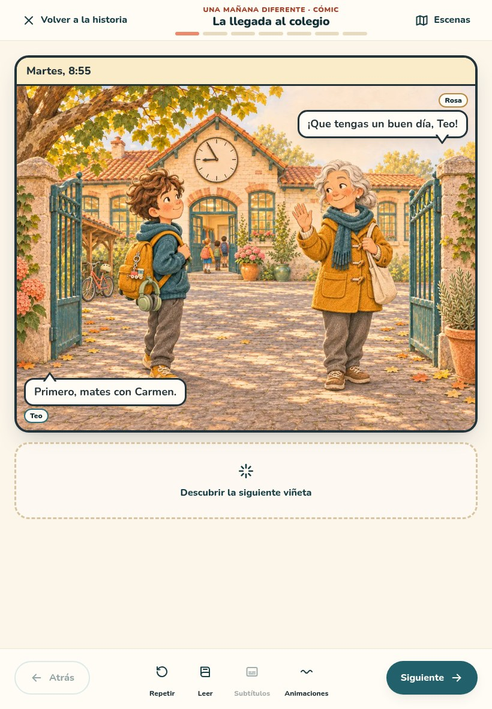
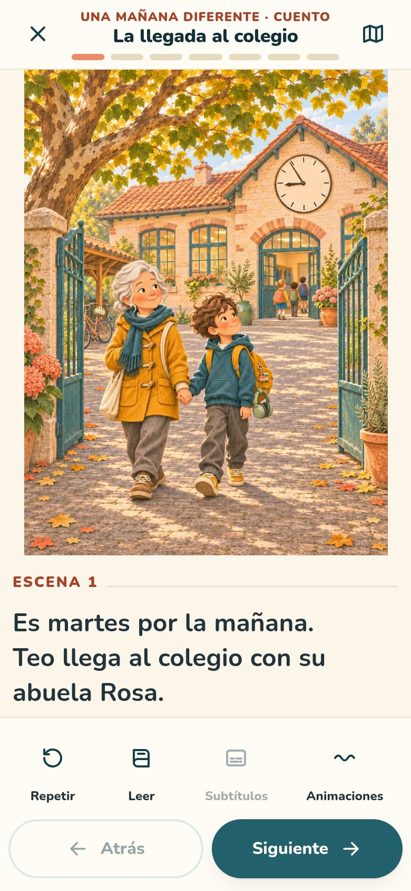

# NUBI — Fase 4 · Segundo lote artístico

16/11/2026 · Rama `feat/codex-art-batch-2` desde `integration/phase-3a` (`82df812`). Sin merge a main, sin cambios de componentes React ni de `story.ts`.

## Entrega

Se completan **10 IDs nuevos del catálogo**: las nueve escenas pendientes del cuento y la primera viñeta. El resultado acumulado es **24 listos / 48 pendientes / 72 recursos**. Las versiones verticales, variantes responsive y propuesta de marca no se cuentan como IDs adicionales.

| Recurso | Entregado en este lote |
|---|---|
| `ume-s1-puerta` | Nueva composición vertical 3:4; horizontal anterior intacto |
| `ume-s1-pasillo` | Horizontal y vertical: Teo toca sus cascos dentro de la mochila |
| `ume-s2-puerta` | Horizontal y vertical: Teo descubre a Andrés en el umbral |
| `ume-s2-anuncio` | Horizontal y vertical: Andrés se presenta a los cuatro compañeros |
| `ume-s2-reacciones` | Horizontal y vertical: cuatro reacciones distintas y comunicador de Lía |
| `ume-s3-pizarra` | Horizontal y vertical: información conocida y dudas |
| `ume-s4-teo-piensa` | Horizontal y vertical: Teo reflexiona con imágenes evocadas |
| `ume-s6-plan` | Horizontal y vertical: libro, pelota, lápiz, plato y pincel, en ese orden |
| `ume-s6-biblioteca` | Horizontal y vertical: los cuatro compañeros usan sus apoyos |
| `ume-s7-salida` | Horizontal y vertical: conversación con Rosa a mediodía |
| `ume-k1-1` | Primera viñeta 4:3: Teo a la izquierda, Rosa a la derecha |
| `nubi-saludo`, `nubi-pensando` | Variantes PNG 512w derivadas de los originales existentes; alfa conservado |

Archivos narrativos en `public/media/stories/una-manana-diferente/scenes/` y `comic/`, con las rutas exactas del registro. Se entregan **52 archivos públicos nuevos**: 20 composiciones principales (9 horizontales, 10 verticales y 1 viñeta), 30 variantes WebP y 2 PNG de Nubi a 512 px. Los originales del primer lote no se han reemplazado.

- Escenas horizontales: 2400×1350, variantes 1200×675.
- Escenas verticales recompuestas: 1536×2048, variantes 768×1024 y 1024×1365 (altura redondeada a píxel).
- Viñeta: 2048×1536, variante 1200×900.
- `portrait` declara archivo, proporción, dimensiones y anchos de variantes; los helpers del registro propagan estos metadatos, sin modificar el renderer.
- Se añadió 1024w a las versiones verticales para que 390 px a DPR2 no necesite descargar el maestro de 1536 px. Se confirmó `currentSrc` en navegador.

El [manifiesto acumulado](art-direction/delivery.json) contiene los recursos listos y sus exportaciones. [exports.json](art-batch-2/exports.json) registra dimensiones nativas/exportadas, calidad WebP, peso y hash de cada WebP nuevo. [generation.json](art-batch-2/generation.json) conserva instrucciones, referencias y correcciones; los originales de generación permanecen en `/workspace/generated_images`.

## Continuidad y control de calidad

Se leyó el argumento completo antes de producir. Se inspeccionaron las nueve hojas maestras; cada generación recibió las hojas relevantes y/o la ilustración del momento que estaba recomponiendo. Las escenas conservan gouache y lápiz, paleta cálida, apoyos, ropa, peinados y el colegio del primer lote.

Las versiones verticales son **generaciones recompuestas**, no recortes del horizontal. La llegada conserva a Teo y Rosa completos, puerta, reloj cercano a las 8:55 y contexto. La salida usa luz de mediodía y otra pose de conversación, con los cascos de nuevo en la mochila. En la biblioteca Teo lleva los cascos puestos, sin duplicarlos en la mochila.

Se corrigieron antes de entregar:

1. El acceso al aula parecía exterior: se sustituyeron piedra y hojas por el pasillo interior, manteniendo las figuras.
2. El comunicador de Lía mostraba cancelación: se sustituyó por el pictograma de duda y se recuperó el asa.
3. Faltaba la flecha prevista junto al retrato de Carmen en la pizarra.

Se revisaron rostros, manos, apoyos, vestuario, iluminación y continuidad espacial en las imágenes generadas y capturas. Las expresiones permanecen contenidas y ninguna reacción se representa como incorrecta. No se modificó el contenido educativo.

No hay texto, títulos ni bocadillos horneados en el arte. Se incluyen los símbolos indispensables previstos por los datos: relojes sin cifras, pictogramas, interrogaciones y flecha en la pizarra, y pictogramas del comunicador. Los objetos imaginados de Teo se pintaron como viñetas suaves sin contorno ni cola de bocadillo. Los textos y diálogos continúan siendo accesibles en HTML.

## Cómic

`ume-k1-1` mantiene a Teo a la izquierda. Arriba a la derecha queda cielo tranquilo para Rosa; abajo a la izquierda, pavimento para Teo. Se comprobaron los bocadillos reales: no tapan caras ni manos. A 820 px el panel es ancho y los superpone; a 390 y 1180 px la distribución deja el panel más estrecho y los muestra debajo. El comportamiento depende del ancho de la viñeta, no solo del viewport.



## Propuesta de símbolo — pendiente de aprobación

[PNG 512 px](art-batch-2/brand/nubi-header-proposal-512.png), [80 px](art-batch-2/brand/nubi-header-proposal-80.png) y [40 px](art-batch-2/brand/nubi-header-proposal-40.png). Se generó con referencias del Nubi editorial y contorno petróleo más legible al reducirlo; exportado con transparencia real. Inspeccionado a 40 px.

No está registrado como recurso de los 72 ni conectado a la cabecera. No sustituye el logotipo ni cambia el nombre. La aprobación de marca corresponde a la persona responsable. El concepto externo de Instagram no estaba incluido como archivo de referencia en este encargo; esta propuesta se fundamenta en las referencias editoriales del repositorio.

## Resolución y peso: límites explícitos

Los horizontales se generaron a **1672×941**, las composiciones verticales a **1086×1448**, la viñeta a **1448×1086** y el símbolo a **1254×1254**. Se exportaron a los tamaños del catálogo: los maestros mayores están remuestreados, **no son originales nativos de 2400/2048 px**. Las variantes pequeñas se obtienen de los originales de generación, no de sucesivas ampliaciones.

WebP nuevo: aproximadamente 100–361 KiB por archivo, con calidad registrada 58–80. La compresión se ajustó preservando un mínimo de calidad; algunos paisajes detallados superan los pesos orientativos de la guía. No se redujo más para ocultar textura. Los PNG 512w pesan aproximadamente 142 y 159 KiB. Los maestros y variantes del primer lote conservan sus bytes.

## Pruebas ejecutadas

| Prueba | Resultado |
|---|---|
| `npm run assets:doc` | 72 recursos; catálogo generado con 24 listos, variantes y composiciones verticales documentadas |
| `npm run check` | Tipos, **43 tests** y build correctos |
| `art-files.mjs` | **24 recursos / 80 archivos**: hashes disponibles, decodificación, dimensiones y transparencia correctos; ampliado para verificar `portrait` y sus variantes |
| `art-batch-2.mjs` | 10 escenas × 3 viewports; fuente vertical en orientación vertical, horizontal en horizontal; proporciones correctas, texto conservado y controles visibles |
| `art-layout.mjs` | 390/820/1180: 58 estados cargados, 96 provisionales, 0 errores; sin recortes narrativos ni desbordamiento horizontal |
| `quality.mjs` | PASS 390/820/1180: cuento, cómic, seis posibilidades, emociones/intensidad, estrategias/resumen, persistencia/borrado, teclado y axe sin infracciones en estados probados |
| `narration.mjs` | PASS: no autoarranque, rechazo de voz remota, error asíncrono y detener |

Capturas: [previews](art-batch-2/previews), **33 imágenes actuales** (30 estados de cuento + 3 de cómic), y [resultados estructurados](art-batch-2/previews/results.json). Viewports emulados: 390×844 DPR2, 820×1180 DPR1 y 1180×820 DPR1, Chromium de Linux. **No se probaron dispositivos físicos.** Las escenas ocupan aproximadamente 345×460, 597×796 y 761×428 px respectivamente. El escenario se desplaza para leer los textos largos sin reducir letra ni controles; en móvil imagen y todo el texto no caben siempre a la vez.



### Reproducir

Con las herramientas externas descritas en TEST_RESULTS.md y Vite en puerto 5173:

```bash
NUBI_BROWSER_TOOLS=/workspace/quality-tools node tests/browser/art-files.mjs
NUBI_BROWSER_TOOLS=/workspace/quality-tools NUBI_ART_EVIDENCE=/tmp/nubi-batch-2 node tests/browser/art-batch-2.mjs
NUBI_BROWSER_TOOLS=/workspace/quality-tools node tests/browser/art-layout.mjs
NUBI_BROWSER_TOOLS=/workspace/quality-tools NUBI_EVIDENCE=/tmp/nubi-functional node tests/browser/quality.mjs
NUBI_BROWSER_TOOLS=/workspace/quality-tools node tests/browser/narration.mjs
```

Se descartó una ejecución inicial del script gráfico nuevo porque el selector de bocadillos encontraba las dos versiones responsive del DOM. Se corrigió el test para exigir exactamente una versión visible y se repitió. No se cambió el componente para hacer pasar la comprobación.

## Pendientes y decisiones

- **48 recursos**: 6 lugares, 7 herramientas, 9 emociones, 12 opciones/consecuencias y 14 viñetas. Las diez escenas narrativas de cuento ya tienen arte real; las decisiones y consecuencias siguen pendientes de ilustración.
- Aprobar o revisar el símbolo de cabecera; no se ha instalado.
- Revisar la dirección artística humana, los significados de pictogramas y la adecuación pedagógica. La validación profesional del episodio sigue pendiente; esta entrega no la sustituye.
- Dispositivos físicos, lector de pantalla y otros navegadores siguen fuera de esta prueba emulada. Vídeo y narración humana continúan pendientes.
- En futuras exportaciones valorar fuentes nativas de mayor resolución si el arte se destina a impresión. Los remuestreos actuales se declaran explícitamente.

## Publicación

Rama publicada: [`feat/codex-art-batch-2`](https://github.com/TinyChat-up/NUBI/tree/feat/codex-art-batch-2). Commit de arte: `a17cb76`; las pruebas, capturas y este informe se entregan en el commit posterior de documentación. No se ha realizado merge a main ni a la rama base. El símbolo de cabecera sigue pendiente de aprobación.
