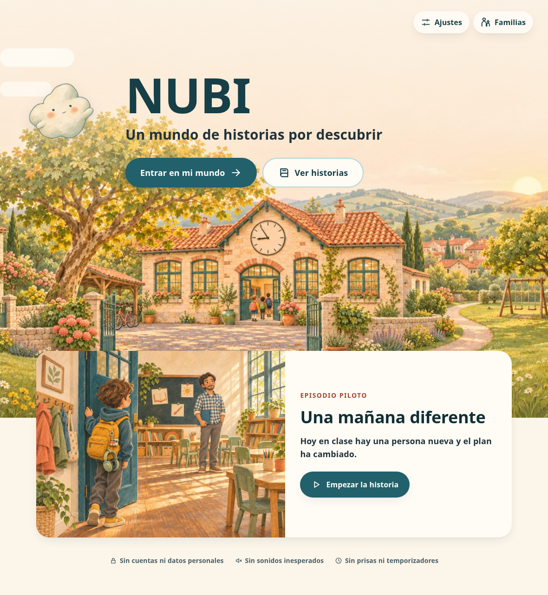
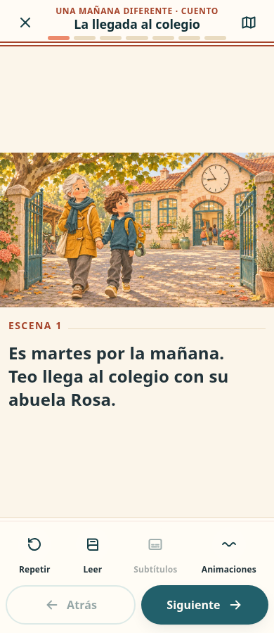

# NUBI — Primera entrega de dirección artística

16/11/2026 · Rama `feat/codex-art-direction`, creada desde `feat/codex-quality` (4c0370b). Se ha leído el contrato de `feat/claude-experience` (1ce927f). No se ha fusionado ninguna rama ni modificado ningún componente React.

## Resultado

**14 de los 72 recursos están entregados** en `public/media/`. Son archivos generados con `image_gen.imagegen`, no dibujos creados con código. ImageMagick solo se ha utilizado para exportar formatos, dimensiones, márgenes transparentes y variantes. No se ha añadido generación de imágenes a la aplicación ni servicios nuevos.

| Recursos | Ruta | Tamaño principal | Variantes |
|---|---|---|---|
| `char-nubi`, `char-teo`, `char-aya`, `char-bruno`, `char-lia`, `char-andres`, `char-carmen`, `char-pilar`, `char-rosa` | `public/media/characters/<personaje>.png` | 1536×2048, PNG con alfa real | 384×512 |
| `nubi-saludo`, `nubi-pensando` | `public/media/characters/<id>.png` | 1024×1024, PNG con alfa real | 256×256 |
| `portada-fondo` | `public/media/common/portada-fondo.webp` | 2400×1350 | 1200×675 |
| `ume-cover` | `public/media/stories/una-manana-diferente/cover.webp` | 2048×1536 | 1200×900 |
| `ume-s1-puerta` | `public/media/stories/una-manana-diferente/scenes/s1-puerta.webp` | 2400×1350 | 1200×675 |

Las variantes añaden `-<ancho>w` antes de la extensión. Solo estos recursos están marcados `listo`; no se han cambiado IDs, rutas ni formatos del catálogo. El helper de personajes mantiene por defecto `pendiente` para futuras altas.

Se entregan además **nueve hojas maestras**, fuera de la app, en [art-direction/models](art-direction/models): cada una muestra frente, perfil, espalda y cuatro expresiones (calma, sorpresa, preocupación, alegría). No se cuentan como nueve recursos adicionales del catálogo.

[Manifiesto de entrega](art-direction/delivery.json): procedencia de los originales, tamaños nativos/exportados, hashes SHA256, pesos y variantes. Los originales de generación se conservan en `/workspace/generated_images`; los archivos publicados son las exportaciones y las hojas de modelo.

## Dirección y continuidad

Gouache opaco y lápiz de color, textura táctil, anatomía orgánica y luz cálida. Paleta crema/petróleo/coral/salvia/mostaza según VISUAL_GUIDE; sin imitar artistas o personajes existentes. Las expresiones son contenidas, sin recompensas visuales ni estímulos intensos. No hay textos, diálogos ni bocadillos horneados en el arte. Los pictogramas del comunicador son dibujos sin palabras.

Las referencias de personajes se adjuntaron a las generaciones posteriores. La cubierta utiliza a Teo y Andrés; la escena de llegada utiliza a Teo y Rosa; el paisaje retoma la escuela de la escena. Se corrigieron el pelo recogido de Rosa y el reloj de la llegada para mantener coherencia con las 8:55 del cómic. Teo conserva mochila, cascos y llavero; Lía conserva su comunicador. Las futuras escenas deben utilizar las hojas y retratos entregados como referencias, no volver a inventar los personajes.

- Portada: foco `{x:50,y:66}`, colegio en la zona central inferior y cielo despejado para UI.
- Cubierta: foco `{x:48,y:48}`, umbral y personajes dentro de la zona central.
- Escena: se muestra completa con la interfaz de Claude; sin texto superpuesto.
- Cómic: aún pendiente. Antes de generar cada viñeta consultar `bubble.position` y reservar esas esquinas sin caras/manos/comunicador. No reutilizar sin más un recorte de la escena de cuento.

## Calidad y límites de exportación

El generador no devolvió los tamaños pedidos de forma nativa: retratos 1086×1448, escenas/paisaje 1672×941 y cubierta 1448×1086; las poses de Nubi son 1254×1254. Se ha remuestreado para cumplir los tamaños del registro, conservando proporciones y añadiendo margen alfa a personajes. **No son originales nativos de 2400 px**; el manifiesto permite comprobarlo por archivo. Las hojas de modelo se conservan a resolución de generación y son referencias de continuidad, no arte de impresión.

PNG con transparencia real, comprobada por decodificación y canal alfa; bordes revisados visualmente sobre fondos crema y petróleo. No se ha horneado sombra de suelo ni fondo de tablero. Los objetivos de peso de ILLUSTRATION_INTEGRATION son orientativos: los PNG maestros pesan aproximadamente 0,55–1,73 MiB, sus variantes 41–136 KiB; los WebP maestros 365–447 KiB, variantes 151–211 KiB. Algunos superan las recomendaciones. Se priorizó conservar textura y rutas PNG; reducirlos más o migrarlos a WebP con alfa requiere revisar calidad y rutas en la siguiente entrega. En las capturas con DPR1 el navegador eligió las variantes, no los PNG maestros.

## Pruebas

- `npm run assets:doc`: catálogo regenerado, 14/72 entregados.
- `npm run check`: tipos, **36 tests** y build correctos, sin nuevas dependencias.
- `tests/browser/art-files.mjs`: **14 recursos / 28 archivos**, hashes de originales, decodificación, tamaños y canal alfa correctos. Evidencia: [file-validation.json](art-direction/file-validation.json).
- `tests/browser/art-layout.mjs`: script de Claude, validado contra una **copia temporal sin Git** de su commit 1ce927f con los archivos y registros entregados superpuestos. Se inició Vite en el puerto 5174. **37 estados cargados observados, 117 provisionales, 0 errores**, sin recortes narrativos ni desbordamiento en 390/820/1180 px. Las imágenes diferidas fuera del viewport no se contabilizan como cargadas por este script; art-files comprueba las 28 exportaciones por separado.
- Las [capturas](art-direction/previews) de portada, ficha y llegada en los tres anchos pertenecen a esa combinación temporal. No se afirma que los componentes de Claude estén incluidos en esta rama.

```bash
# Dependencias externas como en TEST_RESULTS.md. Servidor actual o copia de integración:
NUBI_BROWSER_TOOLS=/workspace/quality-tools NUBI_URL=http://127.0.0.1:5174 node tests/browser/art-files.mjs
NUBI_BROWSER_TOOLS=/workspace/quality-tools NUBI_URL=http://127.0.0.1:5174 node tests/browser/art-layout.mjs
```

## Integración técnica pendiente

`feat/codex-quality` aún tiene la presentación anterior. Se han copiado **exactamente** de Claude los campos opcionales `focus`/`variants` en AssetSpec y el documento ILLUSTRATION_INTEGRATION para poder registrar la entrega sin divergencias de contrato. No se han cambiado `.tsx`, estilos ni scripts npm. Las variantes, el Nubi ilustrado y la presentación sin recortes se activarán con los componentes de `feat/claude-experience` cuando se autorice la integración. No se solicita un cambio React adicional para estos 14 recursos.

## Recursos pendientes

**58 recursos pendientes**, manteniendo sus especificaciones: 6 lugares, 7 herramientas, 9 emociones, 9 escenas de cuento, 12 opciones/consecuencias y 15 viñetas. Vídeo y narración humana siguen pendientes y no se presentan como terminados. El siguiente lote debería completar escenas del cuento, después decisiones/consecuencias y cómic, manteniendo continuidad con estas hojas. La revisión artística no sustituye la validación pedagógica pendiente.

## Vistas de la combinación temporal




