# Comparación antes y después · Fase 17

Antes: `e9793cc`, base de fase 16, en una copia aislada. Después: React de `feat/codex-ux-infantil-v1`. Misma historia y recursos, sin borradores editoriales aplicados.

Las miniaturas siguientes son **capturas reales de viewport**, con letra normal y movimiento reducido para estabilizar la comparación. Pulsarlas permite verlas completas. El escenario del lector desplaza por dentro: una captura no representa todas sus opciones fuera de vista. El inventario final enlaza también página completa y tableta horizontal.

## Portada

- **Antes:** Varias entradas y paisaje de fondo competían por el primer paso.
- **Cambio:** Paisaje íntegro, Nubi oficial y una única entrada a Mi mundo; Ajustes y Familias conservan texto visible.
- **Motivo:** Hace explícita la secuencia de entrada y evita texto sobre el paisaje.
- **Posible coste:** Se pierde el atajo directo a la historia desde portada.
- **Validación humana:** Comprensión de la entrada y deseo de explorar.

| Tamaño | Antes | Después |
|---|---|---|
| Móvil · 390×844 | <a href="evidence/before/390-01-portada-viewport.png">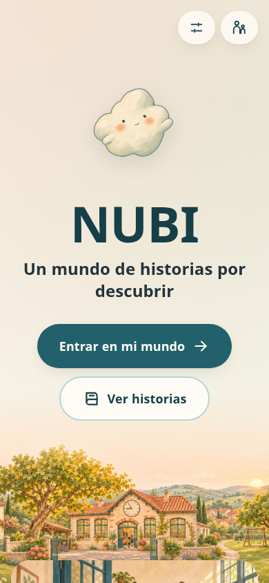</a> | <a href="evidence/after/390-01-portada-viewport.png">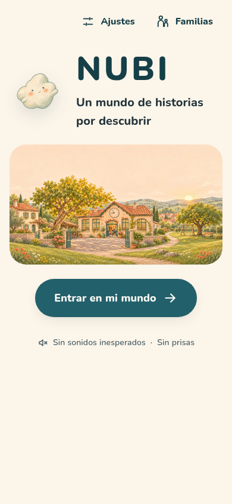</a> |
| Tableta · 820×1180 | <a href="evidence/before/820-01-portada-viewport.png">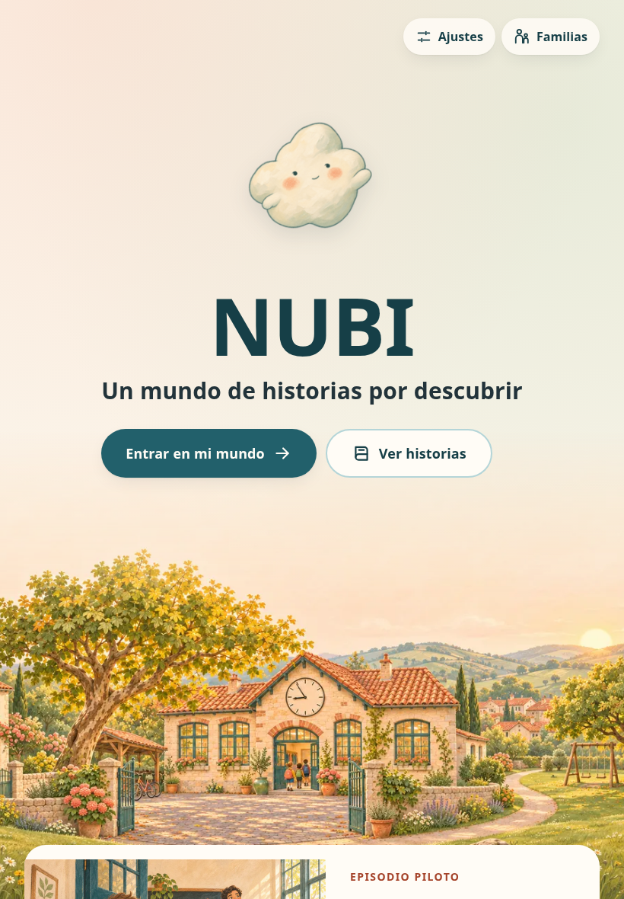</a> | <a href="evidence/after/820-01-portada-viewport.png">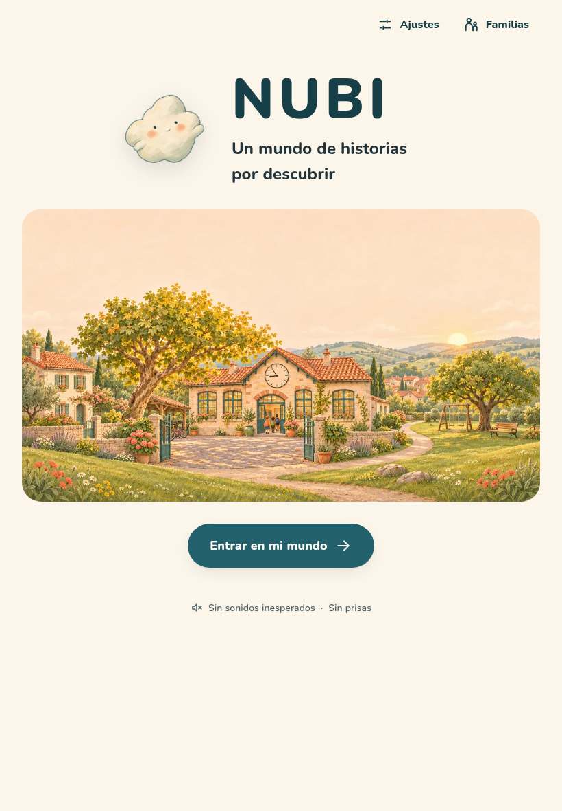</a> |

## Mi mundo

- **Antes:** Seis destinos equivalentes; emociones/herramientas después de tres lugares sin historias.
- **Cambio:** Colegio destacado, apoyos después y futuros en una sección diferenciada.
- **Motivo:** Reduce el recorrido hasta funciones disponibles y vincula cada ilustración con nombre y estado.
- **Posible coste:** La composición deja de ser uniforme; la jerarquía puede sugerir una preferencia por el colegio.
- **Validación humana:** Comprensión de los destinos y de Próximamente.

| Tamaño | Antes | Después |
|---|---|---|
| Móvil · 390×844 | <a href="evidence/before/390-02-mundo-viewport.png">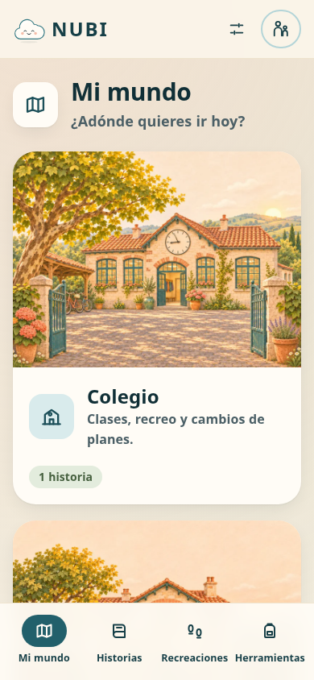</a> | <a href="evidence/after/390-02-mundo-viewport.png">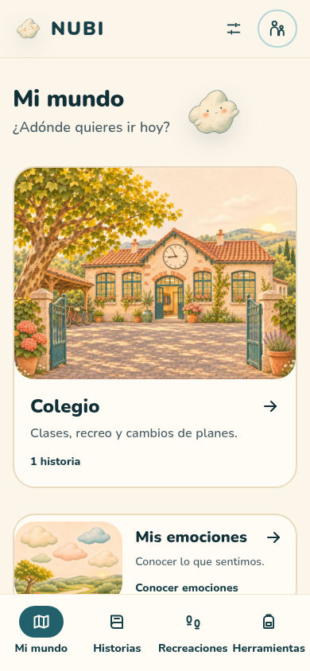</a> |
| Tableta · 820×1180 | <a href="evidence/before/820-02-mundo-viewport.png">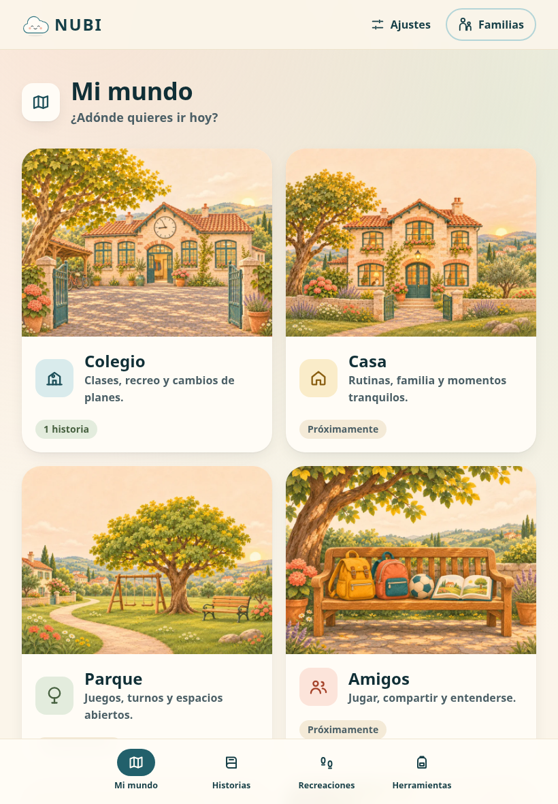</a> | <a href="evidence/after/820-02-mundo-viewport.png">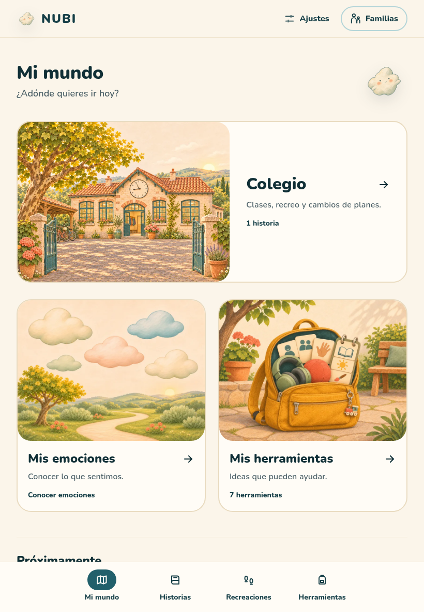</a> |

## Ficha de historia

- **Antes:** Sinopsis larga y cubierta aplazaban el acceso a los formatos; vídeo tenía peso equivalente.
- **Cambio:** Apertura editorial, tagline existente, vistas previas de Cuento/Cómic y vídeo pendiente separado. Sinopsis íntegra desplegable.
- **Motivo:** Facilita comparar las dos formas disponibles sin cambiar la historia.
- **Posible coste:** La sinopsis completa exige abrir Sobre esta historia.
- **Validación humana:** Reconocimiento de formatos y descubrimiento de la sinopsis.

| Tamaño | Antes | Después |
|---|---|---|
| Móvil · 390×844 | <a href="evidence/before/390-04-ficha-viewport.png">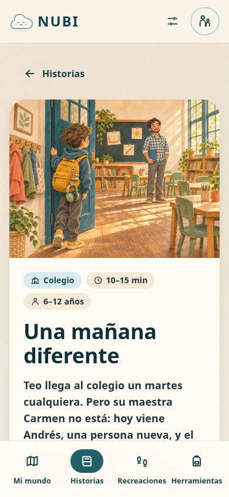</a> | <a href="evidence/after/390-04-ficha-viewport.png">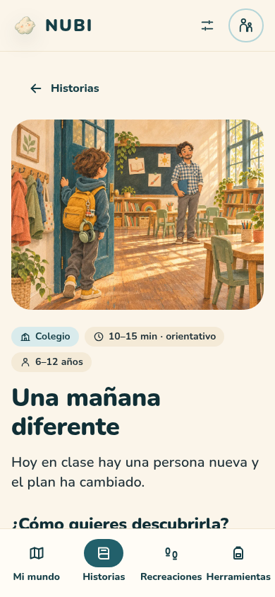</a> |
| Tableta · 820×1180 | <a href="evidence/before/820-04-ficha-viewport.png">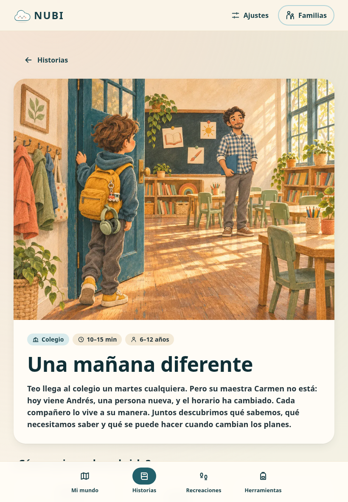</a> | <a href="evidence/after/820-04-ficha-viewport.png">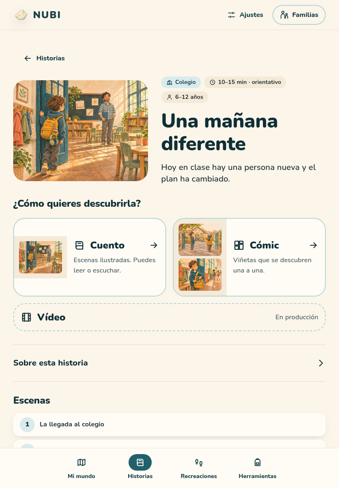</a> |

## Cuento

- **Antes:** Los controles secundarios ocupaban más alto y estaban visualmente separados.
- **Cambio:** Franja compacta y página de lectura con borde editorial; geometría narrativa conservada.
- **Motivo:** Se distingue la lectura de la escena y se libera alto sin esconder controles.
- **Posible coste:** El icono interior es menor aunque el botón conserva ≥48 px.
- **Validación humana:** Reconocimiento táctil de los controles y separación del hablante.

| Tamaño | Antes | Después |
|---|---|---|
| Móvil · 390×844 | <a href="evidence/before/390-05-cuento-viewport.png">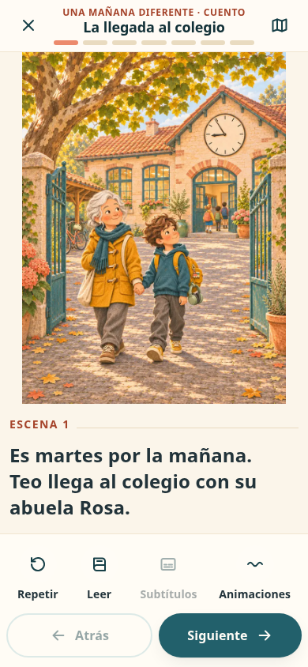</a> | <a href="evidence/after/390-05-cuento-viewport.png">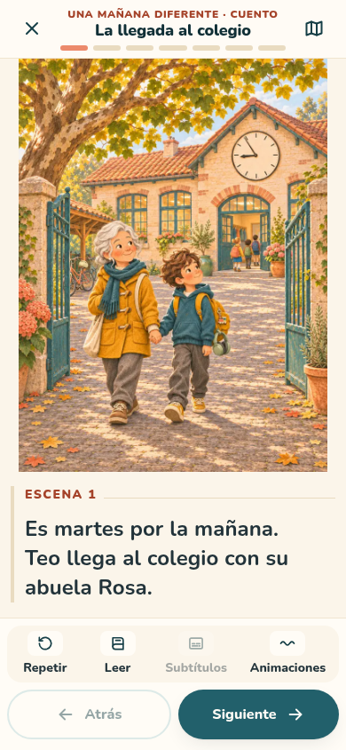</a> |
| Tableta · 820×1180 | <a href="evidence/before/820-05-cuento-viewport.png">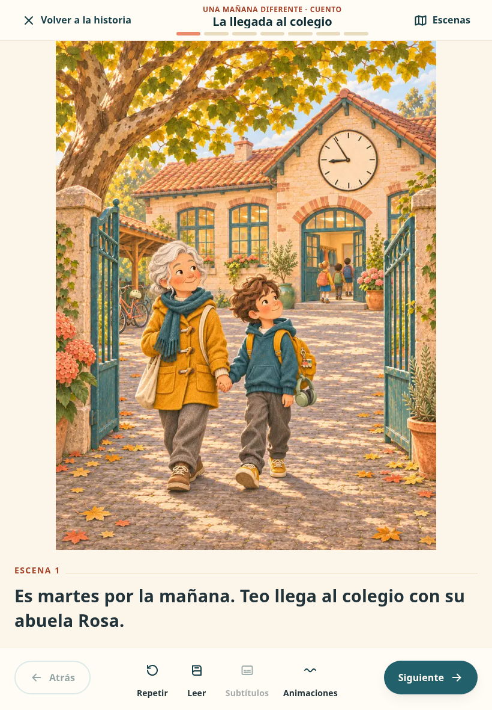</a> | <a href="evidence/after/820-05-cuento-viewport.png">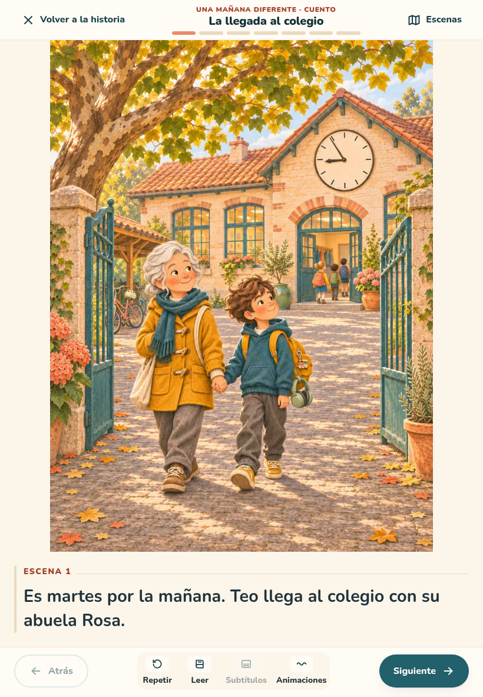</a> |

## Cómic

- **Antes:** El área de revelado tenía un borde muy suave; compartía el marco anterior del reproductor.
- **Cambio:** Área de revelado más definida y controles compactos. Se conservan las 15 viñetas y sus bocadillos.
- **Motivo:** El siguiente paso gana presencia y sigue disponible también en Siguiente y teclado.
- **Posible coste:** El cambio del cómic es deliberadamente menor que el de Mi mundo; no se redibuja su composición.
- **Validación humana:** Descubrimiento progresivo y lectura con apoyos de comunicación.

| Tamaño | Antes | Después |
|---|---|---|
| Móvil · 390×844 | <a href="evidence/before/390-06-comic-viewport.png">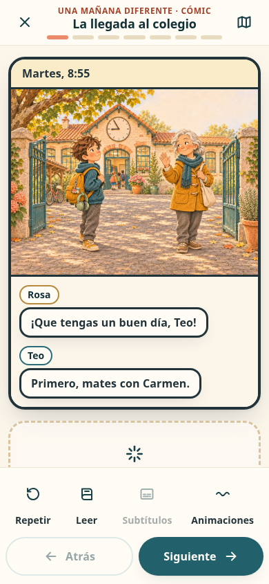</a> | <a href="evidence/after/390-06-comic-viewport.png">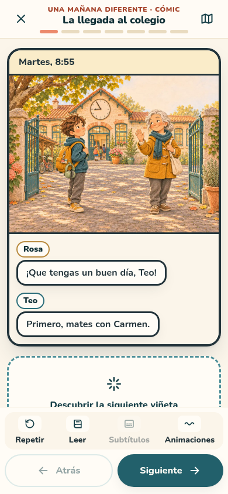</a> |
| Tableta · 820×1180 | <a href="evidence/before/820-06-comic-viewport.png">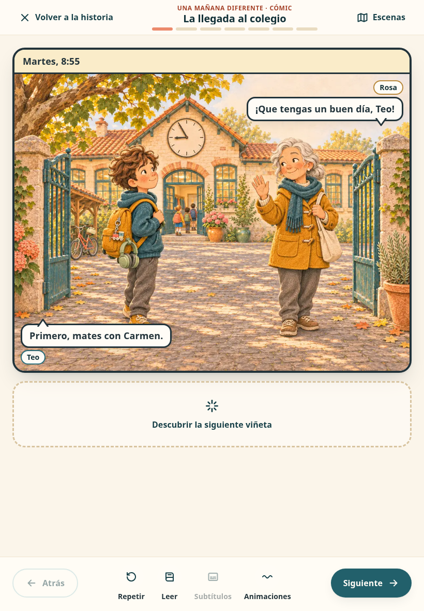</a> | <a href="evidence/after/820-06-comic-viewport.png">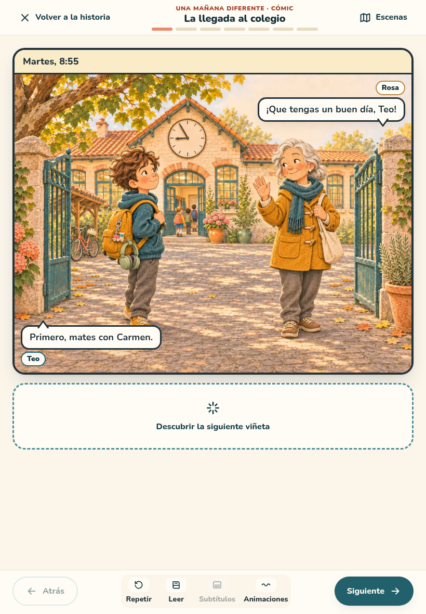</a> |

## Selector de emociones

- **Antes:** Ilustraciones a 56 px en una lista de filas.
- **Cambio:** 96 px, dos columnas en móvil y cuatro desde tableta; nombre y marca de selección.
- **Motivo:** Da más superficie al dibujo sin sustituir las etiquetas ni perder No lo sé/Otra cosa.
- **Posible coste:** Las tarjetas más altas muestran menos opciones de una vez en algunos tamaños.
- **Validación humana:** Reconocimiento y disposición para explorar las opciones restantes.

| Tamaño | Antes | Después |
|---|---|---|
| Móvil · 390×844 | <a href="evidence/before/390-07-selector-emociones-viewport.png">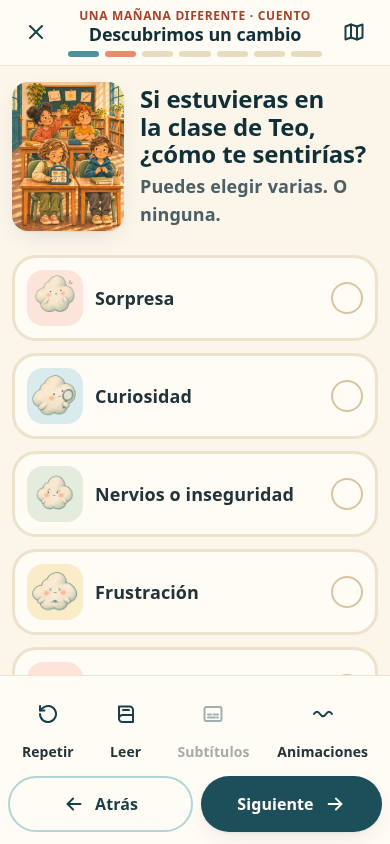</a> | <a href="evidence/after/390-07-selector-emociones-viewport.png">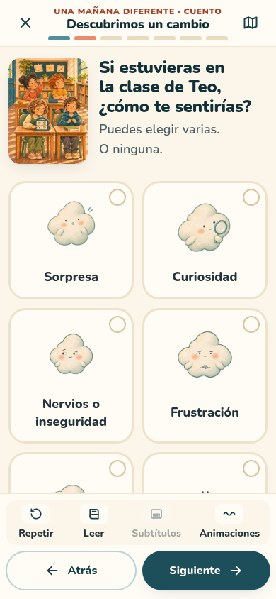</a> |
| Tableta · 820×1180 | <a href="evidence/before/820-07-selector-emociones-viewport.png">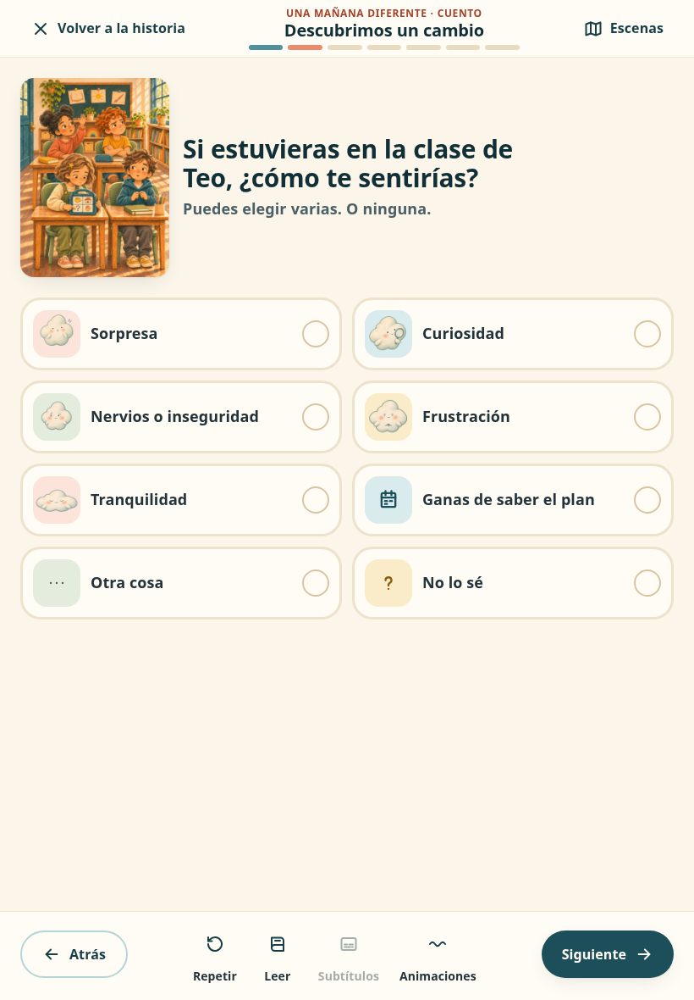</a> | <a href="evidence/after/820-07-selector-emociones-viewport.png">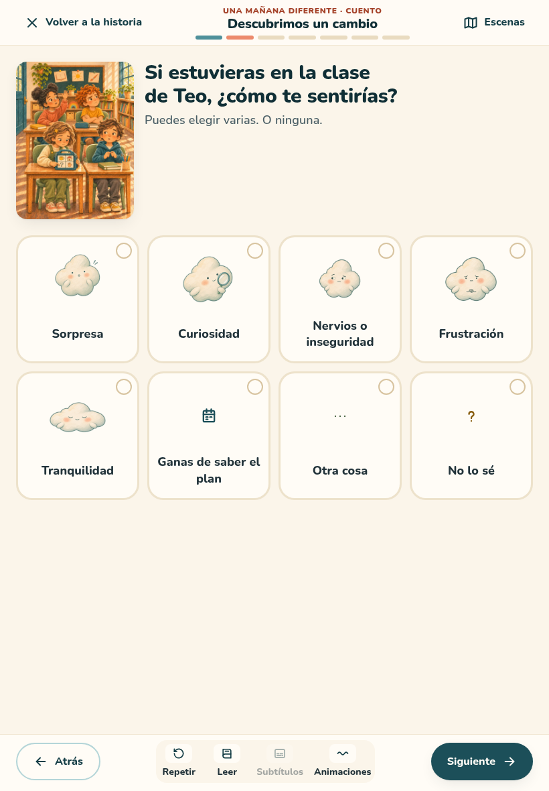</a> |

## Decisiones

- **Antes:** Icono distinto para cada alternativa además de su imagen y texto.
- **Cambio:** Flecha común de entrada a cada posibilidad, manteniendo las seis imágenes y textos.
- **Motivo:** El símbolo comunica una acción consistente; la imagen explica la opción.
- **Posible coste:** La flecha podría necesitar explicación; esta pantalla mantiene una rejilla para conservar comparación y neutralidad.
- **Validación humana:** Que se entiendan como posibilidades, sin idea de respuesta correcta.

| Tamaño | Antes | Después |
|---|---|---|
| Móvil · 390×844 | <a href="evidence/before/390-08-decisiones-viewport.png">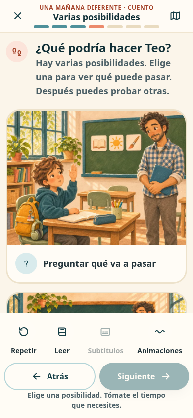</a> | <a href="evidence/after/390-08-decisiones-viewport.png">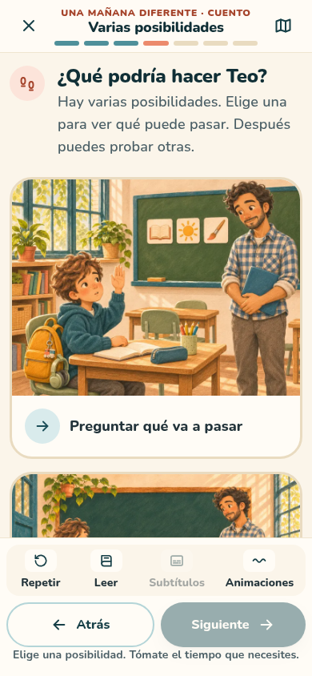</a> |
| Tableta · 820×1180 | <a href="evidence/before/820-08-decisiones-viewport.png">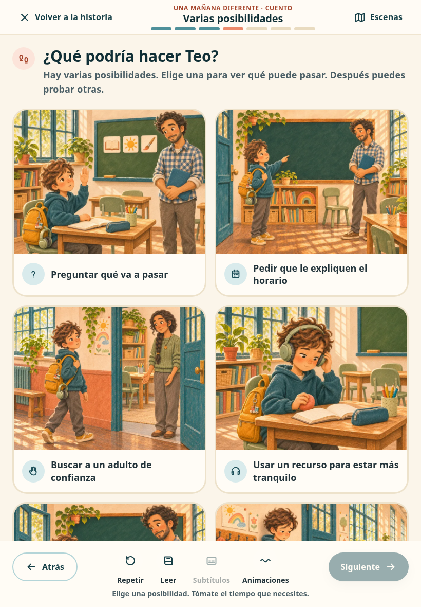</a> | <a href="evidence/after/820-08-decisiones-viewport.png">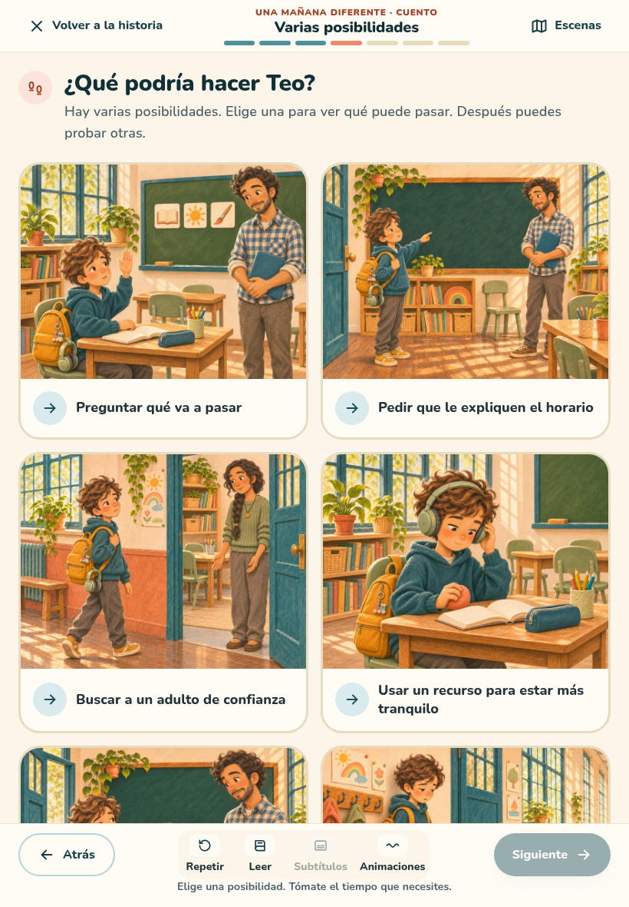</a> |

## Consecuencias

- **Antes:** Probar otra posibilidad se encontraba después de una lectura larga.
- **Cambio:** Ruta de retorno al principio, sin duplicarla; otras rutas permanecen al final.
- **Motivo:** Permite encontrarla al entrar, sin cambiar el desenlace ni bloquear la lectura.
- **Posible coste:** Puede favorecer volver antes de leer la consecuencia.
- **Validación humana:** Descubrimiento del retorno y comprensión de lo que cambia al elegir otra opción.

| Tamaño | Antes | Después |
|---|---|---|
| Móvil · 390×844 | <a href="evidence/before/390-09-consecuencias-viewport.png">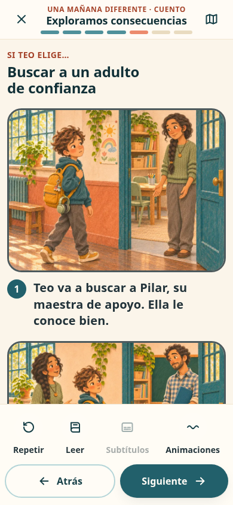</a> | <a href="evidence/after/390-09-consecuencias-viewport.png">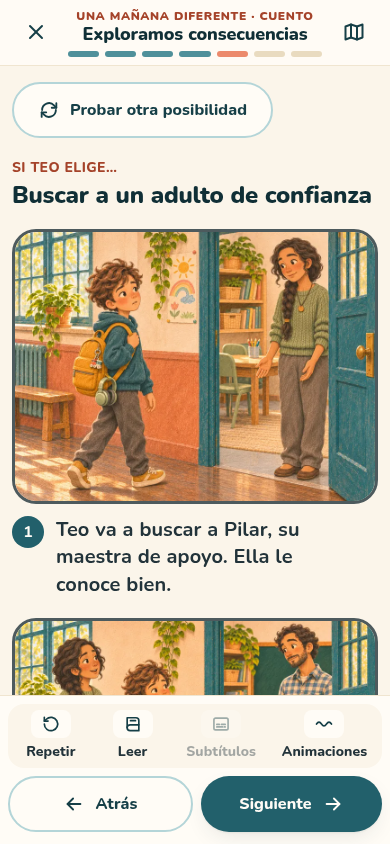</a> |
| Tableta · 820×1180 | <a href="evidence/before/820-09-consecuencias-viewport.png">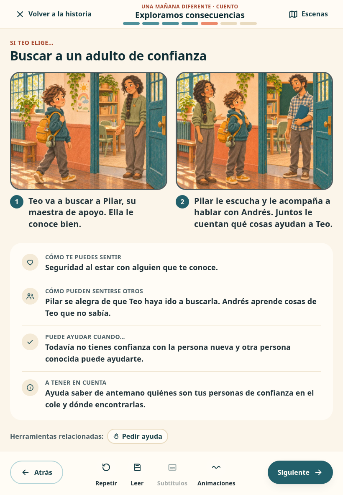</a> | <a href="evidence/after/820-09-consecuencias-viewport.png">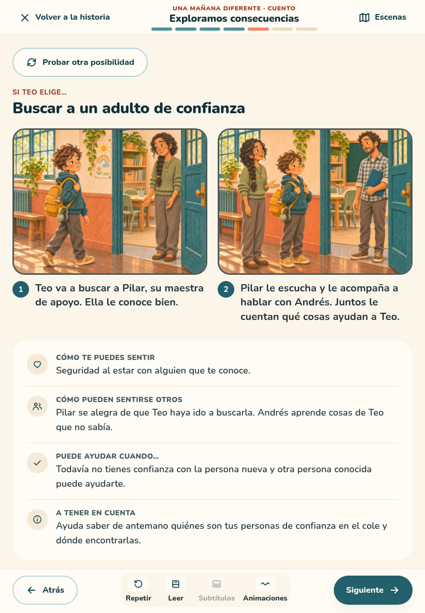</a> |

## Mis emociones

- **Antes:** Nubi pequeño, fondos de distintos tonos y estado indicado con borde.
- **Cambio:** 96 px y marca ✓; detalle a 120 px con fondo neutro.
- **Motivo:** Estado explícito y más espacio para imagen, palabra y explicación.
- **Posible coste:** En móvil sigue siendo necesario bajar para leer el detalle.
- **Validación humana:** Localización del detalle y significado de cada ilustración.

| Tamaño | Antes | Después |
|---|---|---|
| Móvil · 390×844 | <a href="evidence/before/390-11-emociones-viewport.png">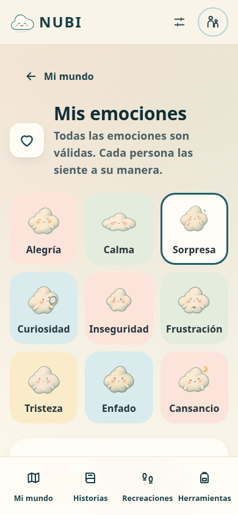</a> | <a href="evidence/after/390-11-emociones-viewport.png">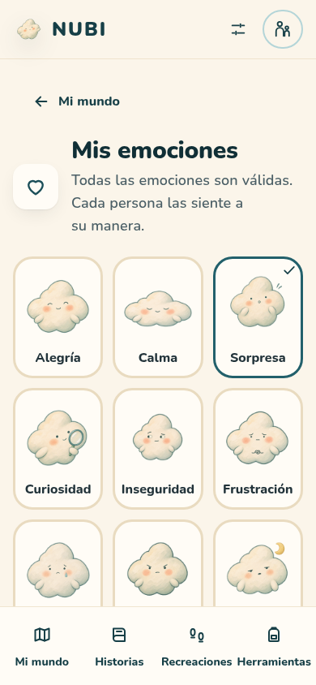</a> |
| Tableta · 820×1180 | <a href="evidence/before/820-11-emociones-viewport.png">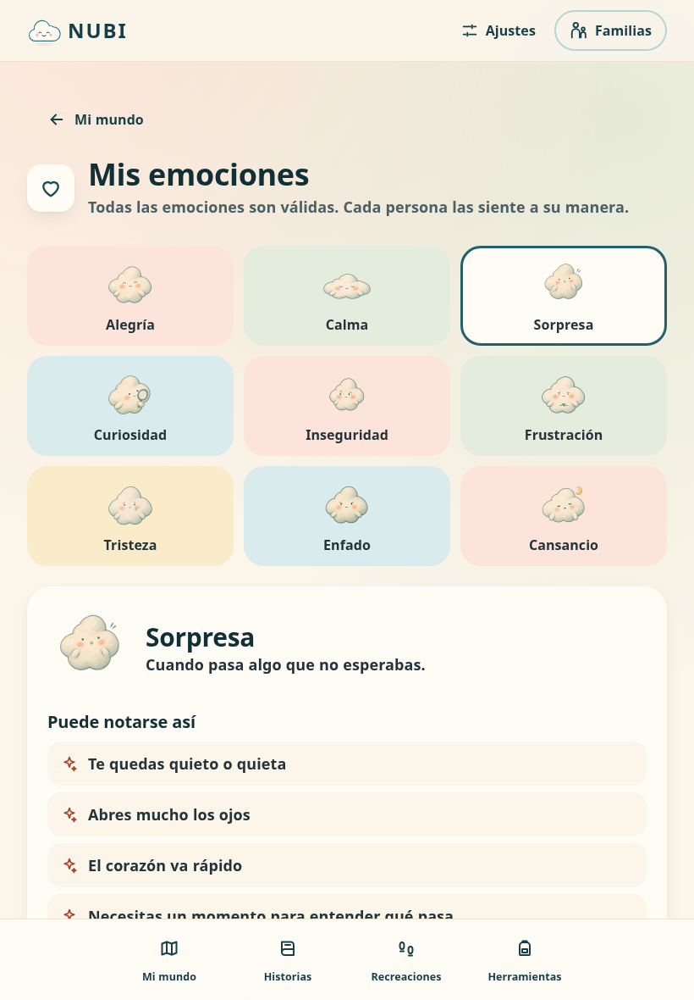</a> | <a href="evidence/after/820-11-emociones-viewport.png">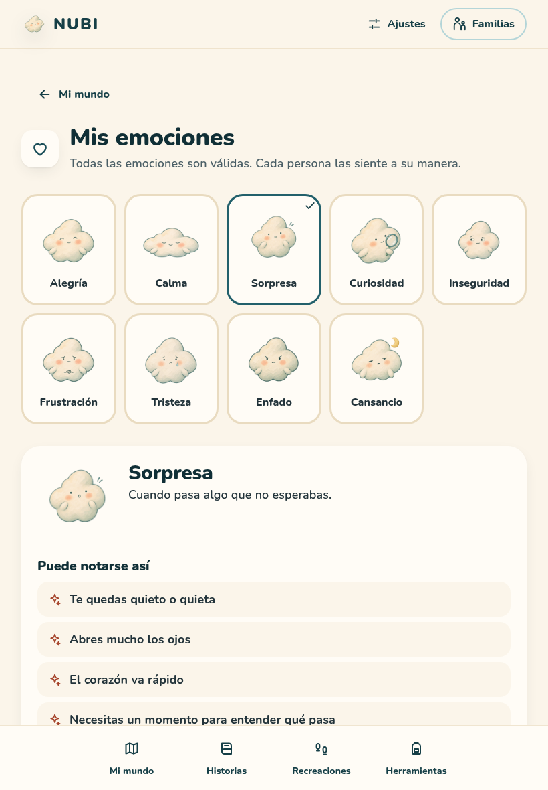</a> |

## Mis herramientas

- **Antes:** Dibujos de 96 px junto a descripciones en tarjetas pequeñas.
- **Cambio:** 144/208 px en catálogo, distribución vertical en tableta; detalle ampliado a 208/288 px.
- **Motivo:** Permite ver mejor apoyos y formas de comunicación conservando instrucciones.
- **Posible coste:** Aumenta la longitud de la página y el desplazamiento.
- **Validación humana:** Reconocimiento, búsqueda y fatiga durante el recorrido.

| Tamaño | Antes | Después |
|---|---|---|
| Móvil · 390×844 | <a href="evidence/before/390-12-herramientas-viewport.png">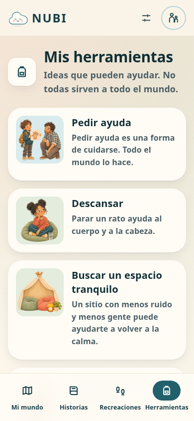</a> | <a href="evidence/after/390-12-herramientas-viewport.png">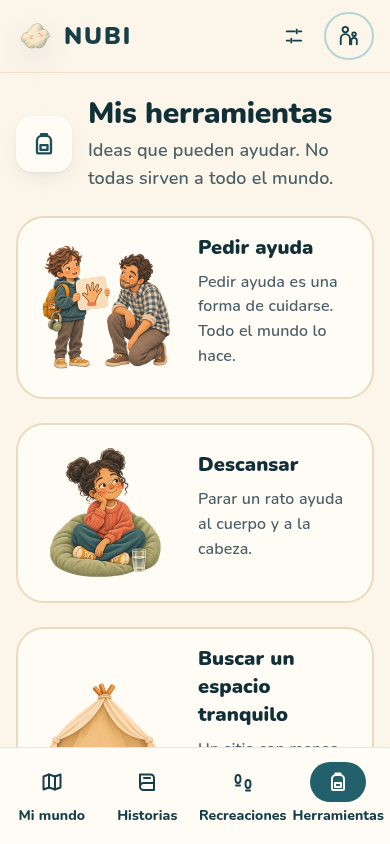</a> |
| Tableta · 820×1180 | <a href="evidence/before/820-12-herramientas-viewport.png">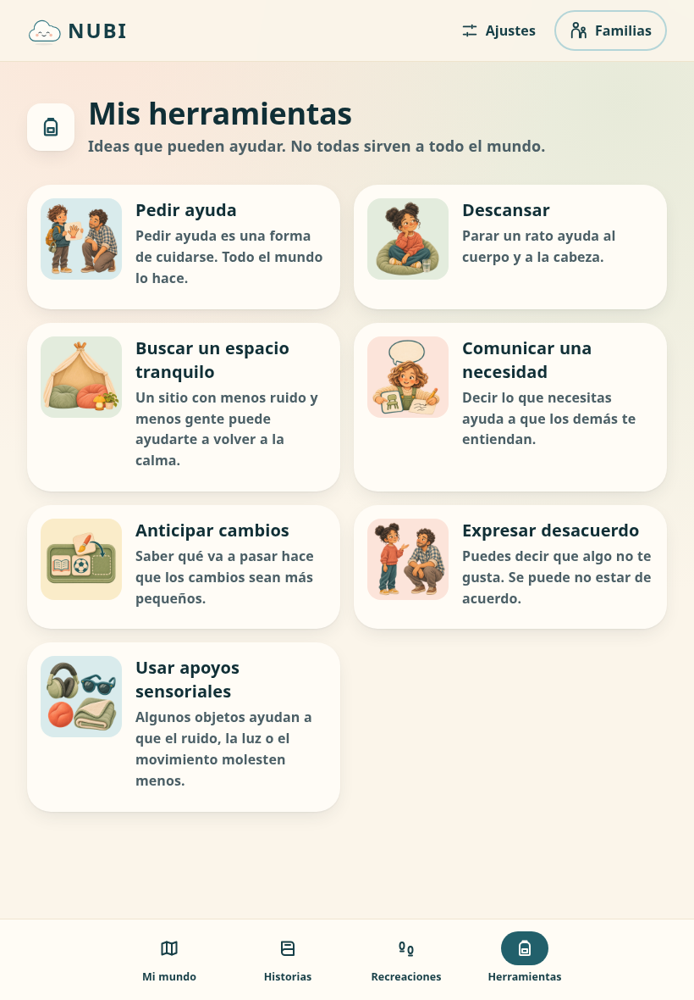</a> | <a href="evidence/after/820-12-herramientas-viewport.png">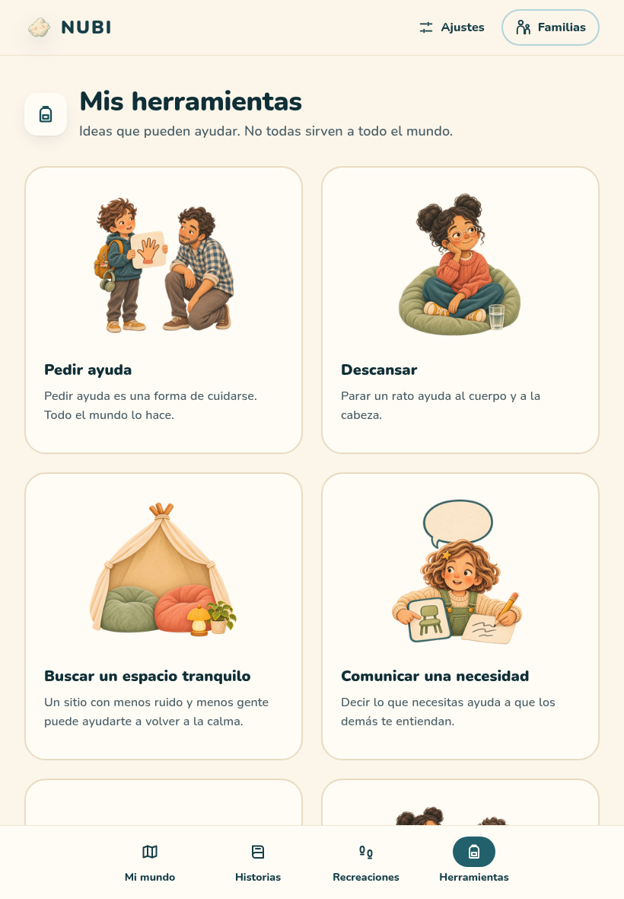</a> |

## Ajustes

- **Antes:** Secciones encerradas en cajas grandes y sucesivas.
- **Cambio:** Secciones abiertas por separadores, vista previa con borde y selección con ✓.
- **Motivo:** Hace más claras las agrupaciones y el estado sin depender del color.
- **Posible coste:** La vista previa sigue arriba y puede quedar lejos del ajuste.
- **Validación humana:** Autonomía al modificar y revertir preferencias.

| Tamaño | Antes | Después |
|---|---|---|
| Móvil · 390×844 | <a href="evidence/before/390-13-ajustes-viewport.png">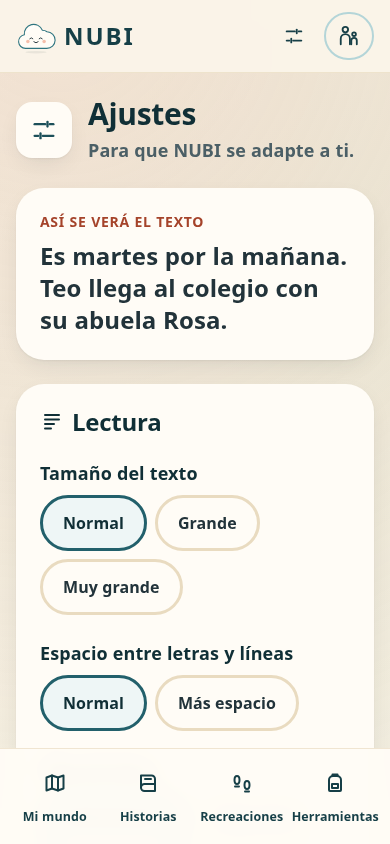</a> | <a href="evidence/after/390-13-ajustes-viewport.png">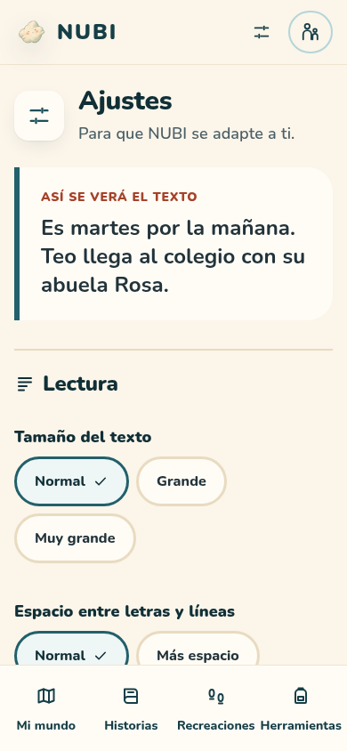</a> |
| Tableta · 820×1180 | <a href="evidence/before/820-13-ajustes-viewport.png">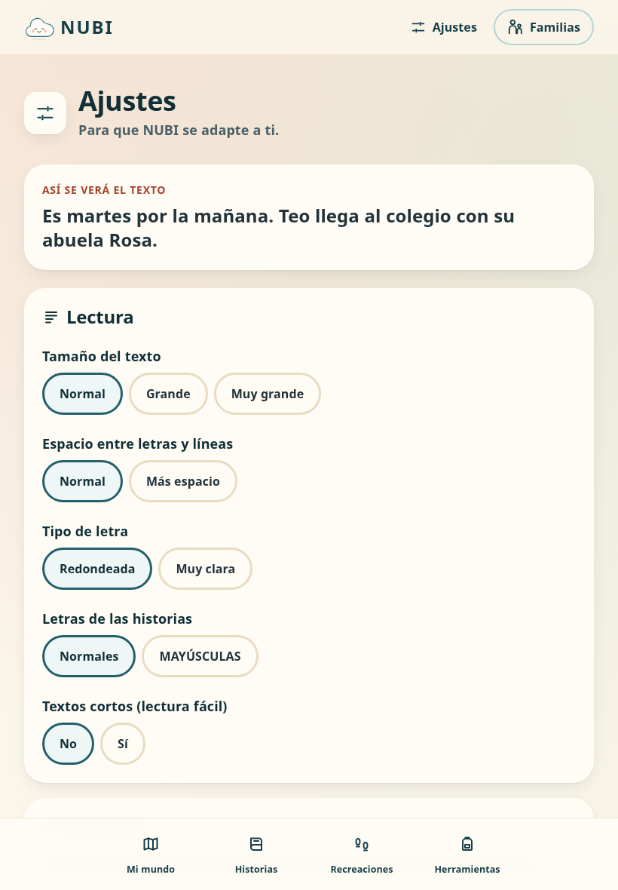</a> | <a href="evidence/after/820-13-ajustes-viewport.png">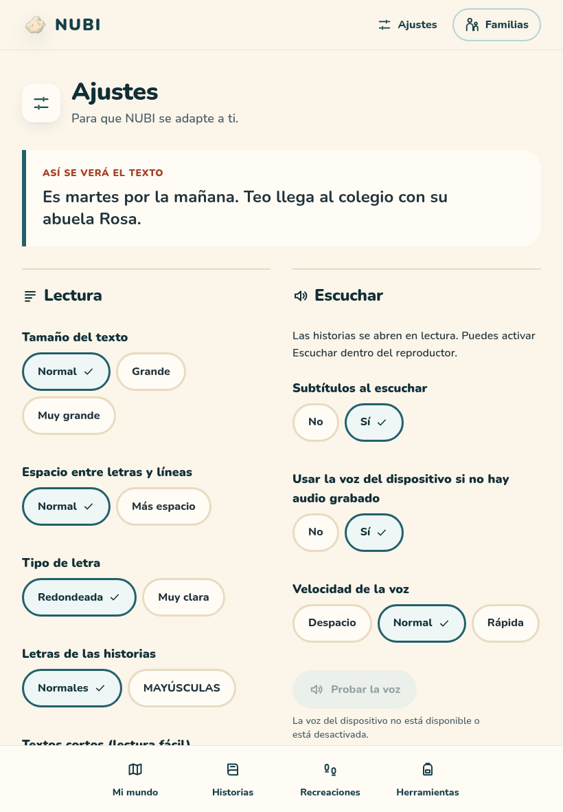</a> |

## Inventario completo

Cada enlace contiene captura de página completa; junto a ella está la versión `-viewport.png`. Incluye 14 estados por tamaño y fase. Los [datos de antes](evidence/before/capture.json) y [después](evidence/after/capture.json) guardan dimensiones, texto y desbordamiento.

| Pantalla | 390×844 | 820×1180 | 1180×820 |
|---|---|---|---|
| Portada | [Antes](evidence/before/390-01-portada.png) / [Después](evidence/after/390-01-portada.png) | [Antes](evidence/before/820-01-portada.png) / [Después](evidence/after/820-01-portada.png) | [Antes](evidence/before/1180-01-portada.png) / [Después](evidence/after/1180-01-portada.png) |
| Mi mundo | [Antes](evidence/before/390-02-mundo.png) / [Después](evidence/after/390-02-mundo.png) | [Antes](evidence/before/820-02-mundo.png) / [Después](evidence/after/820-02-mundo.png) | [Antes](evidence/before/1180-02-mundo.png) / [Después](evidence/after/1180-02-mundo.png) |
| Biblioteca | [Antes](evidence/before/390-03-biblioteca.png) / [Después](evidence/after/390-03-biblioteca.png) | [Antes](evidence/before/820-03-biblioteca.png) / [Después](evidence/after/820-03-biblioteca.png) | [Antes](evidence/before/1180-03-biblioteca.png) / [Después](evidence/after/1180-03-biblioteca.png) |
| Ficha | [Antes](evidence/before/390-04-ficha.png) / [Después](evidence/after/390-04-ficha.png) | [Antes](evidence/before/820-04-ficha.png) / [Después](evidence/after/820-04-ficha.png) | [Antes](evidence/before/1180-04-ficha.png) / [Después](evidence/after/1180-04-ficha.png) |
| Cuento | [Antes](evidence/before/390-05-cuento.png) / [Después](evidence/after/390-05-cuento.png) | [Antes](evidence/before/820-05-cuento.png) / [Después](evidence/after/820-05-cuento.png) | [Antes](evidence/before/1180-05-cuento.png) / [Después](evidence/after/1180-05-cuento.png) |
| Cómic | [Antes](evidence/before/390-06-comic.png) / [Después](evidence/after/390-06-comic.png) | [Antes](evidence/before/820-06-comic.png) / [Después](evidence/after/820-06-comic.png) | [Antes](evidence/before/1180-06-comic.png) / [Después](evidence/after/1180-06-comic.png) |
| Selector de emociones | [Antes](evidence/before/390-07-selector-emociones.png) / [Después](evidence/after/390-07-selector-emociones.png) | [Antes](evidence/before/820-07-selector-emociones.png) / [Después](evidence/after/820-07-selector-emociones.png) | [Antes](evidence/before/1180-07-selector-emociones.png) / [Después](evidence/after/1180-07-selector-emociones.png) |
| Decisiones | [Antes](evidence/before/390-08-decisiones.png) / [Después](evidence/after/390-08-decisiones.png) | [Antes](evidence/before/820-08-decisiones.png) / [Después](evidence/after/820-08-decisiones.png) | [Antes](evidence/before/1180-08-decisiones.png) / [Después](evidence/after/1180-08-decisiones.png) |
| Consecuencias | [Antes](evidence/before/390-09-consecuencias.png) / [Después](evidence/after/390-09-consecuencias.png) | [Antes](evidence/before/820-09-consecuencias.png) / [Después](evidence/after/820-09-consecuencias.png) | [Antes](evidence/before/1180-09-consecuencias.png) / [Después](evidence/after/1180-09-consecuencias.png) |
| Selector de herramientas | [Antes](evidence/before/390-10-selector-herramientas.png) / [Después](evidence/after/390-10-selector-herramientas.png) | [Antes](evidence/before/820-10-selector-herramientas.png) / [Después](evidence/after/820-10-selector-herramientas.png) | [Antes](evidence/before/1180-10-selector-herramientas.png) / [Después](evidence/after/1180-10-selector-herramientas.png) |
| Mis emociones | [Antes](evidence/before/390-11-emociones.png) / [Después](evidence/after/390-11-emociones.png) | [Antes](evidence/before/820-11-emociones.png) / [Después](evidence/after/820-11-emociones.png) | [Antes](evidence/before/1180-11-emociones.png) / [Después](evidence/after/1180-11-emociones.png) |
| Mis herramientas | [Antes](evidence/before/390-12-herramientas.png) / [Después](evidence/after/390-12-herramientas.png) | [Antes](evidence/before/820-12-herramientas.png) / [Después](evidence/after/820-12-herramientas.png) | [Antes](evidence/before/1180-12-herramientas.png) / [Después](evidence/after/1180-12-herramientas.png) |
| Ajustes | [Antes](evidence/before/390-13-ajustes.png) / [Después](evidence/after/390-13-ajustes.png) | [Antes](evidence/before/820-13-ajustes.png) / [Después](evidence/after/820-13-ajustes.png) | [Antes](evidence/before/1180-13-ajustes.png) / [Después](evidence/after/1180-13-ajustes.png) |
| Ficha de herramienta | [Antes](evidence/before/390-14-ficha-herramienta.png) / [Después](evidence/after/390-14-ficha-herramienta.png) | [Antes](evidence/before/820-14-ficha-herramienta.png) / [Después](evidence/after/820-14-ficha-herramienta.png) | [Antes](evidence/before/1180-14-ficha-herramienta.png) / [Después](evidence/after/1180-14-ficha-herramienta.png) |
