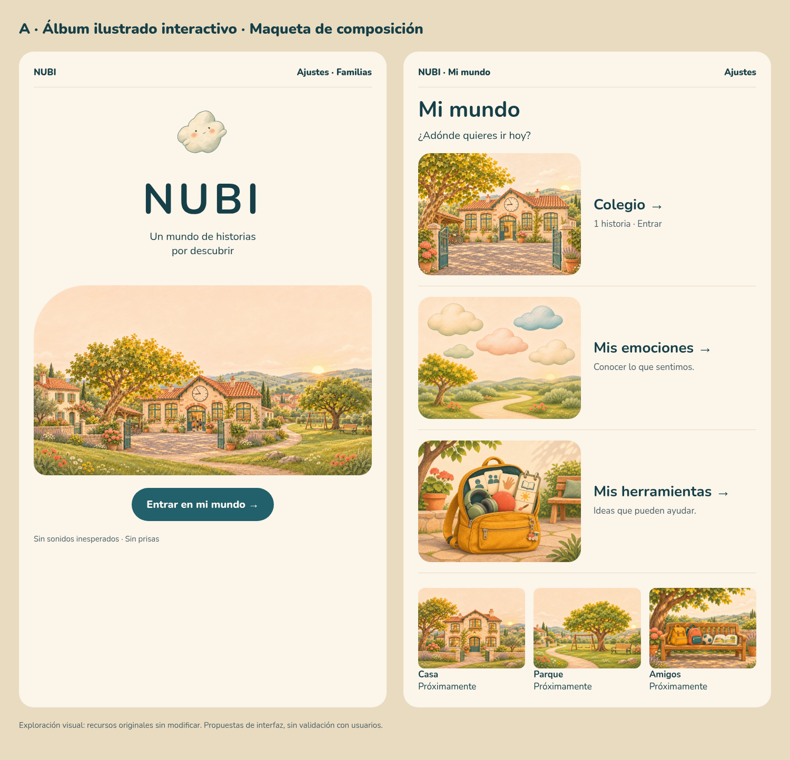
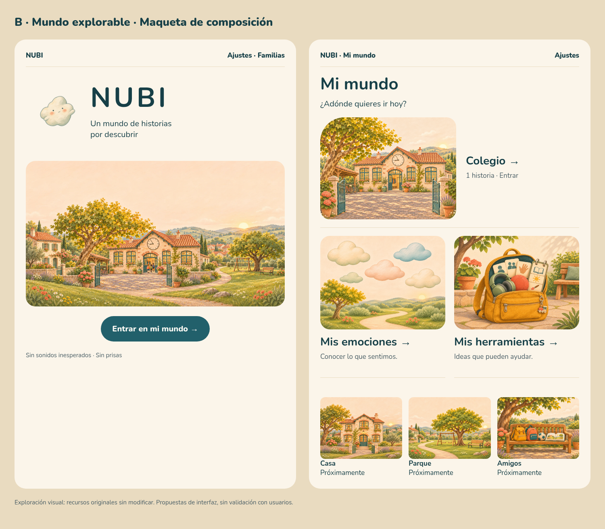
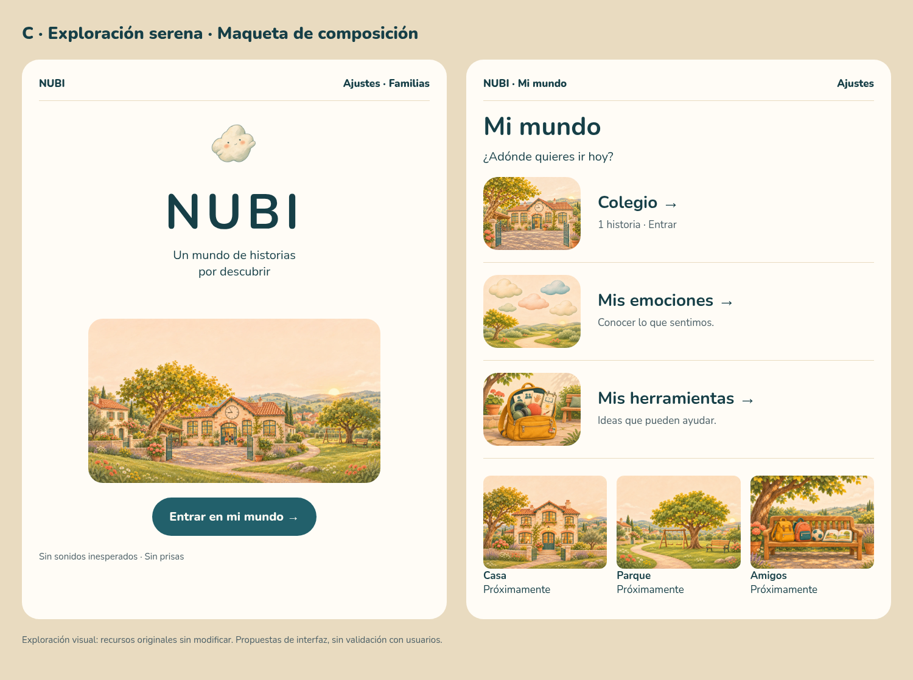

# NUBI · Rediseño infantil accesible · Fase 17

## Alcance y estado

Implementación React en `feat/codex-ux-infantil-v1`, desde `review/phase-16-short-text-drafts`, commit `e9793cc0a5e1aeb4f343722f31ec8feffc490f93`. La autorización excepcional del encargo permite a Codex modificar la interfaz en esta rama. No modifica el reparto permanente de AGENTS.md.

El resultado usa **Mundo explorable**, con separación editorial entre imagen y texto y una presentación más serena. La portada tiene una entrada; Mi mundo distingue los tres destinos disponibles de los futuros; la biblioteca abre una doble página; la ficha permite reconocer Cuento y Cómic por sus imágenes; emociones y herramientas reciben más espacio.

Es una implementación comprobada técnicamente, **no validada con niños, personas autistas ni familias**. La historia conserva `pendiente-validacion`. Los problemas editoriales y las decisiones de las fases 14–16 siguen pendientes. Sin merge ni despliegue público.

Documentación complementaria:

- [Comparación visual antes/después](BEFORE_AFTER.md).
- [Decisiones de accesibilidad y fuentes](ACCESSIBILITY_DECISIONS.md).
- [Validación humana pendiente](PENDING_USER_VALIDATION.md).
- [Resultados de pruebas](evidence/validation/RESULTS.md).

## Método y fuentes de contexto

Se leyeron AGENTS.md, CLAUDE.md, VISUAL_GUIDE, NUBI_DESIGN_PRINCIPLES, ILLUSTRATION_INTEGRATION, CONTENT_STANDARD, ARCHITECTURE y los informes de preparación, correcciones y borradores de las fases 14, 15 y 16. Se inspeccionaron las pantallas React y sus componentes compartidos, reproductor, interacciones, cómic, vídeo y recursos de respaldo. Se revisaron visualmente los **72 recursos** en cuatro hojas de contacto y en la aplicación. No se añadieron ni modificaron recursos gráficos.

La auditoría se realizó sobre la aplicación ejecutada localmente en Chromium. Se capturaron **14 estados × 3 tamaños**: 390×844, 820×1180 y 1180×820. Las capturas de antes corresponden exclusivamente al commit base; se volvió a abrir una copia aislada de esa base para añadir las capturas de viewport. Las capturas de después se obtuvieron del React modificado. El script [ux-captures.mjs](../../tests/browser/ux-captures.mjs) permite reproducirlas.

Las imágenes `*-viewport.png` muestran la ventana real. Las imágenes sin ese sufijo son capturas de página completa: una barra fija puede aparecer a la altura de la ventana inicial, por lo que no deben interpretarse como una sola ventana visible. En el reproductor, el escenario tiene desplazamiento propio: esas capturas muestran el momento visible, no toda la consecuencia o todas las opciones.

## Auditoría inicial: cinco preguntas por pantalla

**Hecho** describe una composición o comportamiento observado. **Riesgo/hipótesis** requiere pruebas con personas; no implica que los niños hayan encontrado dificultad. Los nombres de archivo corresponden a los tres anchos del [inventario de capturas](BEFORE_AFTER.md#inventario-completo).

| Paso y evidencia | Qué debe entender inmediatamente | Acción principal | Competencia visual observada | Qué puede explicarse visualmente | Riesgo o imprevisibilidad a validar |
|---|---|---|---|---|---|
| 01 Portada | Aquí hay un mundo de historias | Entrar en Mi mundo | Entrar, Ver historias y episodio piloto; paisaje relegado al fondo en móvil | Paisaje completo separado del título | Hipótesis: varias entradas hacen menos evidente el primer paso |
| 02 Mi mundo | Cada lugar conduce a algo concreto | Abrir un destino | Seis tarjetas con la misma jerarquía; destinos futuros antes de emociones/herramientas | Colegio disponible, dos destinos de apoyo, tres futuros | Hecho: en móvil emociones exige pasar tres lugares sin historia |
| 03 Biblioteca | Qué historia puede abrir | Abrir la historia | La tarjeta futura ocupa el mismo rango que la historia disponible | Cubierta y apertura de libro | Hecho: filtros requieren desplazamiento lateral en móvil; riesgo de opciones no descubiertas |
| 04 Ficha | De qué trata y cómo abrirla | Cuento o Cómic | Cubierta y sinopsis largas preceden a tres opciones de peso similar | Vista previa de cada formato, vídeo pendiente separado | Hipótesis: el icono pequeño no explica la diferencia entre formatos |
| 05 Cuento | Quién está y qué está ocurriendo | Siguiente | Cuatro controles secundarios en círculos compiten con avanzar | Bloque de lectura separado del arte; nombre del hablante ya presente | Fortaleza: imagen íntegra, texto grande y controles estables. No hay evidencia para cambiar el orden narrativo |
| 06 Cómic | Qué viñeta está descubierta | Descubrir la siguiente | Marco de cada viñeta y controles del reproductor | Área de revelado con límite claro | Fortaleza: las 15 viñetas y los bocadillos tienen composición específica; rehacerla arriesga tapar CAA y caras |
| 07 Selector de emociones | Puede elegir varias o ninguna | Seleccionar o avanzar | Filas y fondos distintos; ilustraciones de 56 px | Nubi más grande, nombre y marca de selección | Hipótesis: las expresiones pequeñas cuestan reconocer; ya señalada en fase 14 |
| 08 Decisiones | Son posibilidades explorables | Abrir una posibilidad | Imagen, icono y borde en cada opción | Flecha de entrada; imagen completa | Hipótesis: seis opciones exigen exploración con desplazamiento, pero reducirlas alteraría el contenido |
| 09 Consecuencias | Qué puede pasar con esta elección | Leer y probar otra posibilidad | Acción de volver a explorar al final de una página larga | Secuencia ilustrada ya funciona; retorno puede ser visible antes | Hecho: el retorno no aparece al comenzar a leer |
| 10 Selector de herramientas | Puede elegir varias o ninguna | Marcar herramientas o avanzar | Apoyos de 56 px junto a nombre y descripción | Dibujo de 96 px manteniendo texto y estado | Hipótesis: mejorar tamaño ayuda al reconocimiento; no sustituye nombres |
| 11 Mis emociones | Es un catálogo, no una evaluación | Explorar una emoción | Fondos de cuatro tonos; dibujo de 64 px y selección por borde | Nueve ilustraciones de 96 px y marca ✓ | Hecho: la ficha está debajo de la rejilla en móvil; hay que validar descubrimiento |
| 12 Mis herramientas | Hay distintas ideas, no una solución universal | Abrir una herramienta | Imagen de 96 px en fichas estrechas | Dibujo protagonista, texto separado y espacio | Hipótesis: reconocer el apoyo por el dibujo ayuda a encontrarlo |
| 13 Ajustes | Puede adaptar lectura, voz y movimiento | Cambiar una preferencia | Cajas grandes consecutivas, vista previa y opciones | Secciones abiertas y estado marcado ✓ | Hecho: la vista previa queda lejos al bajar; fijarla reduciría mucho el alto útil |
| 14 Ficha de herramienta | Qué propone y cómo hacerlo | Mi tarjeta / leer instrucciones | Varias cajas y arte sobre fondo tintado | Apertura con dibujo grande y pasos numerados conservados | No se puede inferir eficacia ni adecuación personal de la estrategia |

## Tres direcciones visuales reales

Las maquetas se compusieron con HTML/CSS y **archivos originales del repositorio**, antes de reescribir React. No se generaron ilustraciones nuevas. Se conservan [el documento fuente](concepts/directions.html) y las tres imágenes. Abrir el HTML mediante Vite, con `?direction=a`, `b` o `c`.

### A · Álbum ilustrado interactivo



- Ventajas: ritmo de lectura claro, papel generoso, lugares como ilustraciones editoriales con título separado.
- Inconvenientes: tres filas equivalentes todavía dan poco protagonismo a la historia disponible; más altura para recorrer el mundo.
- Aplicación elegida: separación imagen/lectura, biblioteca como doble página, superficies sin sombras apiladas.

### B · Mundo explorable — dirección principal



- Ventajas: colegio destacado y dos destinos complementarios reconocibles; los lugares futuros no interrumpen las entradas disponibles. Nubi y paisaje permanecen juntos sin texto sobre la escena.
- Inconvenientes: hay que adaptar la composición editorial a móviles estrechos; no todos reconocerán una función a partir de un lugar.
- Decisión: mantener siempre título, descripción, estado y enlace semántico. No se usa mapa espacial ni navegación por coordenadas. El orden del DOM coincide con la lectura visual.

### C · Exploración serena



- Ventajas: lista predecible, pocas superficies y contraste de jerarquía moderado.
- Inconvenientes: los lugares pierden tamaño; visualmente se acerca más a un índice. No existe evidencia de que sea la preferencia de todos los usuarios autistas.
- Aplicación elegida: eliminación de movimiento continuo y degradados ambientales; opciones visibles, agrupadas y reversibles.

La elección es una **decisión de diseño**, no el resultado de una prueba comparativa con usuarios.

## Sistema visual actualizado en esta rama

Se conservan crema, petróleo, coral, salvia, mostaza, Nunito y Atkinson, con los mismos tokens. Cambia su distribución: papel liso, bordes suaves en vez de sombras elevadas y un uso más limitado de fondos de color. No se añaden dependencias, servicios ni tipografías.

| Regla anterior | Evolución aplicada | Motivo y límite |
|---|---|---|
| Portada como fondo decorativo recortable | Paisaje íntegro como página ilustrada, texto fuera | Mostrar el pueblo desde el primer momento sin necesitar un velo para leer |
| Seis tarjetas idénticas de lugares | Destino con historias destacado, emociones/herramientas después, futuros al final | La jerarquía deriva de `kind` y disponibilidad, nunca de un ID de historia |
| Biblioteca en tres columnas | Historia a doble página desde 640 px; futuras como nota inferior | La única historia disponible tiene una escala útil, sin inventar más contenido |
| Ficha: sinopsis antes de formatos | `tagline` existente visible; sinopsis íntegra en «Sobre esta historia» | Llegar antes al formato sin reescribir el contenido. El coste es una apertura adicional para leer la sinopsis |
| Portada con varios accesos | Un enlace principal a Mi mundo; Ajustes/Familias visibles | La biblioteca y la historia siguen accesibles desde el mundo y la navegación |
| Nubi vectorial en la marca de cabecera | Ilustración oficial existente + misma palabra NUBI | Coherencia con la nube anfitriona. No se redibuja ni se modifica ningún archivo de marca |
| Imágenes de selectores a 56 px | Emociones y estrategias a 96 px | Mejor oportunidad de reconocer detalles; no garantiza reconocimiento |
| Emociones por color y borde | Papel neutro, borde y ✓, con `aria-pressed` | Estado visible sin depender del color |
| Herramientas de catálogo a 96 px | 144 px móvil / 208 px tableta; ficha 208/288 px | Protagonismo de apoyos y comunicación; aumenta el desplazamiento |
| Navegación superior desde 1024 px | Desde 1280 px; inferior hasta ese punto | Dejar sitio a nombres completos con letra grande. A 320 px y móvil con 125 %, dos columnas |
| Sway/float continuos | Sin balanceo continuo; transiciones breves conservadas | Calma por defecto, sin añadir un ajuste más |
| Controles secundarios del lector separados | Franja común compacta, todos visibles | Liberar alto para el arte y distinguirlos de Atrás/Siguiente sin esconder funciones |

Esta sección documenta la evolución respecto a VISUAL_GUIDE §§3, 6 y NUBI_DESIGN_PRINCIPLES §§6–11. Es una propuesta implementada en la rama autorizada, sin borrar las decisiones históricas. Los contratos de arte narrativo, bocadillos, 3:4/16:9, texto fuera de escenas y zoom alto permanecen vigentes.

### Vista tranquila

No se implementa un ajuste nuevo. Se aplican calma visual y ausencia de movimiento perpetuo al diseño general. Los ajustes existentes permiten tamaño, espaciado, fuente, mayúsculas, texto corto, contraste, movimiento y voz local. Añadir otro modo sin pruebas podría duplicar opciones y cambiar inesperadamente dónde buscar una función. La propuesta queda para una segunda iteración con preferencias observadas, no perfiles clínicos.

### Reproductor y contenido

Se conserva la geometría narrativa porque las pruebas de encaje, variantes y regiones protegidas justifican mantenerla. El rediseño del lector actúa sobre su marco, agrupación de controles y página de texto. El cómic conserva sus 15 viñetas, el descubrimiento progresivo, botones y flechas; cambia la presentación del control de revelado y comparte los controles compactos.

No se ha cambiado `src/engine/`, `src/content/`, `public/`, `src/state/`, ni propuestas de las fases 15/16. No hay migraciones de preferencias o respuestas. «Textos cortos» mantiene exactamente la cobertura anterior: las consecuencias no tienen todavía versiones cortas aprobadas.

## Pruebas y límites

Resultados reproducibles y registros en [RESULTS.md](evidence/validation/RESULTS.md). Las pruebas de presentación de lotes 5/6 se actualizan de 56 a 96 px y para el archivo de 512 px de la herramienta ampliada. Permanecen todas las comprobaciones de nombre, selección, transparencia, encaje, teclado, texto original y carga. El lote 5 pasa a escribir por defecto en `/tmp`, para no sobrescribir evidencias históricas.

Los problemas encontrados en la matriz ampliada (navegación con letra grande y fichas estrechas) se resolvieron mediante reorganización, sin ocultar desbordamientos ni reducir el tamaño del texto. La comprobación `screens` ahora falla ante infracciones axe, además de informarlas.

No se han realizado pruebas con lectores de pantalla reales, Safari, Firefox, dispositivos táctiles físicos ni zoom del sistema. No se declara conformidad WCAG completa. Los riesgos editoriales existentes y el protocolo humano siguen abiertos; ver [validación pendiente](PENDING_USER_VALIDATION.md).

## Ejecución y revisión

```sh
npm ci
npm run dev -- --host 0.0.0.0 --port 5173
npm run check
# Herramientas de navegador instaladas fuera del proyecto:
NUBI_BROWSER_TOOLS=/ruta/a/herramientas node tests/browser/ux-redesign.mjs
NUBI_BROWSER_TOOLS=/ruta/a/herramientas NUBI_EVIDENCE=/tmp/nubi-capturas node tests/browser/ux-captures.mjs
```

Abrir `/`, entrar a Mi mundo, abrir Colegio y la historia, elegir Cuento/Cómic, recorrer decisiones, abrir emociones/herramientas y probar los ajustes. El código se publica únicamente en `feat/codex-ux-infantil-v1` para revisión.
