# Portada · comparación A / B / C · Fase 18

Rama: `review/phase-18-ux-qa` (desde `feat/codex-ux-infantil-v1`, `176e30d`). Informe general: [PHASE_18_UX_QA_REPORT.md](PHASE_18_UX_QA_REPORT.md).

- **A · Antes del rediseño:** `e9793cc` (rama `review/phase-16-short-text-drafts`), servida desde una copia aislada (`git worktree`) en el puerto 5174.
- **B · Codex:** `176e30d` (`feat/codex-ux-infantil-v1`), paisaje como imagen rectangular dentro de la página.
- **C · Fase 18:** esta rama; paisaje `portada-fondo` a sangre en toda la primera pantalla.

Todas las capturas son **de la aplicación real** en Chromium (Playwright), letra normal, movimiento reducido, viewport sin desplazar, DPR 1. Archivos en [`phase-18/`](phase-18/) (WebP). No se ha generado ni retocado ninguna ilustración: las tres versiones usan el mismo archivo `portada-fondo` (2400×1350, 16:9, punto focal 50 % / 66 %).

## Capturas

| Tamaño | A · antes del rediseño | B · Codex (imagen rectangular) | C · fase 18 (pantalla completa) |
|---|---|---|---|
| Móvil · 390×844 | 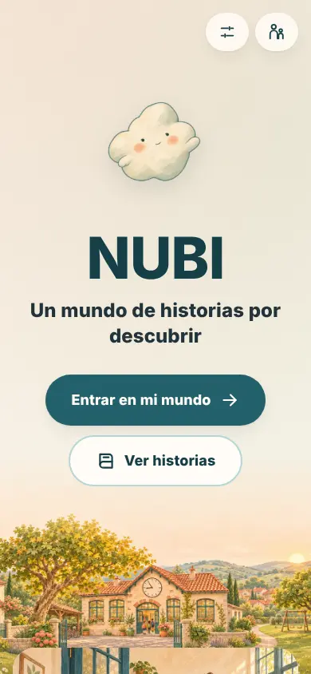 | 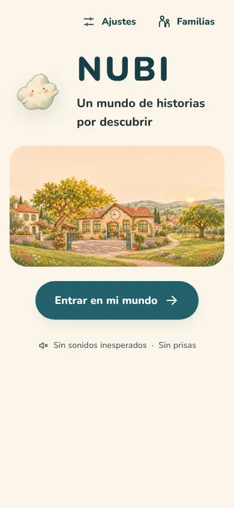 | 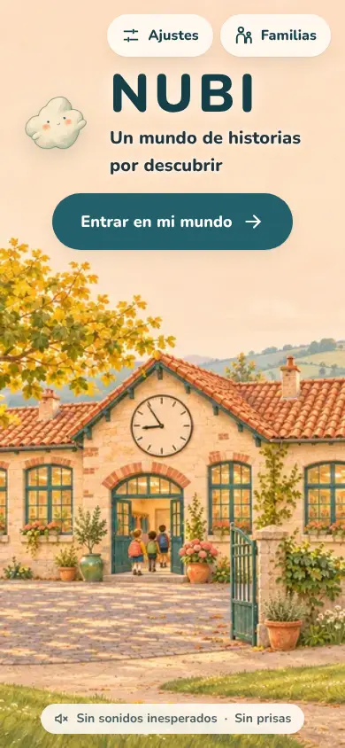 |
| Tableta vertical · 820×1180 | 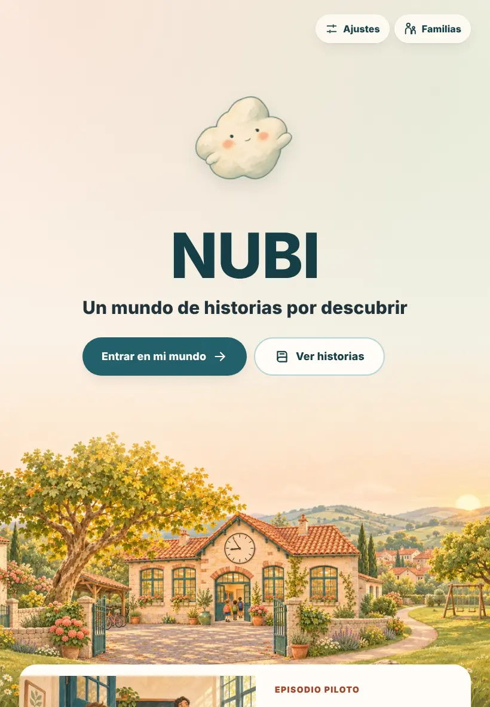 | 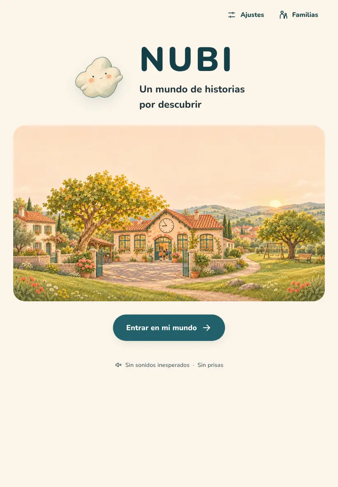 | 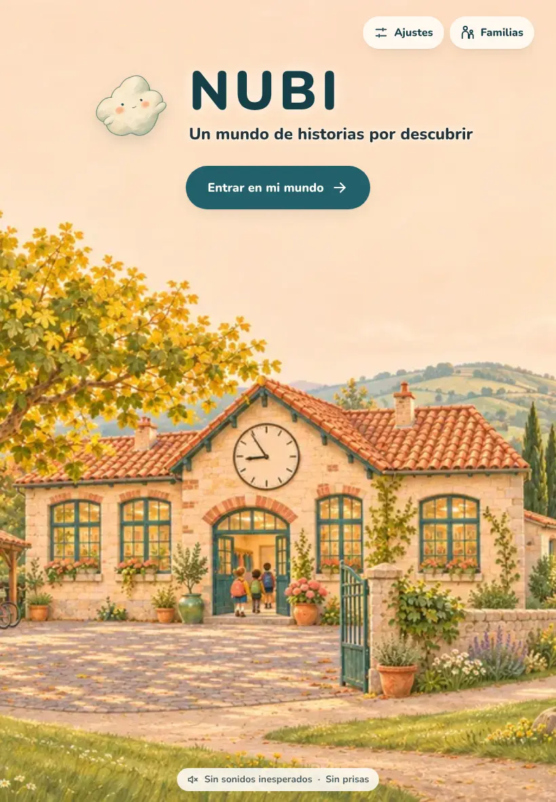 |
| Tableta horizontal · 1180×820 | 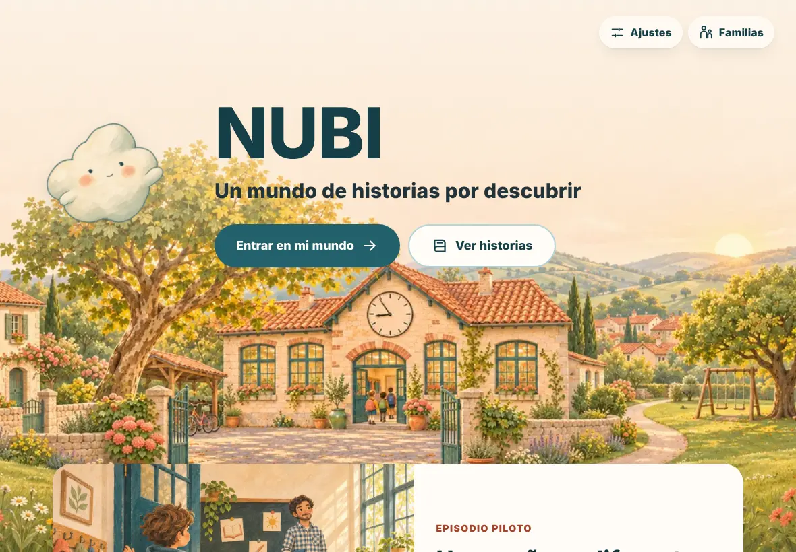 | 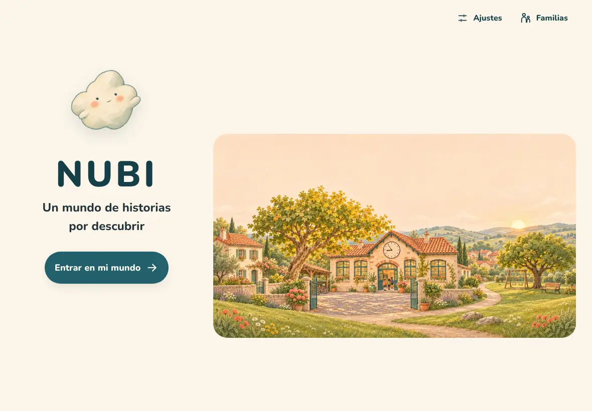 | 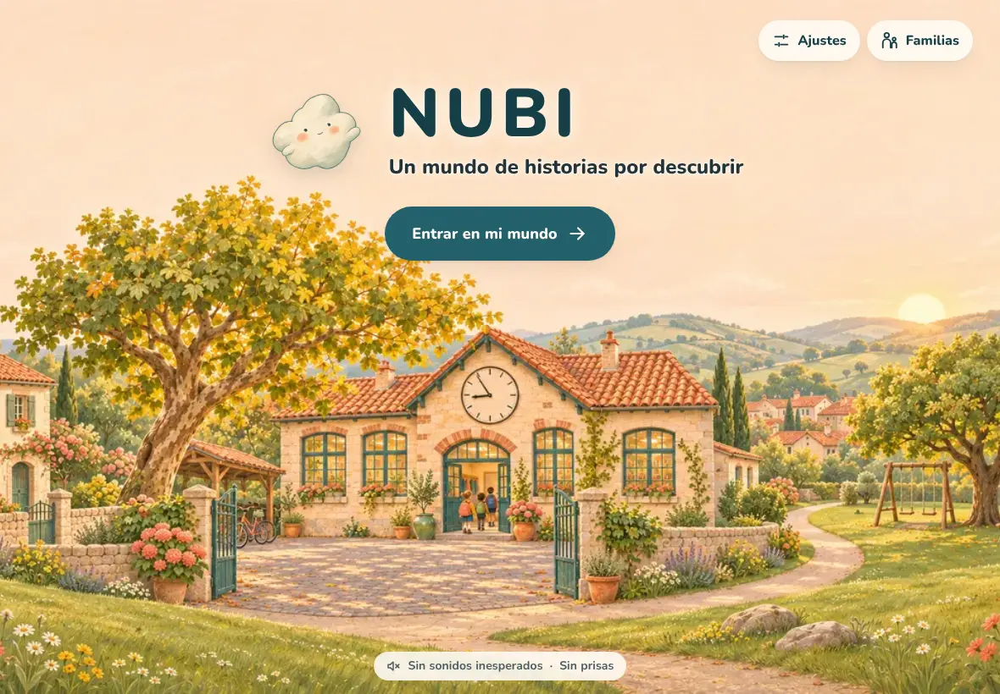 |
| Ordenador · 1440×900 | 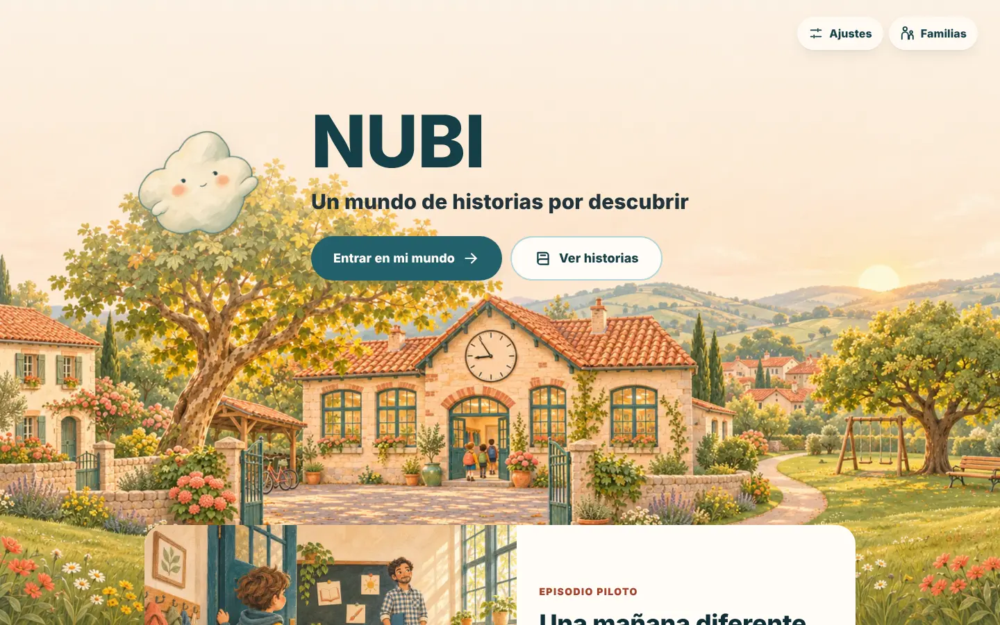 | 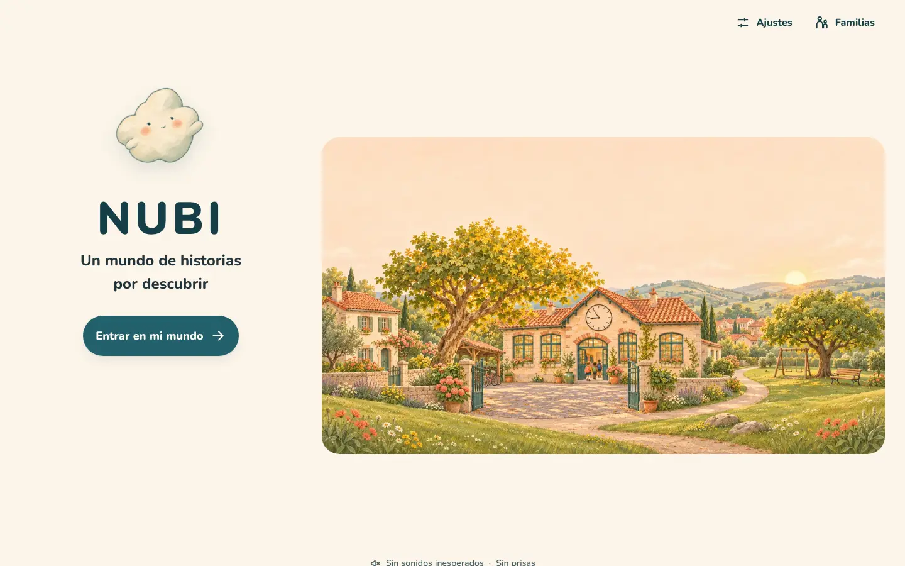 | 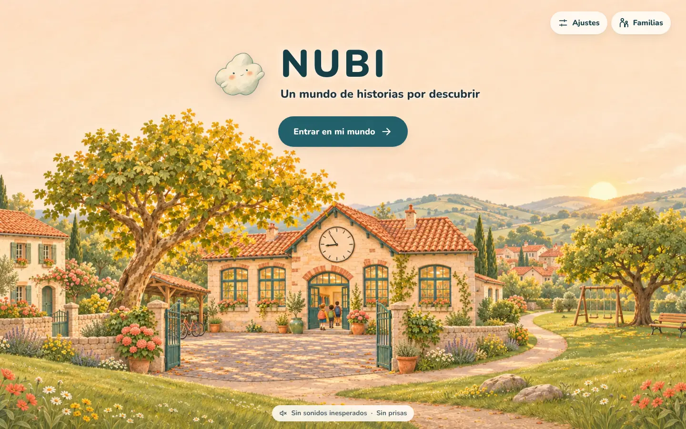 |

Zoom alto (solo C, la composición se adapta y se desplaza en vertical):

| 640×512 (≈ 200 %) | 320×256 (≈ 400 %) |
|---|---|
| 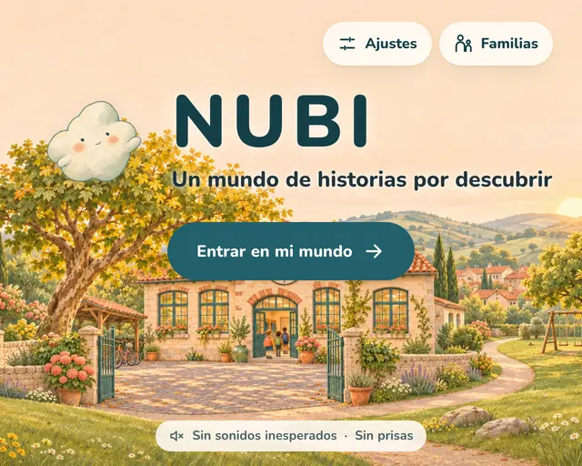 | 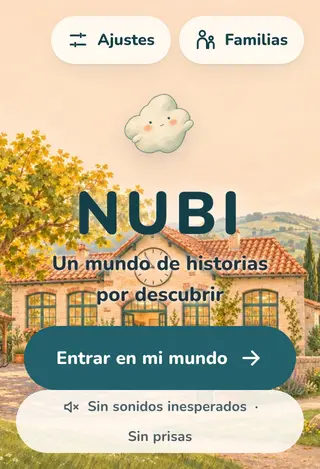 |

## Medidas

Parte de la **primera pantalla** que ocupa la ilustración (área visible del `` / área del viewport), y borde inferior del botón «Entrar en mi mundo»:

| Viewport | A | B | C |
|---|---|---|---|
| 390×844 | 33 % | 22 % | **100 %** |
| 820×1180 | 52 % | 33 % | **100 %** |
| 1180×820 | 100 % | 30 % | **100 %** |
| 1440×900 | 100 % | 35 % | **100 %** |

En C, el botón principal termina a 282 px (móvil) y 308 px (resto) del borde superior: a la vista sin desplazar. El reloj del colegio, centro de la escena, queda en x = 180 / 389 / 575 / 704 px (centrado, entre el 30 % y el 70 % del ancho), y el bloque de título y botón termina siempre por encima del tejado (282 ≤ 397, 308 ≤ 555, 308 ≤ 385, 308 ≤ 423 px).

En A, el 100 % horizontal no equivalía a un paisaje despejado: la tarjeta del episodio piloto subía sobre el pie de la ilustración y competía con dos botones («Entrar en mi mundo» y «Ver historias»). En móvil, Ajustes y Familias eran solo iconos. Estas comprobaciones forman parte de la prueba [`tests/browser/homepage.mjs`](../../tests/browser/homepage.mjs).

## Qué recuperamos del diseño original (A)

- El paisaje como **escenario de fondo** que llega a los cuatro bordes, sin tarjeta, marco, radio ni sombra.
- La sensación de «entrar» en el mundo: título y Nubi flotan en el cielo de la propia ilustración.
- El encuadre por punto focal (`object-fit: cover` + `focus` del registro), que en A ya funcionaba en horizontal.

A no llegaba a pantalla completa en vertical (33 % en móvil, 52 % en tableta): la ilustración quedaba debajo de varios bloques de contenido. C la extiende a toda la primera pantalla también en vertical.

No recuperamos de A la segunda entrada «Ver historias» ni la tarjeta del episodio en portada (B las retiró con razón: una sola acción principal), ni los botones de solo icono.

## Qué conservamos del rediseño de Codex (B)

- **Una sola acción principal**, «Entrar en mi mundo», en lugar de varias entradas que competían.
- **Ajustes y Familias con su palabra visible** (no solo icono), arriba a la derecha, ≥ 48 px.
- **Nubi oficial** (`nubi-saludo`) junto al título, en lugar del vector provisional.
- La nota «Sin sonidos inesperados · Sin prisas».
- Sin animaciones continuas en portada.

## Por qué C es más inmersiva

- La ilustración pasa de ocupar un 22–35 % de la primera pantalla (B) al 100 % en todos los tamaños.
- No hay «página blanca con un cuadro dentro»: no existe ningún fondo liso visible alrededor del paisaje.
- El texto se coloca en la zona de cielo que la ilustración reserva para el logotipo (descripción del recurso: «mucho aire en el tercio superior para el logotipo»), sin bloques opacos encima del pueblo.
- El colegio queda centrado en vertical y horizontal: el lugar de la primera historia es lo que el niño ve al llegar.

## Decisiones de accesibilidad aplicadas

| Decisión | Motivo |
|---|---|
| Ilustración decorativa (`alt=""`), `fit="cover"` sin deformar (proporción natural 16:9 comprobada) | La información está en el texto; el recorte es solo de fondo (`ILLUSTRATION_INTEGRATION.md` §2) |
| Título y subtítulo con halo crema (`text-shadow`) en vez de caja opaca | Legibilidad sobre el cielo sin tapar el paisaje; contraste del título petróleo-800 sobre crema ≈ 10,5:1 |
| Subtítulo a 20 px (móvil) / 24 px (≥ 640 px), sin reducirlo nunca | No se reduce la letra para que quepa; la prueba falla si baja de 20 px |
| Ajustes y Familias: pastillas crema al 88 % con icono **y palabra**, ≥ 48 px; Familias con nombre accesible «Familias: espacio para personas adultas» | No depender de iconos ambiguos; objetivo táctil mínimo |
| Botón principal grande, el único de su tipo en la pantalla | Una acción principal por momento |
| `min-height: 100dvh`, sin altura fija | Con zoom alto la portada crece y se desplaza en vertical; no se fuerza la pantalla completa a costa de tapar controles |
| A < 360 px el título se apila (Nubi encima de NUBI) | Sin esto, «NUBI» se recortaba a 320×256 (lo detectó la nueva prueba) |
| Orden de tabulación: Ajustes → Familias → Entrar; foco visible | Comprobado con teclado en los cuatro tamaños |
| Márgenes con `env(safe-area-inset-*)` | Barras y muescas de móviles reales |

## Qué requiere validación humana

- **Preferencia y comodidad:** si la portada a pantalla completa resulta acogedora o demasiado cargada para algunos niños y niñas. No todos los niños autistas prefieren lo mismo; si aparece sobrecarga, la alternativa sería una opción individual (p. ej. vista tranquila), no un cambio para todos.
- **Comprensión de la entrada:** si «Entrar en mi mundo» se identifica como lo que hay que pulsar sobre una ilustración rica (hipótesis «Alta» de [PENDING_USER_VALIDATION.md](PENDING_USER_VALIDATION.md)).
- **Legibilidad en pantallas reales:** halo del texto sobre el cielo con brillo bajo, reflejos o filtros de color del dispositivo; Safari/iPad y Android.
- **Logotipo:** la decisión de marca sigue pendiente (ver informe, §Logotipo). En la portada Nubi aparece a 96–144 px, donde sí se reconoce.
- Estas capturas **no** sustituyen las sesiones del [protocolo infantil](../review/CHILD_USABILITY_PROTOCOL.md); no se han realizado sesiones con alumnado.
