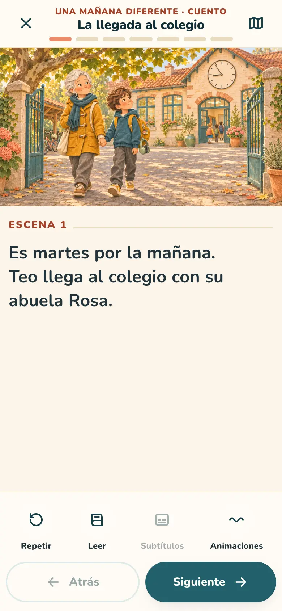
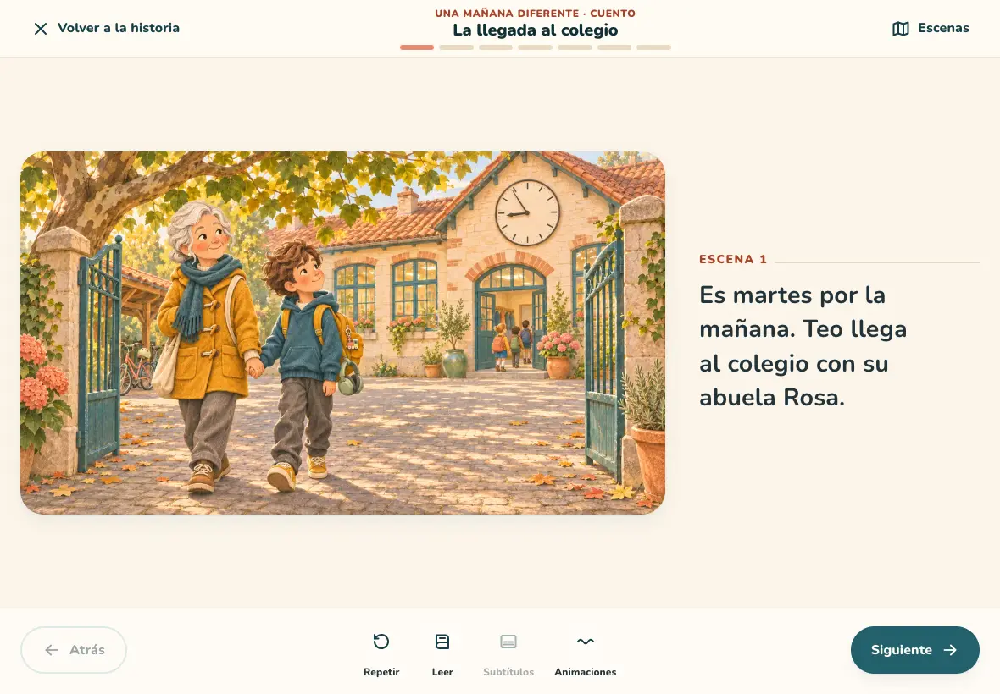

# Integración fase 3A — interfaz narrativa + arte real

Rama `integration/phase-3a` · creada desde `feat/claude-experience` (1ce927f) · fusiona `feat/codex-art-direction` (5c3fac1) · **sin merge a `main` y sin despliegue público.** Preparada para revisión humana.

## 1. Resultado de la integración

| | |
|---|---|
| Fusión | `git merge --no-ff origin/feat/codex-art-direction` → commit 27cffb7, **sin conflictos** |
| Archivos compartidos | `src/engine/types.ts`, `docs/ILLUSTRATION_INTEGRATION.md` y `tests/browser/art-layout.mjs` eran **idénticos byte a byte** en ambas ramas: Codex copió el contrato de Claude sin divergencias. Git los resolvió solo |
| Registros | Los cambios de Codex en `src/content/assets/common.ts`, `src/content/stories/una-manana-diferente/assets.ts` y `src/content/characters.ts` se conservan íntegros. Claude no ha modificado ningún registro |
| Catálogo | `npm run assets:doc` regenera `ASSET_REQUESTS.md` **idéntico** al versionado (14/72 entregados) |
| Archivos gráficos | Ningún archivo de `public/media/` ni de `docs/art-direction/` modificado |

Después de la fusión, Claude añadió ajustes de interfaz detectados en la revisión visual (§5).

## 2. Estado de los recursos

**14 listos · 58 pendientes · 72 en total.** Todos los archivos y variantes existen; ningún recurso pendiente tiene archivo en disco.

| Recurso | Tipo | Variante servida (390 px DPR2 · 820 · 1180) | Alfa | Comprobación |
|---|---|---|---|---|
| `portada-fondo` | Portada 16:9 | 1200w · 1200w · 1200w | — | Visible en portada; recorte decorativo según `focus` (50, 66) |
| `nubi-saludo` | Nubi 1:1 | **maestro (566 KB)** en portada móvil · 256w en el resto | Sí | Proporciones correctas; ver petición P2 |
| `nubi-pensando` | Nubi 1:1 | — (aún no aparece en estas pantallas) | Sí | Cargado y validado por `art-files` |
| `char-nubi`, `char-teo`, `char-aya`, `char-bruno`, `char-lia`, `char-andres`, `char-carmen`, `char-pilar`, `char-rosa` | Retrato 3:4 | 384w en todos los anchos | Sí | Transparencia limpia sobre crema; sin recorte |
| `ume-cover` | Cubierta 4:3 | 1200w | — | Catálogo, ficha y portada |
| `ume-s1-puerta` | Escena 16:9 | 1200w | — | Cuento: imagen entera, sin texto encima |

Los 58 pendientes son: 6 lugares, 7 herramientas, 9 emociones, 9 escenas de cuento, 12 opciones o consecuencias y 15 viñetas de cómic. Se siguen mostrando como placeholder, **solo donde falta arte**: `art-layout` cuenta 37 imágenes reales cargadas y 117 placeholders, sin errores.

**Transparencia:** `art-files.mjs` verifica alfa mínimo 0 y máximo ≥ 250 en los 22 archivos con transparencia. Claude midió además el cuerpo de las figuras: alfa 251-254 (prácticamente opaco, sin efecto visible; ver petición P5).

## 3. Pruebas ejecutadas

| Prueba | Resultado |
|---|---|
| `npm run assets:doc` | 72 recursos, sin diferencias |
| `npm run check` | Tipos, **43 tests** (41 de la base de Claude + 2 nuevos de dirección de arte vertical) y build correctos |
| `tests/browser/art-files.mjs` (Codex) | PASS: 14 recursos / 28 archivos, SHA-256, decodificación, dimensiones y alfa |
| `tests/browser/art-layout.mjs` | PASS 390/820/1180: 37 cargadas, 117 provisionales, 0 errores, 0 recortes narrativos |
| `tests/browser/quality.mjs` (Codex) | PASS 390/820/1180: cuento, cómic, seis opciones, emociones, intensidad, resumen, persistencia, borrado, teclado, vídeo; **axe sin infracciones** |
| `tests/browser/narration.mjs` (Codex) | PASS: sin autoarranque, rechazo de voz remota, error asíncrono, detener |
| `tests/browser/screens.mjs` (Codex) | 9 pantallas sin infracciones axe ni desbordamiento |
| Deslizar (táctil real, Chrome) | Avanza, retrocede e ignora el desplazamiento vertical |
| Dirección de arte vertical | Simulada en copia aislada con imagen de prueba: `<picture>` sirve la versión 3:4 en vertical y la 16:9 en horizontal |

Entorno: macOS, Chrome 150.0.7871.125 sin interfaz, Node 24.14, Playwright y axe instalados fuera del repositorio (como en `docs/TEST_RESULTS.md`), y servidor Vite en 127.0.0.1:5173.

**No realizado:** dispositivos físicos (iPad, Android), Safari/iOS, lector de pantalla real y zoom 200-400 %. Las capturas son de Chrome con viewport emulado.

## 4. Revisión visual

Capturas en [`phase-3a/`](phase-3a), en WebP. Móvil 390×844 a DPR2; tabletas 820×1180 y 1180×820 a DPR1.

| Pantalla | 390 (móvil) | 820 (tableta vertical) | 1180 (tableta horizontal) |
|---|---|---|---|
| Portada | [ver](phase-3a/390-01-portada.webp) | [ver](phase-3a/820-01-portada.webp) | [ver](phase-3a/1180-01-portada.webp) |
| Biblioteca | [ver](phase-3a/390-02-biblioteca.webp) | [ver](phase-3a/820-02-biblioteca.webp) | [ver](phase-3a/1180-02-biblioteca.webp) |
| Ficha del episodio | [ver](phase-3a/390-03-ficha.webp) | [ver](phase-3a/820-03-ficha.webp) | [ver](phase-3a/1180-03-ficha.webp) |
| Primera escena | [ver](phase-3a/390-04-primera-escena.webp) | [ver](phase-3a/820-04-primera-escena.webp) | [ver](phase-3a/1180-04-primera-escena.webp) |
| Cuento (pasillo, pendiente) | [ver](phase-3a/390-05-cuento-pasillo.webp) | [ver](phase-3a/820-05-cuento-pasillo.webp) | [ver](phase-3a/1180-05-cuento-pasillo.webp) |
| Cuento con Nubi | [ver](phase-3a/390-06-cuento-nubi.webp) | [ver](phase-3a/820-06-cuento-nubi.webp) | [ver](phase-3a/1180-06-cuento-nubi.webp) |
| Pregunta | [ver](phase-3a/390-07-pregunta.webp) | [ver](phase-3a/820-07-pregunta.webp) | [ver](phase-3a/1180-07-pregunta.webp) |
| Cómic | [ver](phase-3a/390-08-comic.webp) | [ver](phase-3a/820-08-comic.webp) | [ver](phase-3a/1180-08-comic.webp) |
| Herramientas | [ver](phase-3a/390-09-herramientas.webp) | [ver](phase-3a/820-09-herramientas.webp) | [ver](phase-3a/1180-09-herramientas.webp) |
| Espacio familiar | [ver](phase-3a/390-10-familias.webp) | [ver](phase-3a/820-10-familias.webp) | [ver](phase-3a/1180-10-familias.webp) |

### El espacio vacío en móvil (llegada)

**Diagnóstico.** La escena es 16:9 y la pantalla del móvil, vertical (~9:19). A todo el ancho (390 px), la imagen mide 219 px de alto. Antes, la página se centraba en vertical: el hueco sobrante (~230 px) se repartía arriba y abajo, y parecía que la imagen flotaba. En 820×1180 pasaba lo mismo (~380 px libres).

**Qué se ha mejorado (sin recortar ni reducir legibilidad):**
- En vertical, la ilustración queda **pegada a la cabecera y a sangre** (sin márgenes ni esquinas), como la página de un álbum. El texto va justo debajo. Desaparece el hueco superior.
- En tableta vertical, la imagen también va a sangre: 820 px de ancho en lugar de 772.
- Ningún tamaño de texto ni objetivo táctil se ha reducido. No se ha añadido ninguna animación.

**Qué queda y por qué.** Debajo del texto sigue habiendo espacio libre en vertical. Es consecuencia directa de la proporción 16:9: la imagen no puede crecer más sin recortarse, y recortar perdería información (la abuela, el reloj de las 8:55 y la puerta con los niños están repartidos por todo el ancho). Llenarlo con adornos iría contra el encargo.

**Solución propuesta (preparada técnicamente):** versiones **verticales recompuestas** de las escenas (campo `portrait`, petición P1). Con una versión 3:4, en 390×844 la ilustración ocupa ~460 px de alto y el conjunto llega hasta los controles. Ya está implementado y probado con una imagen de prueba; solo falta el arte.

## 5. Cambios de Claude en esta rama, tras la fusión

| Cambio | Motivo |
|---|---|
| Página de cuento en vertical: anclada arriba, a sangre y con altura según la proporción real del arte | Espacio vacío señalado en la revisión |
| Campo opcional `portrait` + `<picture>` por orientación + 2 tests | Dirección de arte vertical sin recortes |
| Sombra de Nubi aplicada fuera del contenedor recortado | La sombra CSS se cortaba y dibujaba un **cuadrado tenue** alrededor del Nubi ilustrado (el PNG estaba bien) |
| Nubi del cuento a 80-96 px (antes 72 px) | El personaje real se veía demasiado pequeño |
| `sizes` correcto en los retratos de la ficha | En móvil se descargaban los PNG maestros (~1,5 MB cada uno); ahora, la variante de 384 px |
| Sin foco ni anillo de foco al abrir el reproductor | Al abrir aparecía una doble línea coral bajo la cabecera. Ahora el foco se mueve solo tras cambiar de paso, con un anillo interior visible para teclado |
| Nubes CSS de relleno de la portada, solo sin arte final | Con el paisaje real sobraban formas geométricas |
| En vertical, la cubierta destacada solapa menos la portada | El colegio de la portada quedaba tapado en móvil |
| "Más historias en camino" con el Nubi ilustrado | Coherencia con el arte entregado |
| Bocadillos inferiores del cómic con la etiqueta debajo | La cola del bocadillo pisaba "Teo piensa" |
| Espacio familiar: «Cómic» en lugar de «comic» | Se mostraba el identificador interno |

## 6. Peticiones artísticas para Codex

| # | Petición | Prioridad |
|---|---|---|
| P1 | **Versiones verticales 3:4 recompuestas** de las escenas del cuento (empezando por `ume-s1-puerta`), registradas con el campo `portrait` (ver `ILLUSTRATION_INTEGRATION.md` §4). Es la solución al espacio libre en móvil | Alta |
| P2 | Variante **512w** de `nubi-saludo` y `nubi-pensando`: en la portada móvil (DPR 2-3) el navegador descarga el maestro de 566 KB porque 256 px se queda corto | Media |
| P3 | Al producir `ume-k1-1`: el bocadillo de Teo está en `bottom-left`, pero en el placeholder Rosa ocupa la izquierda. Componer a Teo a la izquierda o proponer otra posición (cambio de contenido: requiere aprobación) | Media |
| P4 | Marca pequeña de Nubi para la cabecera (logotipo a ~40 px). Hoy usa el vector provisional. **Decisión de marca: persona responsable** | Baja |
| P5 | Opcional: exportar el cuerpo de las figuras con alfa 255 (hoy 251-254). No es visible, pero simplifica composiciones futuras sobre fondos oscuros | Baja |
| P6 | Pesos: los maestros PNG (1,4-1,7 MB) ya no se descargan en estas pantallas. Si se usan retratos más grandes, añadir una variante de 768w | Baja |

## 7. Problemas visuales pendientes

- 58 recursos sin arte: escenas 2-7, cómic, opciones, herramientas, emociones y lugares siguen con placeholder. La mezcla de arte real y placeholders geométricos en una misma historia es esperable en esta fase, pero conviene revisarla con ese contexto.
- Espacio libre bajo el texto en vertical hasta que llegue la petición P1.
- En la portada de tableta horizontal, el título y los botones quedan sobre las copas de los árboles. Se leen bien gracias al velo superior, pero un `focus` algo más bajo, o más cielo en el arte, daría más aire.
- Póster de vídeo: sigue usando la cubierta 4:3 en un marco 16:9.

## 8. Siguientes pasos

1. **Revisión humana** de esta rama y de las capturas.
2. Si se aprueba: PR de `integration/phase-3a` a `main`, **solo con autorización**.
3. Codex: peticiones P1-P3 y el siguiente lote de escenas, cómic y decisiones, sobre esta rama o una nueva desde ella, para heredar la interfaz.
4. Pruebas en dispositivos físicos y lector de pantalla antes de cualquier publicación.
