# NUBI · Simplificación en cuentos sociales interactivos · Fase 19

Rama: `feat/claude-social-stories-v1`, creada desde `review/phase-18-ux-qa` (`9f7d969`). Sin merge a `main`, sin despliegue y sin borrar ramas anteriores. El contenido sigue **pendiente de validación pedagógica** (`validation.status` sin cambios).

Documentos de esta fase:

- [NEW_USER_JOURNEYS.md](NEW_USER_JOURNEYS.md): los dos recorridos, paso a paso.
- [REMOVED_NAVIGATION.md](REMOVED_NAVIGATION.md): qué secciones salen de la navegación, a dónde llevan las direcciones antiguas y qué pasa con los datos guardados.

> **Este trabajo no se ha probado con niños, niñas, familias ni docentes.** Las pruebas son técnicas, automáticas y en navegador. Lo que necesita a personas está en §13.

## 1. Qué hacía NUBI antes

NUBI tenía un buen cuento ilustrado, «Una mañana diferente», rodeado de **siete destinos**: Mi mundo, Historias, Recreaciones, Mis emociones, Mis herramientas, Espacio familiar y Ajustes. Había cuatro pestañas abajo y dos botones arriba. Un niño o una niña podía acabar en un catálogo de siete herramientas o en una galería de nueve emociones sin haber abierto el cuento. La persona adulta entraba en un «espacio familiar» que, tras una puerta numérica, mostraba un panel con el progreso del niño (escenas visitadas, herramientas practicadas, actividades pendientes).

Dentro del cuento, una barra de siete escenas y siete títulos numerados («Escena 3») ocupaban el sitio de la idea central: **qué pasa, qué podría hacer el personaje y qué podría pasar después**.

## 2. Qué hace ahora

> NUBI es una plataforma de cuentos sociales interactivos que permite comprender situaciones cotidianas, explorar emociones y descubrir qué podría ocurrir al tomar diferentes decisiones.

- La portada lleva a **dos sitios**: **Descubrir un cuento** y **Para familias y docentes**.
- No hay pestañas. Arriba solo están **Inicio** y **Ajustes**, con su palabra visible.
- El cuento se entiende en **tres momentos**: *Qué está pasando*, *¿Qué podría hacer Teo?* y *Qué podría pasar*.
- Las emociones y los apoyos aparecen **dentro del cuento**, donde tienen sentido.
- La persona adulta tiene una **guía** por cuento (antes, durante y después), no un panel.

## 3. Las dos funciones principales

| | Descubrir un cuento | Para familias y docentes |
|---|---|---|
| Para quién | El niño o la niña | Familias y docentes |
| Dónde | Portada → botón grande · `/historias` | Portada → acceso con borde, debajo · `/acompanar` |
| Qué ofrece | Elegir un cuento, elegir Cuento o Cómic, recorrerlo con decisiones y consecuencias | Una guía breve por cuento y un botón para empezar el mismo cuento |
| Qué no tiene | Puntos, aciertos, temporizadores, avance automático | Estadísticas, porcentajes, perfiles, registros ni respuestas del menor |

En la portada, las dos entradas se ven distintas: la del niño es un botón petróleo relleno; la adulta, una pastilla crema con borde, icono y una segunda línea que dice para qué sirve («Cómo acompañar cada cuento»).

## 4. Recorrido infantil completo

Inicio → **Descubrir un cuento** → **Abrir el cuento** → **Cuento** o **Cómic** → *Momento 1: Qué está pasando* (con una pregunta opcional sobre emociones y otra sobre lo que le gustaría saber) → *Momento 2: ¿Qué podría hacer Teo?* (seis posibilidades) → *Momento 3: Qué podría pasar* («Esto es lo que podría pasar» → **Probar otra decisión** o **Seguir el cuento**) → lo que pasó después → **Mi resumen** → Leer otra vez · Elegir otro cuento · Ir al inicio.

Detalle paso a paso: [NEW_USER_JOURNEYS.md §1](NEW_USER_JOURNEYS.md#1-recorrido-del-niño-o-la-niña).

### Los tres momentos

No son secciones de navegación ni datos nuevos: se deducen de la estructura de cada historia (`src/components/player/moments.ts`). Las escenas anteriores a la primera decisión forman el momento 1; la escena de la decisión, el 2; las siguientes, el 3. Así sirve igual para futuras historias sin escribir nada más.

| Momento | Escenas de «Una mañana diferente» |
|---|---|
| 1 · Qué está pasando | La llegada al colegio · Descubrimos un cambio · ¿Qué sabemos y qué necesitamos saber? |
| 2 · ¿Qué podría hacer Teo? | Varias posibilidades |
| 3 · Qué podría pasar | Exploramos consecuencias · Estrategias que pueden ayudar · Cierre y resumen personal |

En pantalla:

- La cabecera del lector nombra el momento («Qué está pasando»), con tres rayitas en lugar de siete.
- La primera página de cada momento lleva una etiqueta («Momento 1 · Qué está pasando»). Cada escena conserva su título, sin número.
- El índice «Escenas» agrupa las siete escenas bajo los tres momentos y sigue permitiendo ir a cualquiera.

**No se pierde ninguna escena ni ilustración**: las 23 páginas del cuento, las 15 viñetas del cómic, las 6 posibilidades y sus 13 momentos ilustrados siguen en el mismo orden (comprobado por `moments.test.ts`, `art-batch-2/3/4` y `journeys.mjs`).

### Decisiones

- Las seis posibilidades se mantienen, con el mismo texto y en el mismo orden. Todas tienen el mismo tamaño y aspecto: ninguna se destaca como preferible.
- En móvil pasan de seis tarjetas apiladas (≈ 1 800 px de desplazamiento) a **seis filas compactas** con la ilustración a la izquierda y el texto a la derecha. Desde 480 px: 2 y 3 columnas, como antes.
- Cada una tiene ilustración, texto breve, área táctil amplia y el estado «Ya la exploraste» (texto y marca, nunca solo color).
- Elegir es la única acción obligatoria del cuento (el motor no cambia), pero nada obliga a explorar las seis. El índice permite saltarse la decisión.

### Consecuencias

- «Si Teo elige… **Esto es lo que podría pasar**»: la consecuencia se presenta como una posibilidad, no como un resultado seguro.
- **Probar otra decisión** (arriba, visible sin desplazar) y **Seguir el cuento** (al final, acción principal). Son etiquetas de la interfaz, iguales en todos los cuentos. Las rutas de `story.ts` conservan sus textos.
- **Apoyos que podrían ayudar**: los apoyos relacionados con esa consecuencia se abren ahí mismo, con su ilustración, qué son y su tarjeta («Necesito un descanso»). Sustituyen al catálogo independiente de herramientas. No se presenta ninguno como la única forma válida.

### Emociones dentro del cuento

La pregunta «Si estuvieras en la clase de Teo, ¿cómo te sentirías?» **no se ha cambiado**. Conserva las ocho respuestas (cinco con la ilustración de Nubi a 96 px), «Otra cosa», «No lo sé», la posibilidad de no responder y la intensidad opcional, que solo aparece tras elegir una emoción. Ahora va marcada como **pregunta opcional**. Las respuestas solo se ven en «Mi resumen», en el propio dispositivo: no se muestran a familias ni a docentes.

## 5. Recorrido de familias y docentes

Inicio → **Para familias y docentes** → **Ver la guía** → *Antes · Durante · Después* → **Empezar el cuento** (la misma ficha, con «Volver a la guía») → el niño o la niña elige Cuento o Cómic. Desde la ficha de cualquier cuento se puede volver a la guía.

La guía usa **solo texto que ya existía**:

| Parte de la guía | De dónde sale |
|---|---|
| Qué situación se presenta | `story.synopsis` |
| Qué se puede explicar antes de empezar | `familyGuide.beforeReading` |
| Apoyos que aparecen en el cuento | `story.strategies` + `tools[].familyTip` |
| Preguntas que hace el propio cuento | Las preguntas de los pasos del cuento, indicando cuáles se pueden no responder |
| Cómo acompañar | `familyGuide.duringReading` |
| Respetar silencios y respuestas diferentes | `familyGuide.respectNotes` |
| Cuándo parar | `familyGuide.pauseSignals` |
| Para hablar después | `familyGuide.afterReading` |
| Ideas para el día a día | `familyGuide.dailyPractice` |
| Más ideas | `familyGuide.pendingActivities` (sin marcarlas como hechas a partir del progreso) |
| Qué trabaja y en qué se basa | `validation`, `objectives`, `references` |

Se han retirado del espacio adulto el panel («Historias exploradas», «Estrategias practicadas», escenas visitadas…), las actividades marcadas como hechas a partir del progreso, los recursos «en preparación» (anunciaban materiales que aún no existen) y la **puerta numérica**. Ver [REMOVED_NAVIGATION.md](REMOVED_NAVIGATION.md#la-puerta-numérica-de-adultos).

## 6. Secciones retiradas de la navegación

Mi mundo, Recreaciones, Mis emociones, Mis herramientas y el Espacio familiar tal como era. Sus direcciones abren una página «NUBI ha cambiado» con un destino nuevo, sin redirigir por sorpresa. Tabla completa y estrategia de compatibilidad en [REMOVED_NAVIGATION.md](REMOVED_NAVIGATION.md).

## 7. Contenido y recursos conservados

- **72 ilustraciones** sin cambios. `art-files.mjs` comprueba los 224 archivos con SHA-256. De ellas, 6 lugares y 4 emociones (alegría, tristeza, enfado, cansancio) **ya no aparecen en ninguna pantalla**; se conservan para futuras historias.
- **Historia, textos y borradores**: `src/content/` no tiene ningún cambio (`git diff 9f7d969 -- src/content` vacío). Siguen sin aplicar los borradores de lectura fácil y los parches editoriales de las fases 15 y 16.
- **Motor narrativo**: `src/engine/` sin cambios.
- **Personajes y logotipo** sin cambios (la decisión de marca de la fase 18 sigue pendiente).
- **Pantallas retiradas**: movidas a `src/screens/legacy/`, sin borrar.

## 8. Cambios en React

| Archivo | Cambio |
|---|---|
| `src/App.tsx` | Rutas de las dos funciones (`/historias`, `/acompanar`, `/acompanar/:id`), Ajustes y compatibilidad de rutas antiguas. El 404 lleva al inicio |
| `src/components/AppShell.tsx` | Sin pestañas ni navegación superior. Cabecera con logotipo, **Inicio** y **Ajustes**. Umbral de ventana baja para una sola barra |
| `src/lib/useTightViewport.ts` | Umbral opcional `SINGLE_BAR` (25 % / 20 %): sin la barra inferior, la cabecera sola también deja de ser fija a 320×256 |
| `src/screens/HomeScreen.tsx` + `index.css` | Portada de la fase 18 intacta. «Descubrir un cuento» (principal), «Para familias y docentes» (secundaria, aspecto distinto), Ajustes |
| `src/screens/StoriesScreen.tsx` | «Descubrir un cuento»: con una sola historia, cubierta grande, título, descripción y un botón. Con varias, tarjetas automáticas. Sin filtros ni «Más historias en camino» |
| `src/screens/StoryDetailScreen.tsx` | Elegir **Cuento** o **Cómic**. Vídeo en preparación como nota, sin tarjeta. Sinopsis plegable, enlace a la guía y «Volver a la guía» si se llega desde ella. Se retiran las listas de escenas y personajes |
| `src/screens/AccompanyScreen.tsx` (nuevo) | Índice y guía para familias y docentes |
| `src/screens/MovedScreen.tsx` (nuevo) | Página «NUBI ha cambiado» para rutas antiguas |
| `src/screens/SettingsScreen.tsx` | «Datos de este dispositivo»: explica qué se guarda y permite borrar el progreso |
| `src/components/player/moments.ts` (nuevo) | Tres momentos a partir de la estructura de la historia |
| `src/components/player/StoryPlayer.tsx` | Cabecera por momentos, «Salir del cuento», marca de pregunta opcional, «Probar otra decisión» / «Seguir el cuento», índice agrupado |
| `src/components/player/StoryPage.tsx` | Etiqueta del momento y título de escena en lugar de «Escena N» |
| `src/components/player/interactions.tsx` | Decisiones en filas en móvil, «Esto es lo que podría pasar», apoyos desplegables en la consecuencia |
| `src/components/player/SceneMenu.tsx` | Escenas agrupadas por momento |
| `src/components/player/SummaryView.tsx` | Final: Leer otra vez · Elegir otro cuento · Ir al inicio |
| `src/components/player/imageSizes.ts` | `sizes` de las decisiones acorde a las filas de móvil (40vw), compartido con la precarga |
| `src/screens/legacy/*` | Pantallas retiradas, sin ruta |

### Mapa de pasos del cuento

| Tipo de paso | En el piloto | Papel | Qué depende de él | Presentación ahora |
|---|---|---|---|---|
| `beat` | 23 páginas (15 viñetas en cómic) | **Narrativo esencial** | Partidas (posición), precarga | Igual; etiqueta de momento en la primera página de cada momento |
| `feelings` | «¿Cómo te sentirías?» (escena 2) | **Pregunta opcional** | `responses['cambio-sentir']`, intensidad, «Mi resumen» | Marcada como opcional; sin cambios de texto |
| `know-need` | «Lo que ya sabemos» + «¿Qué te gustaría saber a ti?» (escena 3) | **Mixto**: lo que ya se sabe es información de la historia; las preguntas son opcionales | `responses['saber-preguntas']`, «Mi resumen» | Marcado como opcional. Lo que ya se sabe se sigue mostrando (no se puede suprimir sin perder hechos) |
| `choice` | Seis posibilidades (escena 4) | **Esencial** (momento 2) | `choices`, `explored`, ruta a consecuencias, `canAdvance` | Filas en móvil; sin cambios de texto ni orden |
| `consequence` | Escena 5 | **Esencial** (momento 3) | Rutas, `explored` | «Esto es lo que podría pasar», apoyos desplegables, etiquetas de acción de la interfaz |
| `strategies` | «¿Cuáles podrían ayudarte a ti…?» (siete apoyos, escena 6) | **Pregunta opcional**. Duplica en parte los apoyos de las consecuencias | `responses['estrategias-elegir']`, `progress.toolsChosen`, «Mi resumen» | Marcada como opcional; sin cambios |
| `summary` | «Mi resumen» (escena 7) | Cierre personal | Lee las respuestas de los cuatro pasos anteriores | Solo cambian sus botones finales |

**Cómo se reducen las interrupciones sin perder nada.** Las tres preguntas opcionales del cuento se marcan como tales y «Siguiente» está siempre disponible: no hay que completar ningún cuestionario para seguir leyendo. No se han suprimido pasos: hacerlo cambiaría el contenido aprobado y, en el caso de `know-need`, quitaría información de la historia. Las partidas guardadas apuntan a `sceneId` + `stepIndex`. Como no cambia ninguna escena ni paso, siguen siendo válidas, y `restoreRun` sigue descartando las que no lo sean. Las simplificaciones que sí cambiarían el contenido están en §12 como propuestas.

## 9. Compatibilidad de progreso

- Sin cambios en el formato de `localStorage` (`nubi.v1.run.*`, `nubi.v1.settings`, `nubi.v1.progress`).
- Una partida empezada antes de esta fase continúa en el mismo punto. «Seguir donde lo dejaste» aparece en la ficha (`journeys.mjs` lo comprueba tras recorrer el cuento).
- Lo que ya no se muestra (herramientas practicadas, elegidas, recreaciones) no se borra. «Borrar el progreso», ahora en Ajustes, lo elimina con confirmación y conserva los ajustes y cualquier clave ajena a NUBI (`quality.mjs`).
- Las direcciones de los cuentos (`/historias/…`, `?escena=`, `?continuar=1`) no cambian.

## 10. Pruebas ejecutadas

**Estado: trabajo detenido a petición antes de terminar la verificación final.**

- `npm run check`: TypeScript + Vitest (**15 archivos, 95 tests**) + build. Correcto. Son 90 de base más 5 nuevos: 4 de `moments.test.ts` y 1 de umbral de una barra en `useTightViewport.test.ts`.
- Pruebas nuevas de navegador: `tests/browser/journeys.mjs`, recorrido del niño (inicio → cuento → decisión → consecuencia → otra decisión → final) y del adulto (inicio → acompañar → guía → iniciar cuento), en 390×844, 820×1180, 1180×820, 640×512, 320×256 y con letra muy grande y movimiento reducido. **PASS**.
- Suites adaptadas (cambio de contrato documentado en cada archivo): `homepage`, `consequence-routes`, `ux-redesign`, `quality`, `screens`, `focus-obscured`, `reflow`, `reflow-probe`, `art-layout`, `art-batch-3`, `art-batch-5`, `art-batch-6`, `story-preload`, `ux-captures`.
- Navegador con el código final: **10 suites completadas y superadas, 12 pendientes de ejecutar**.
- Última ejecución con el código final, interrumpida: **PASS** en `journeys`, `homepage`, `consequence-routes`, `ux-redesign`, `quality`, `screens`, `story-fit`, `focus-obscured`, `reflow` y `reflow-probe`.
- **Sin repetir con el código final**: `short-text`, `comic-flow`, `comic-sizes`, `story-preload`, `narration`, `art-files`, `art-layout` y `art-batch-2` a `art-batch-6`.
  - Pasaron en la ejecución anterior: `short-text`, `comic-flow`, `comic-sizes`, `narration` y `art-files`.
  - `art-batch-3` pasó tras corregir su etiqueta.
  - `story-preload` y `art-batch-5/6` adaptados no se han llegado a ejecutar con éxito.
  - `art-layout` y `art-batch-2/4` no terminaron por la caída del servidor.
  - **No se declaran superadas.**

## 11. Capturas de la nueva experiencia

Aplicación real en Chromium, movimiento reducido, DPR 1. Archivos WebP en [`phase-19/`](phase-19/).

### Recorrido infantil

| | Móvil · 390×844 | Tableta horizontal · 1180×820 |
|---|---|---|
| Inicio: dos entradas | 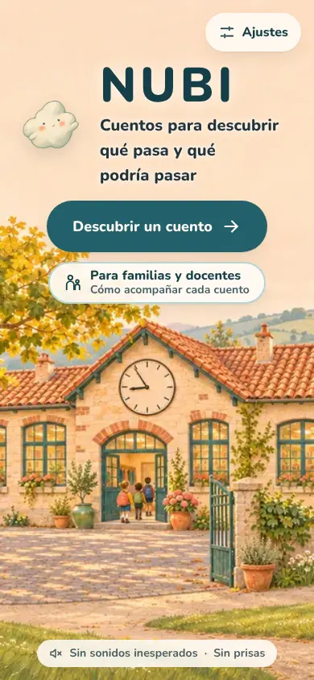 | 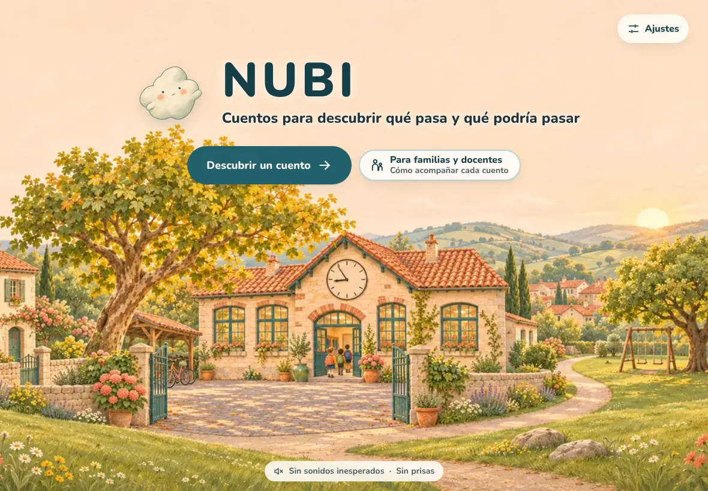 |
| Descubrir un cuento | 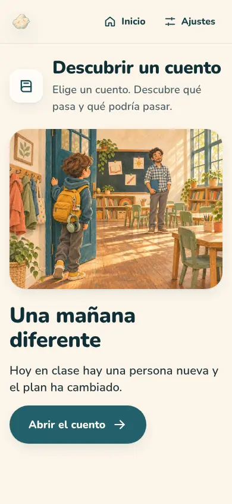 | 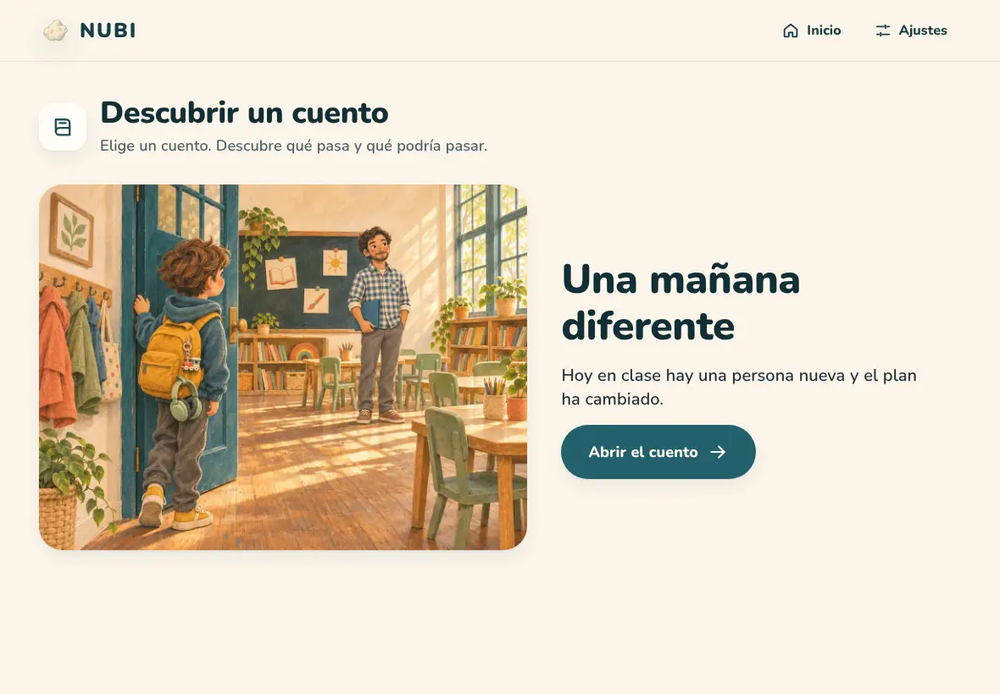 |
| Cuento o Cómic | 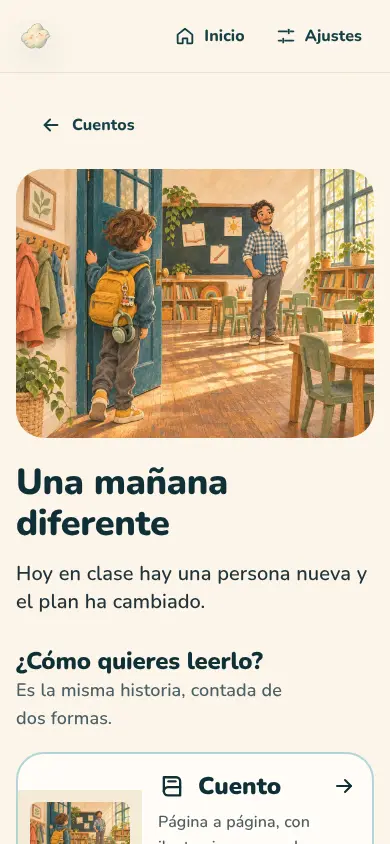 | 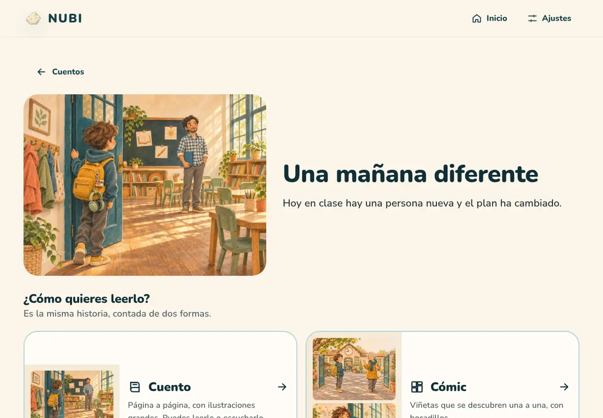 |
| Decisión (momento 2) | 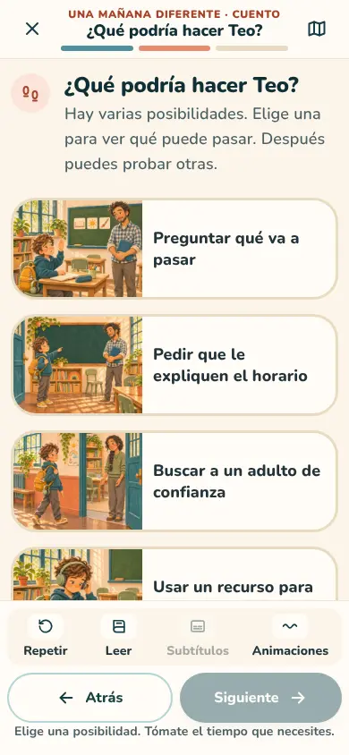 | 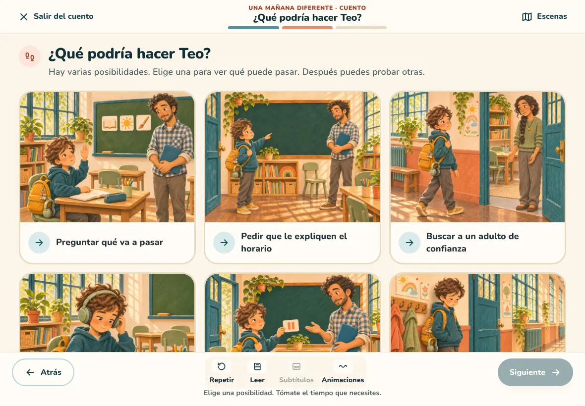 |
| Consecuencia (momento 3) | 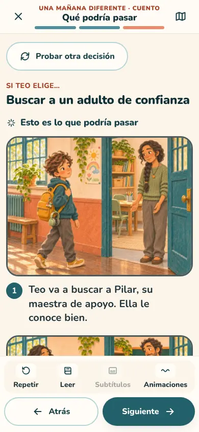 | 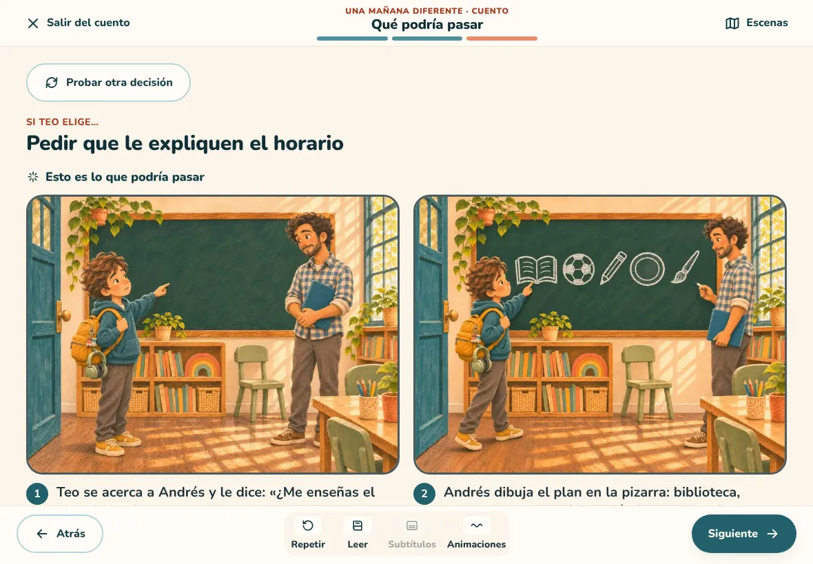 |

| Momento 1 | Pregunta opcional | Apoyo desplegado | Mi resumen | Índice por momentos |
|---|---|---|---|---|
| 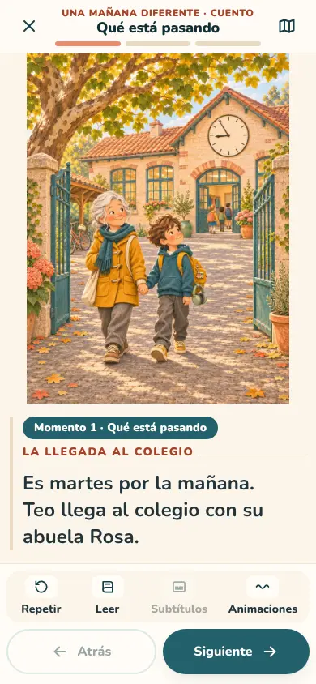 | 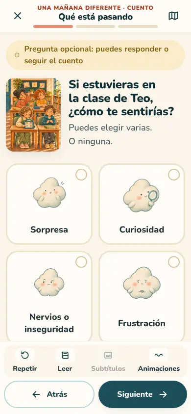 | 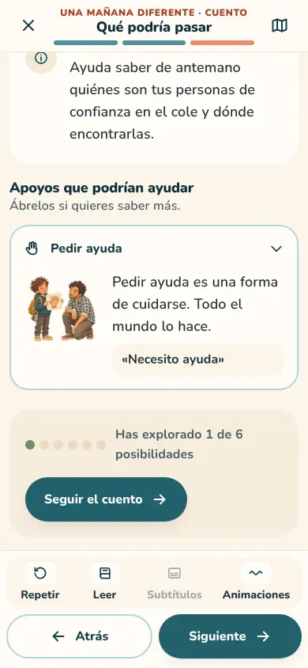 | 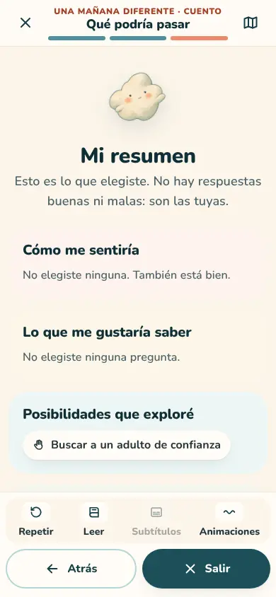 | 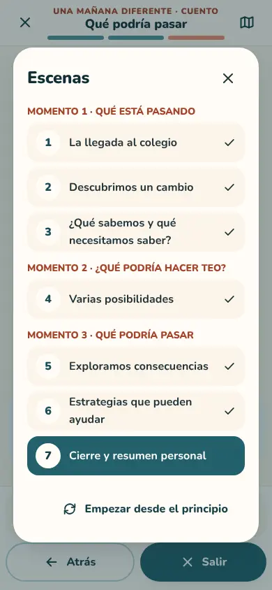 |

### Familias y docentes, Ajustes y compatibilidad

| Para familias y docentes | Guía (inicio) | Guía completa | Ruta antigua | Ajustes · datos |
|---|---|---|---|---|
| 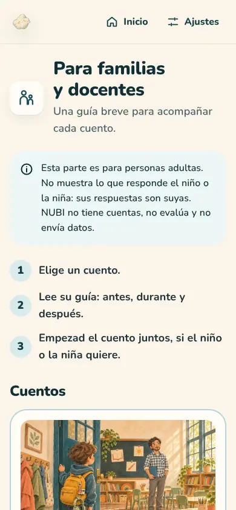 | 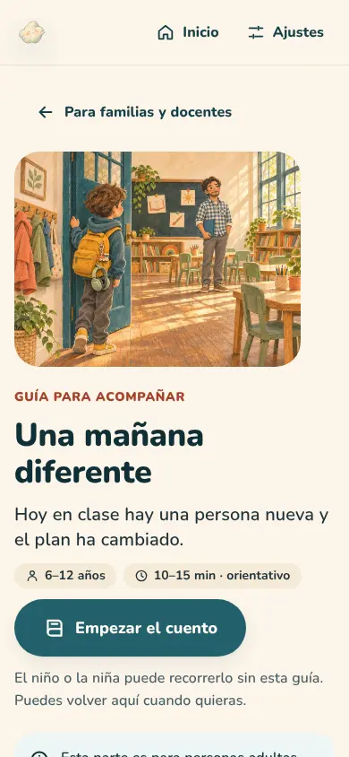 | 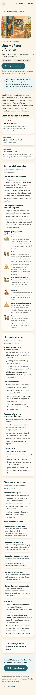 | 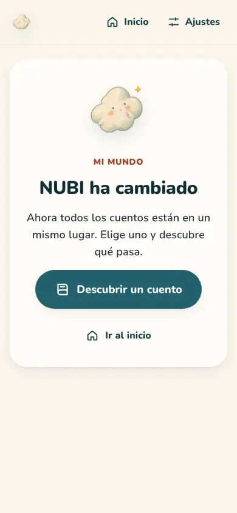 | 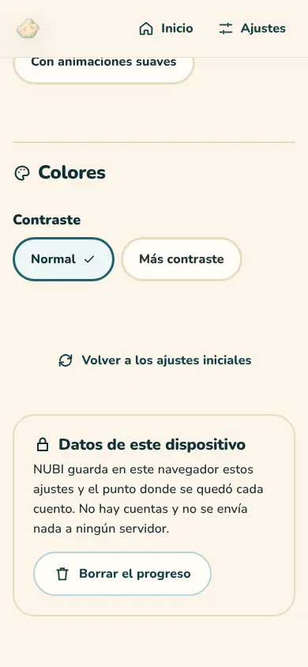 |

### Tableta vertical y zoom alto

| Inicio · 820×1180 | Decisión · 820×1180 | Guía · 820×1180 | Inicio · 320×256 (≈ 400 %) |
|---|---|---|---|
| 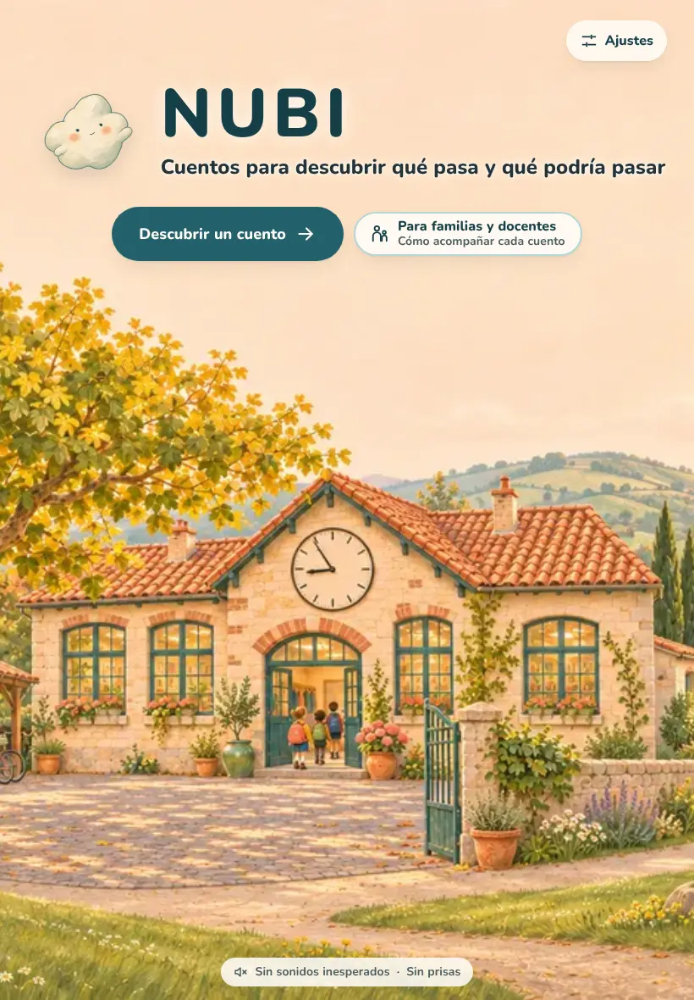 | 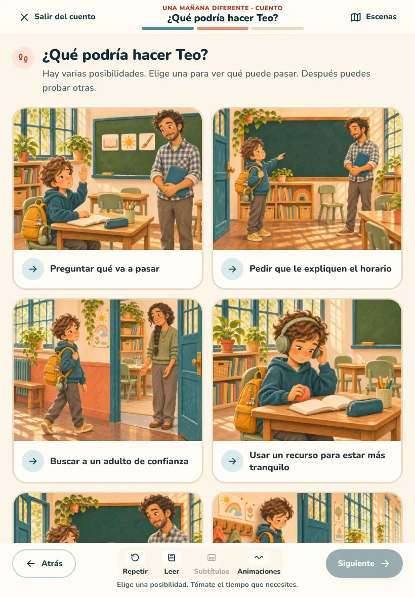 | 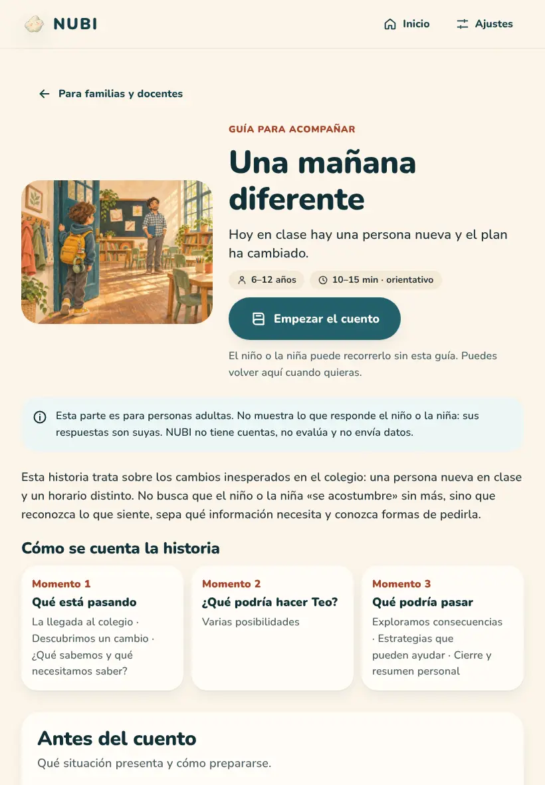 | 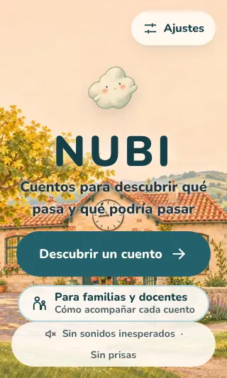 |

## 12. Cuestiones pedagógicas pendientes (no aplicadas)

Propuestas para revisión humana. **Ninguna se ha incorporado a `story.ts`.**

| # | Dónde | Texto actual | Propuesta | Motivo |
|---|---|---|---|---|
| P-1 | «Mi resumen», sección de herramientas, texto si no se eligió ninguna (`cierre-resumen`) | «Puedes elegirlas cuando quieras en Mis herramientas.» | «Puedes elegirlas otra vez cuando vuelvas a leer el cuento.» | «Mis herramientas» ya no existe como sección. **Prioritaria**: el niño o la niña puede leer una referencia a un lugar que no encuentra |
| P-2 | Guía, «Para hablar después» (`afterReading[2]`) | «Si quiere, imprimid o dibujad su «tarjeta» preferida de Mis herramientas.» | «Si quiere, dibujad o imprimid su tarjeta preferida de las que aparecen en el cuento (por ejemplo, «Necesito un descanso»).» | Misma referencia retirada |
| P-3 | Guía, «Más ideas» (`pendingActivities` a1 y a2) | «En la escena 4 hay seis posibilidades…» / «Elegir una herramienta de la escena 6…» | «En el momento 2 hay seis posibilidades…» / «Elegir uno de los apoyos del final del cuento…» | El lector ya no numera escenas; habla de momentos |
| P-4 | Guía, «Durante» (texto nuevo) | — | «Cómo acompañar sin inducir una decisión»: dejar que elija primero y sin pistas; si pregunta qué haría el adulto, responder después y como una opción más; no comentar si una posibilidad «es mejor» | El encargo lo pide y `familyGuide` no lo cubre. Requiere redacción y aprobación pedagógica |
| P-5 | Guía, «Después» (texto nuevo) | — | «Cómo escuchar sus preferencias»: preguntar qué parte le gustó o no y qué formato prefiere (cuento, cómic, escuchar); aceptar «no sé» o no querer hablar | Igual que P-4 |
| P-6 | Paso `strategies` (escena 6) | Siete apoyos | Mantener, mostrar solo los apoyos que aparecen en la historia, o pasarlo al final como pregunta opcional | Duplica en parte los apoyos de las consecuencias y es la pregunta más larga. Decisión pedagógica |
| P-7 | Rutas de la consecuencia (`story.ts`) | «Probar otra posibilidad» / «Seguir con la historia» | Igualar los datos a «Probar otra decisión» / «Seguir el cuento», o mantener los datos y la etiqueta de la interfaz | Hoy la interfaz muestra la etiqueta nueva y los datos conservan la antigua |
| P-8 | Nombre del producto | «Cuentos sociales interactivos» | Mantener la expresión genérica en español y evitar «Social Stories™» | `PEDAGOGICAL_FOUNDATIONS.md` aclara que NUBI **no** es una Social Story™ (Carol Gray). Conviene que la comunicación pública lo respete |

Siguen pendientes, sin tocar, las decisiones anteriores: textos de las fases 15 y 16, logotipo (fase 18) y registro de la fase 14.

## 13. Aspectos que necesitan pruebas con personas

| Hipótesis | Qué observar (protocolo de la fase 14, sin recoger datos personales en NUBI) |
|---|---|
| Con dos entradas, el niño o la niña sabe qué pulsar desde el primer momento | Abrir NUBI sin indicaciones. ¿Pulsa «Descubrir un cuento»? ¿Le llama la atención el acceso adulto? |
| Los tres momentos ayudan a entender la historia | Al terminar: «¿Qué pasó? ¿Qué podía hacer Teo? ¿Qué pasó después?», sin corregir |
| «Pregunta opcional» se entiende y reduce la sensación de cuestionario | ¿Responde, sigue sin responder o se queda dudando? |
| Las filas de decisiones en móvil se recorren bien | ¿Mira las seis? ¿Elige la primera por ser la primera? |
| «Probar otra decisión» y «Seguir el cuento» se distinguen | ¿Vuelve a explorar? ¿Sale cuando quiere? |
| Los apoyos desplegables se descubren | ¿Abre alguno? ¿Lo relaciona con lo que le pasa a Teo? |
| La guía es útil y breve para familias y docentes | ¿Encuentran «Antes/Durante/Después»? ¿Qué echan en falta? ¿Les parece una evaluación? |
| El cambio de secciones no desorienta a quien conocía la versión anterior | ¿La página «NUBI ha cambiado» se entiende? |

Además, siguen pendientes las pruebas manuales M-01 a M-16 ([MANUAL_ACCESSIBILITY_PROTOCOL.md](../review/MANUAL_ACCESSIBILITY_PROTOCOL.md)): lectores de pantalla, zoom real, iPad/Safari, Android y voz local.
