# NUBI · Cuentos visuales, voz y cierre de calidad · Fase 20

Rama: `feat/codex-nubi-visual-v1`, desde `feat/claude-social-stories-v1` (`93e70d2`). Sin merge a `main`, sin despliegue. No se ha eliminado ninguna ilustración ni contenido, no cambia el logotipo y el cuento sigue **pendiente de validación pedagógica**.

Plan técnico de historias ramificadas: [PHASE_21_BRANCHING_PLAN.md](PHASE_21_BRANCHING_PLAN.md).

> No se ha probado con niños, niñas, familias ni docentes. Todo lo que aquí se da por comprobado lo está con pruebas automáticas en navegador.

## 1. Pruebas pendientes de la fase 19

Las 12 suites que no terminaron en la fase 19 se ejecutaron **primero, con el código de la fase 19 sin cambios** (`93e70d2`):

| Suite | Resultado |
|---|---|
| short-text | PASS |
| comic-flow | PASS |
| comic-sizes | PASS |
| story-preload | **Se quedaba colgada** (límite de 600 s). Ver abajo. Tras corregir la prueba: PASS en 390, 820 y 1180, DPR 1 y 2 |
| narration | PASS |
| art-files | PASS (72 recursos, 224 archivos, SHA-256) |
| art-layout | PASS |
| art-batch-2 | PASS |
| art-batch-3 | PASS |
| art-batch-4 | PASS |
| art-batch-5 | PASS |
| art-batch-6 | PASS |

**Único error demostrado: la prueba `story-preload` se quedaba colgada; la aplicación funcionaba bien.** La prueba llamaba a `decode()` sobre todas las imágenes del escenario. Desde la fase 19, los apoyos de una consecuencia van plegados (`
`), y sus imágenes son perezosas: no se cargan hasta abrirlos, así que `decode()` no se resolvía nunca.

Corrección: la prueba ignora las imágenes de un `
` cerrado, que no se muestran. Sus aserciones no cambian: si alguna de esas imágenes se descargara sin mostrarse, seguiría fallando por «descargadas y nunca mostradas».

## 2. Cambios visuales implementados

### Decisiones: tarjetas de álbum ilustrado

- **Antes (fase 19):** en móvil, seis filas compactas con una imagen pequeña a la izquierda.
- **Ahora:** tarjetas con la **ilustración grande arriba y la frase breve debajo**, centrada.
  - Dos columnas desde el móvil y tres en tableta horizontal.
  - Una columna con menos de 360 px o con letra muy grande en móvil.
- «Ya la exploraste» va sobre la imagen, con texto y marca (no solo color).
- Las **seis posibilidades se conservan**, con su texto, su orden y sus consecuencias. No se agrupan ni se convierten en elecciones consecutivas.
- Todas tienen el mismo tamaño (`journeys.mjs` lo comprueba).

### Consecuencias

- Se mantiene el orden natural de lectura:
  1. qué decisión se tomó («Si Teo elige… *Pedir que le expliquen el horario*»);
  2. «Esto es lo que podría pasar», con las escenas ilustradas grandes y numeradas;
  3. reflexiones;
  4. otra forma de conseguirlo;
  5. apoyos plegados.
- **Probar otra decisión** queda arriba y **Seguir el cuento** al final, como acción principal.
- Las cuatro reflexiones (cómo te puedes sentir, cómo pueden sentirse otros, cuándo ayuda, a tener en cuenta) pasan a **dos columnas en tableta**. Es el mismo texto en la mitad de alto, y la pantalla ya no es una columna de tarjetas.
- No se ha ocultado ni resumido ningún texto educativo. Quitar tarjetas o fusionar reflexiones cambiaría el contenido, así que queda como propuesta (§6).

### Quién habla

- En los bocadillos del cuento, junto al nombre del personaje aparece su **retrato oficial** (`char-*`, recursos existentes que desde la fase 19 no se veían en ninguna pantalla). El nombre sube de 14 a 16 px.
- En el cómic de móvil, el texto de los bocadillos en lista sube de 16 a **18 px**, igual que el resto de la lectura. Los bocadillos superpuestos de tableta no cambian, para no tapar ilustraciones.

### Carrusel de historias

- «Descubrir un cuento» es ahora un **carrusel de portadas grandes**, con una tarjeta por historia (se añaden solas).
- Al final, la tarjeta **«Próximamente: nuevas historias»**: «Las próximas historias nacerán de las situaciones que propongáis en los comentarios de Instagram».
- **Sin enlace**, porque no hay una URL oficial. Queda preparada en `src/content/community.ts` (`instagramUrl`, vacía). Mientras esté vacía, la tarjeta invita a contárselo a una persona adulta. No se ha creado ninguna historia falsa.
- Se maneja con:
  - tacto (deslizar, con ajuste a cada tarjeta);
  - ratón;
  - flechas visibles «Cuento anterior» / «Cuento siguiente» (56 px);
  - teclado (← → dentro del carrusel);
  - indicador «1 de 2» anunciado a lectores de pantalla.
- No hay movimiento automático. Con movimiento reducido, los saltos son instantáneos.

### Guía para familias y docentes

- **Índice al principio**: tres enlaces grandes, **1 Antes · 2 Durante · 3 Después**, que llevan a cada parte (con margen para que la cabecera no tape el título).
- Al final de cada parte, «Volver al índice».
- El contenido es el mismo: sin panel, sin estadísticas y sin respuestas del menor.

### Texto del cuento

- Tamaños sin reducir. La narración se queda en 24 px en móvil y 28 px en tableta; los bocadillos y subtítulos, igual.
- La versión corta aprobada se muestra con Ajustes → «Textos cortos» (infraestructura de las fases 15 y 16, sin cambios). **No se ha aplicado ningún borrador nuevo.**

## 3. Capturas · móvil y tableta

Aplicación real, Chromium, movimiento reducido. Archivos en [`phase-20/`](phase-20/).

### Antes (fase 19) y ahora (fase 20)

| | Antes · 390×844 | Ahora · 390×844 |
|---|---|---|
| Cuentos | 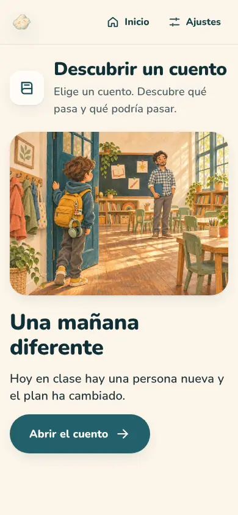 | 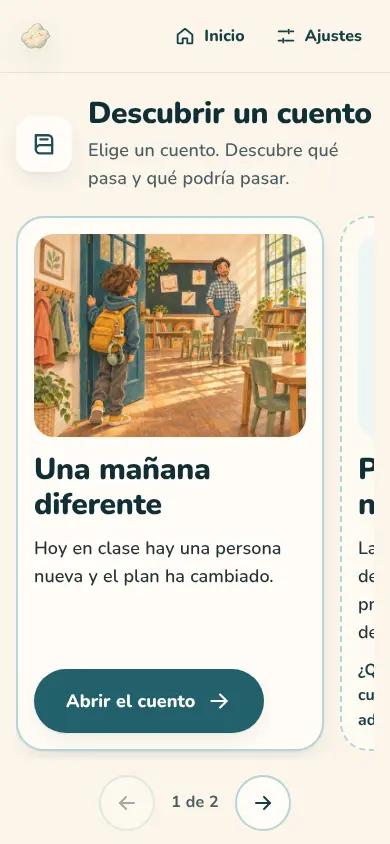 |
| Decisión | 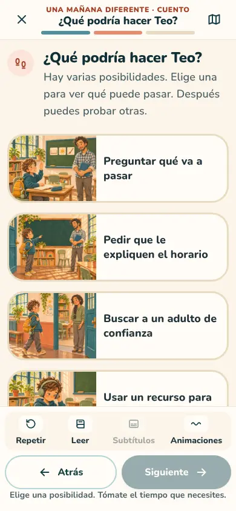 | 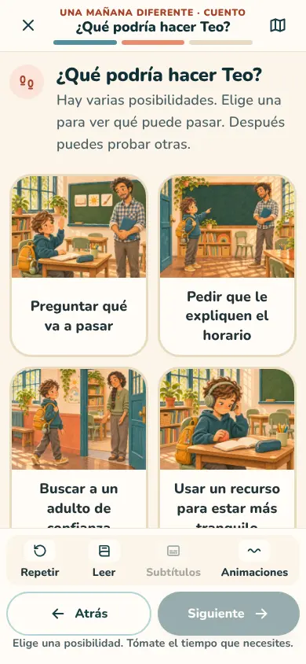 |
| Consecuencia | 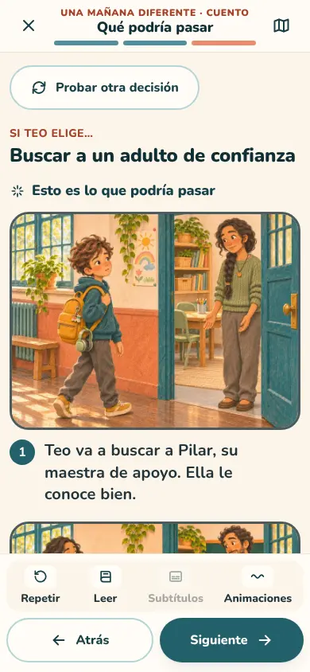 | 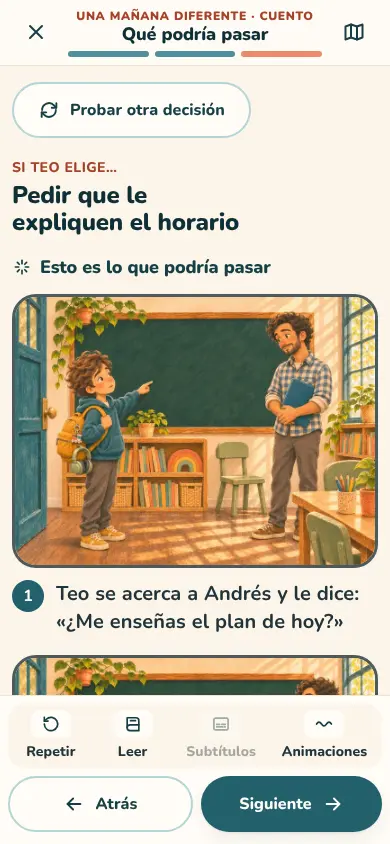 |
| Guía | 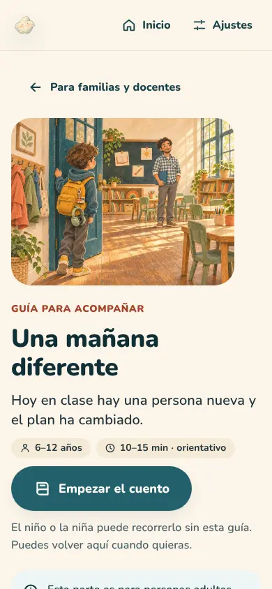 | 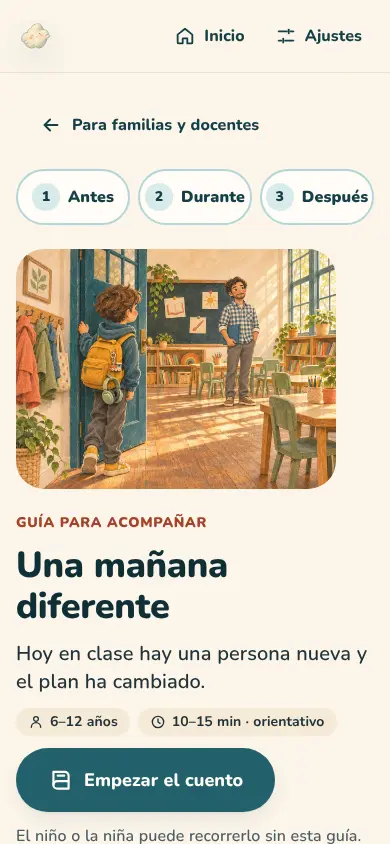 |

| | Antes · 820×1180 | Ahora · 820×1180 |
|---|---|---|
| Decisión | 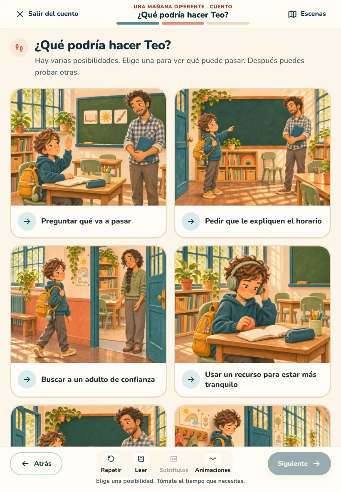 | 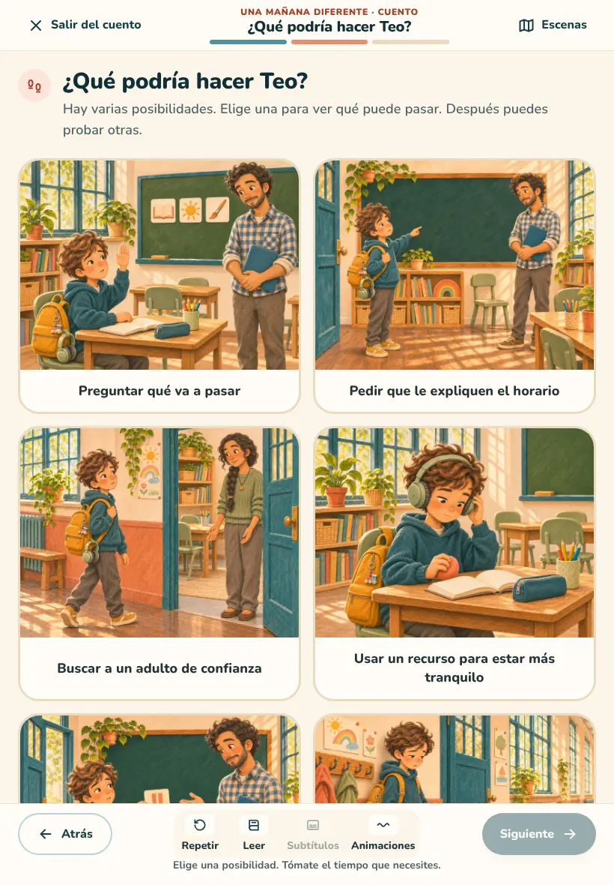 |
| Guía | 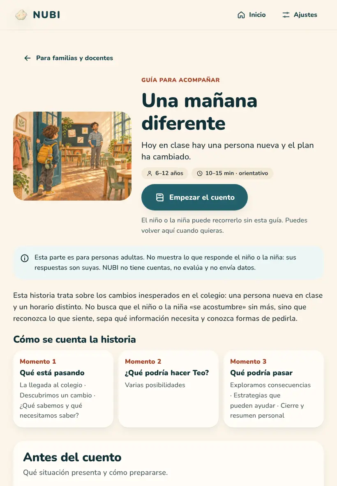 | 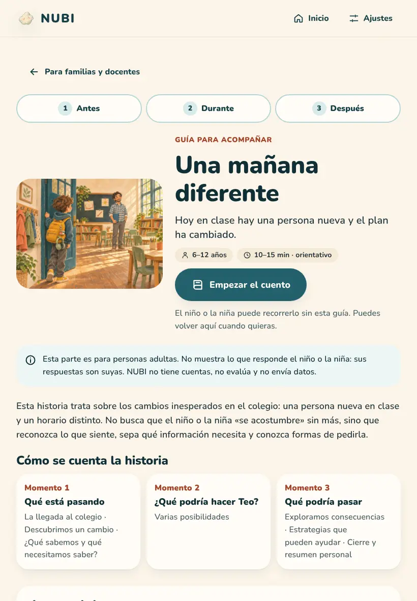 |

### Otras pantallas de la fase 20

| Móvil | | | | |
|---|---|---|---|---|
| 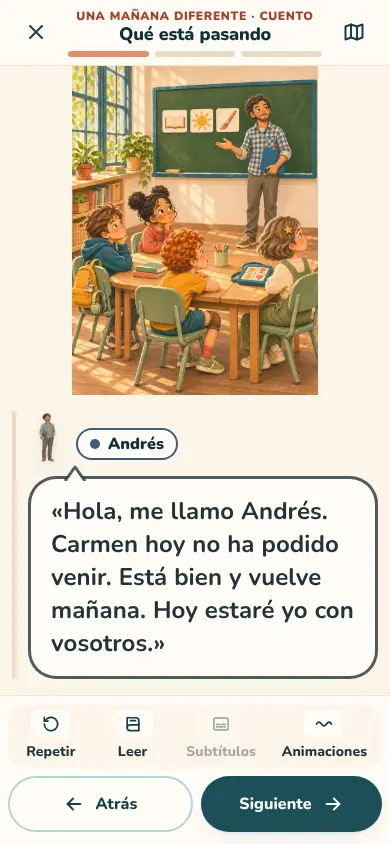 | 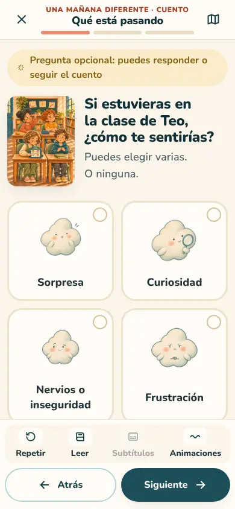 | 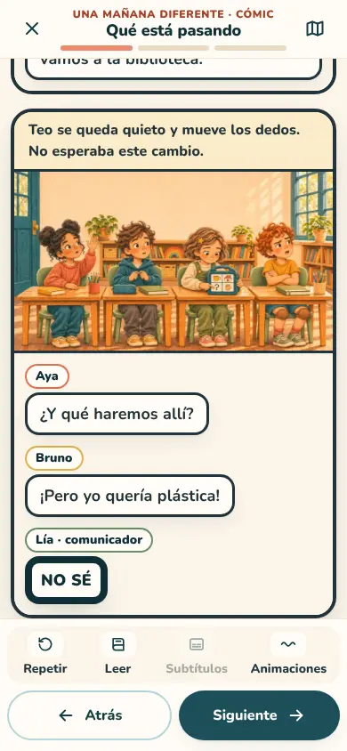 | 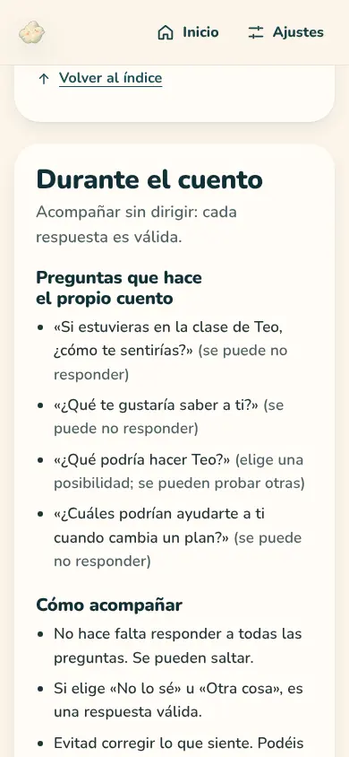 | 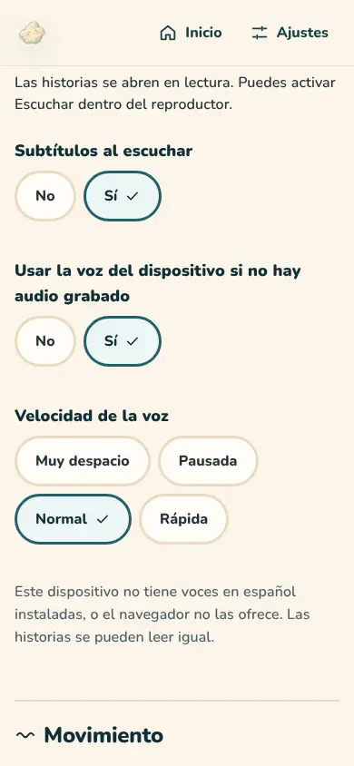 |

| Tableta | | | |
|---|---|---|---|
| 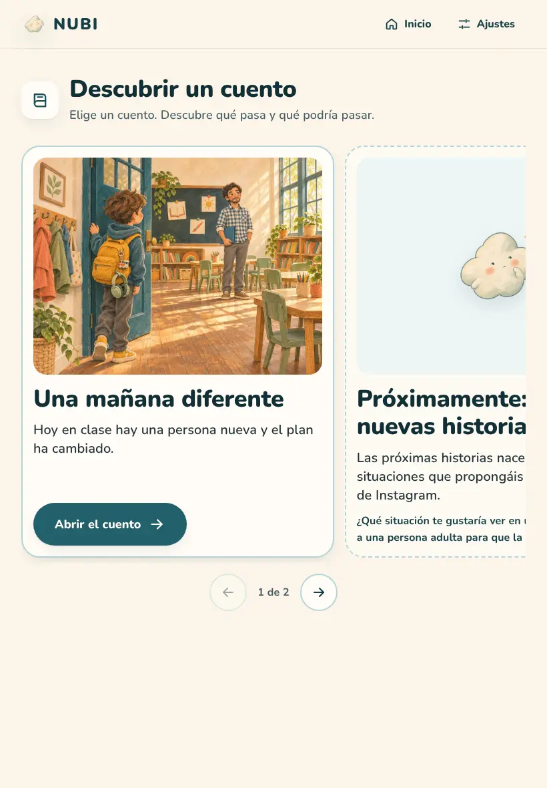 | 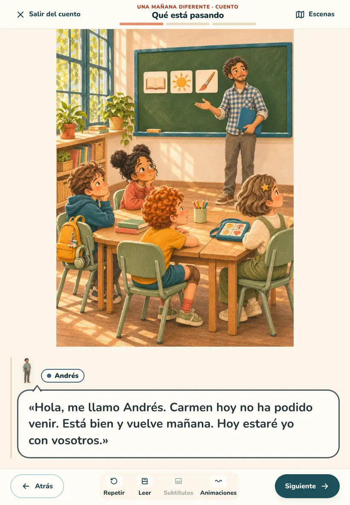 | 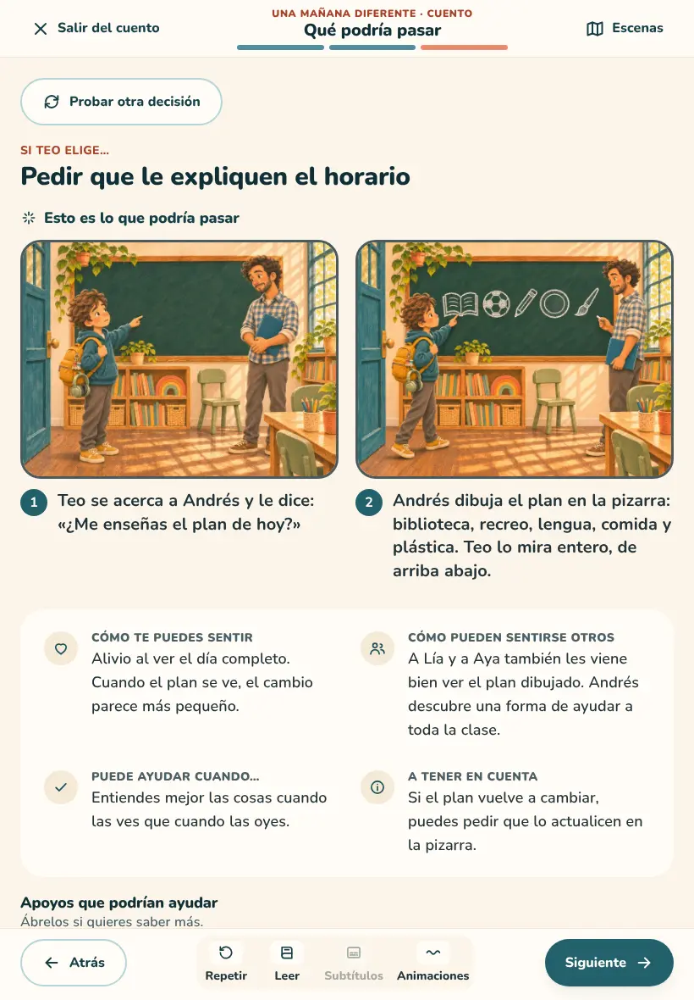 | 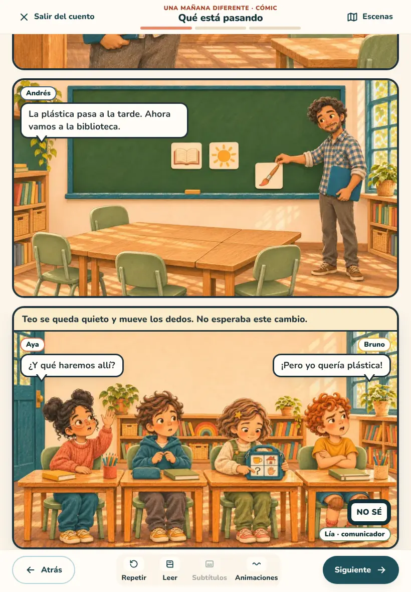 |

## 4. Mejoras de voz

| Antes | Ahora |
|---|---|
| Se usaba la primera voz local en español que devolviera el navegador | Lista de **todas las voces locales en español**, ordenadas por `src/lib/voices.ts`: primero español de España; delante las que el sistema marca como de mayor calidad («Natural», «Premium», «Enhanced», «Mejorada»…); detrás las que suelen sonar más mecánicas (eSpeak, «Compact») |
| Sin elección | **Elegir voz** en Ajustes, con **Muestra** para escucharla antes (la muestra no cambia la elección). Se guarda en el dispositivo (`voiceURI`). Si la voz elegida deja de estar disponible, se usa la primera de la lista y se avisa |
| Velocidad: despacio, normal, rápida | **Muy despacio (0,75) · Pausada (0,85) · Normal (0,9) · Rápida (1,05)**. Los valores antiguos guardados siguen siendo válidos |
| «Repetir» volvía al principio de la escena | En modo Escuchar, **Escuchar otra vez** repite solo la frase actual y **Parar la voz** la detiene. «Repetir» conserva su función |

- **Nada suena sin pedirlo**: el cuento se abre en modo Leer, como antes.
- **Privacidad**: solo voces locales (`localService`). Las remotas no aparecen ni se usan aunque se pidan.
- **Narración humana**: si una página tiene `narration` (audio grabado), se reproduce ese archivo antes que cualquier voz del dispositivo, como hasta ahora. El sistema queda listo para cuando haya grabaciones.
- **No se afirma que ninguna voz sea «dulce»**. El orden es una ayuda; la calidad depende del dispositivo y solo se puede juzgar escuchando. En Chromium sin cabeza no hay voces reales: la prueba `voice.mjs` usa voces simuladas, y en dispositivos reales queda pendiente (M-15).

## 5. Pruebas de esta fase

- `npm run check`: TypeScript + Vitest (**16 archivos, 99 tests**: los 95 de la fase 19 y 4 nuevos de `voices.test.ts`) + build. Correcto.
- **Navegador, con el código final de esta fase: 23 suites ejecutadas, 23 PASS.** Las evidencias van al scratchpad; las versionadas en `docs/` no se tocan (`git status` limpio).

| Suite | Resultado |
|---|---|
| `journeys.mjs` (ampliada) | PASS · 390×844, 820×1180, 1180×820, 640×512, 320×256 y letra muy grande + movimiento reducido en 390 y 1180. Ahora también comprueba el carrusel (flechas, ← →, «Próximamente» sin enlace inventado, sin desbordamiento) y el índice de la guía (cada enlace lleva a su parte, visible) |
| `voice.mjs` (nueva) | PASS · 390 y 1180: solo voces locales en español y ordenadas, la muestra no cambia la elección, voz y velocidad guardadas, el lector usa la voz elegida, nada suena al abrir, «Escuchar otra vez» repite la misma frase, «Parar la voz» cancela |
| `homepage`, `consequence-routes`, `ux-redesign` (80 pantallas, axe, ≥ 48 px), `quality`, `screens`, `story-fit`, `focus-obscured`, `reflow`, `reflow-probe` | PASS × 9 |
| `short-text`, `comic-flow`, `comic-sizes`, `story-preload`, `narration`, `art-files`, `art-layout`, `art-batch-2` a `art-batch-6` | PASS × 12 |

Errores encontrados y corregidos durante la fase:

- **Carrusel**: con letra muy grande en 1180 px, el carril no puede alinear la última tarjeta a la izquierda y el indicador volvía a «1 de 2». Ahora, al final del desplazamiento cuenta como la última. Lo detectó `journeys.mjs`.
- **`story-preload`**: la prueba se quedaba colgada (§1).

## 6. Propuestas editoriales (no aplicadas)

Ningún texto educativo se ha modificado. Sustituciones exactas propuestas en `src/content/stories/una-manana-diferente/story.ts`:

| # | Campo | Texto actual | Texto propuesto | Prioridad |
|---|---|---|---|---|
| P-1 | `cierre-resumen` → sección «Herramientas que podrían ayudarme» → `empty` | «Puedes elegirlas cuando quieras en Mis herramientas.» | «Puedes elegirlas otra vez cuando vuelvas a leer el cuento.» | **Alta**: lo lee el niño o la niña y nombra una sección que ya no existe |
| P-2 | `familyGuide.afterReading[2]` | «Si quiere, imprimid o dibujad su «tarjeta» preferida de Mis herramientas.» | «Si quiere, dibujad o imprimid su tarjeta preferida de las que aparecen en el cuento (por ejemplo, «Necesito un descanso»).» | Alta (guía adulta) |
| P-3a | `familyGuide.pendingActivities` a1 → `text` | «En la escena 4 hay seis posibilidades. Se pueden explorar en distintos días.» | «En el momento 2 («¿Qué podría hacer Teo?») hay seis posibilidades. Se pueden explorar en distintos días.» | Media: el índice del lector aún numera escenas |
| P-3b | `familyGuide.pendingActivities` a2 → `text` | «Elegir una herramienta de la escena 6 y probarla esta semana en una situación real.» | «Elegir uno de los apoyos del final del cuento y probarlo esta semana en una situación real.» | Media |
| P-4 | Guía, «Durante» (texto nuevo) | — | «Cómo acompañar sin inducir una decisión» (borrador en el informe de la fase 19, §12) | Requiere redacción y aprobación pedagógica |
| P-5 | Guía, «Después» (texto nuevo) | — | «Cómo escuchar sus preferencias» (borrador en el informe de la fase 19, §12) | Igual |
| P-6 | Paso `strategies` (siete apoyos) | — | **Pendiente de revisión pedagógica**: mantener, reducir a los apoyos que aparecen en la historia o moverlo como pregunta opcional al final | Sin propuesta de texto; decisión pedagógica |
| P-7 | Rutas de la consecuencia | «Probar otra posibilidad» / «Seguir con la historia» | Igualar a «Probar otra decisión» / «Seguir el cuento» (la interfaz ya muestra estas etiquetas) | Baja |
| P-8 | Nombre del producto | «Cuentos sociales interactivos» | Mantener el término genérico y no usar «Social Stories™» | Comunicación |

Simplificaciones visuales que **cambiarían el contenido**, propuestas y no aplicadas:

- **P-9**: en la consecuencia, mostrar primero solo las escenas ilustradas y dejar las cuatro reflexiones tras «Pensar un poco más».
- **P-10**: versión corta de las reflexiones (`ConsequenceShort` ya lo admite, pero exige redacción aprobada; los borradores de la fase 16 siguen pendientes).

## 7. Historias ramificadas

Esquema completo en [PHASE_21_BRANCHING_PLAN.md](PHASE_21_BRANCHING_PLAN.md):

- campos **opcionales** `option.next`, `scene.role`, `scene.ending` y `engineVersion`;
- `RunState.path` / `endingsSeen` con valores por defecto, para que las partidas guardadas sigan valiendo;
- acción `revisit` para explorar otro camino;
- validador de grafo con aviso si hay más de dos opciones;
- orden de implementación con pruebas.

«Una mañana diferente» no cambia.

## 8. Problemas pendientes

1. **P-1** sigue visible para el niño o la niña mientras no se apruebe.
2. **Voces reales**: elegir y escuchar en iPad, Android, macOS y Windows (M-15). La clasificación de voces es heurística.
3. **Carrusel con una sola historia**: muestra dos tarjetas (cuento + «Próximamente»). Observar si el niño o la niña entiende que la segunda no se abre.
4. **Tarjetas de decisión con letra muy grande** en móvil pasan a una columna. El atributo `sizes` anuncia media pantalla, así que la imagen puede descargarse con algo menos de resolución de la ideal. No afecta a la lectura.
5. **Retratos de quien habla**: son retratos de cuerpo entero (3:4) a 40–48 px. Se reconocen por color y silueta más que por la cara. Una versión de busto exigiría arte nuevo y aprobación.
6. Siguen pendientes las decisiones de fases anteriores (logotipo, textos de las fases 15 y 16) y las pruebas con personas (informe de la fase 19, §13).
