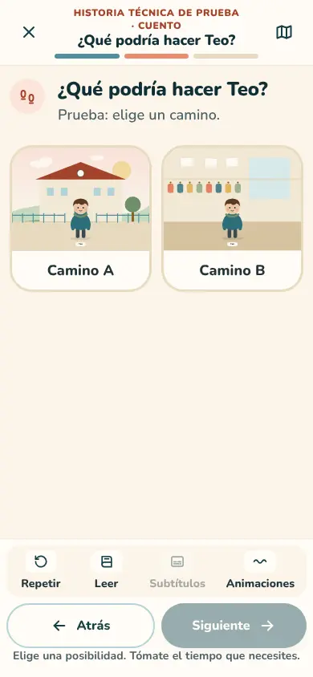
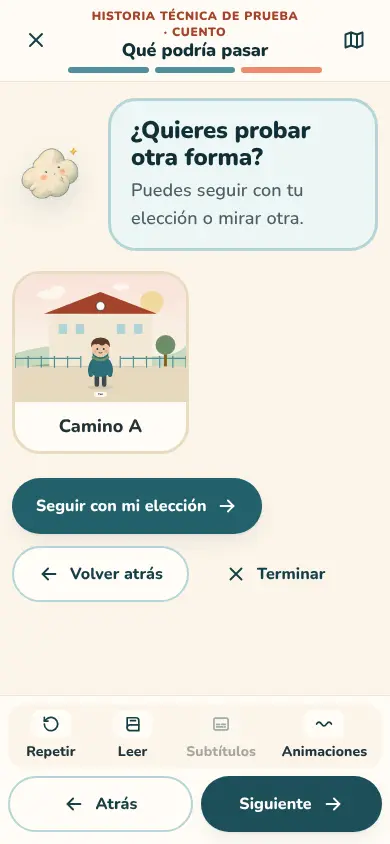
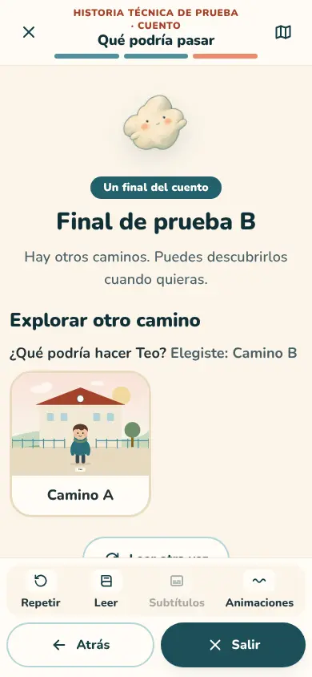
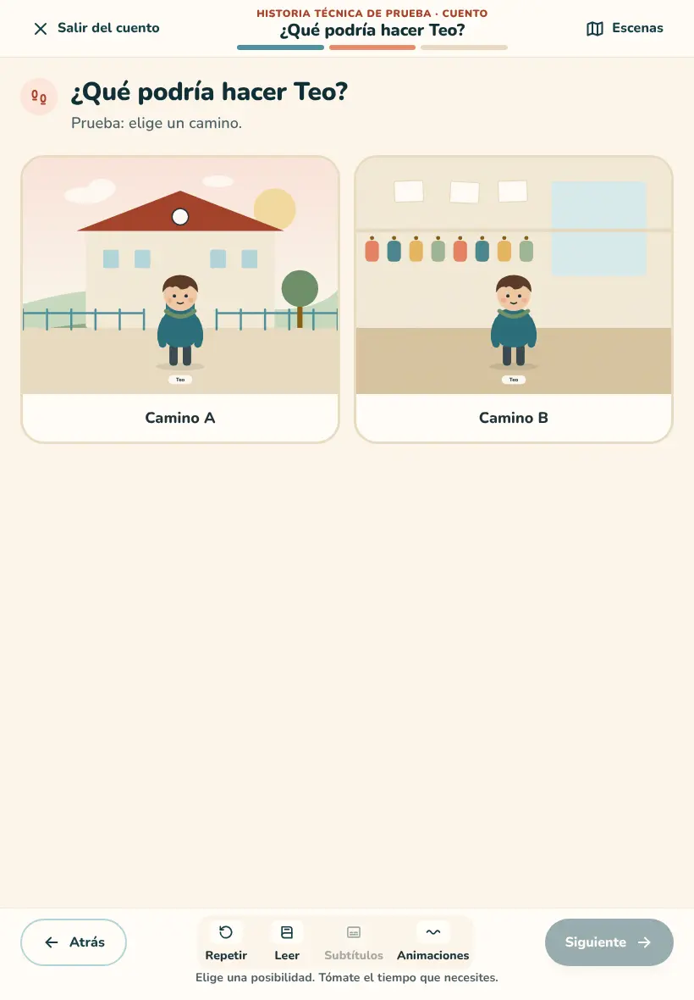
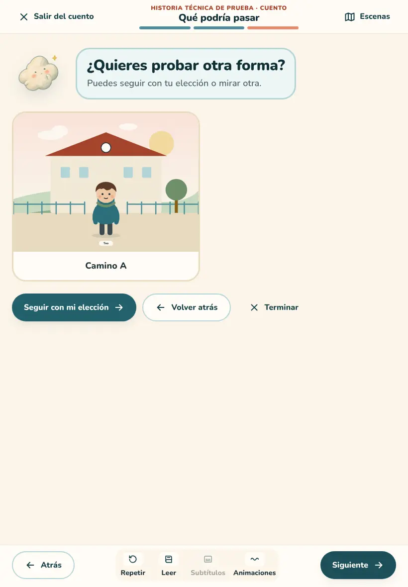
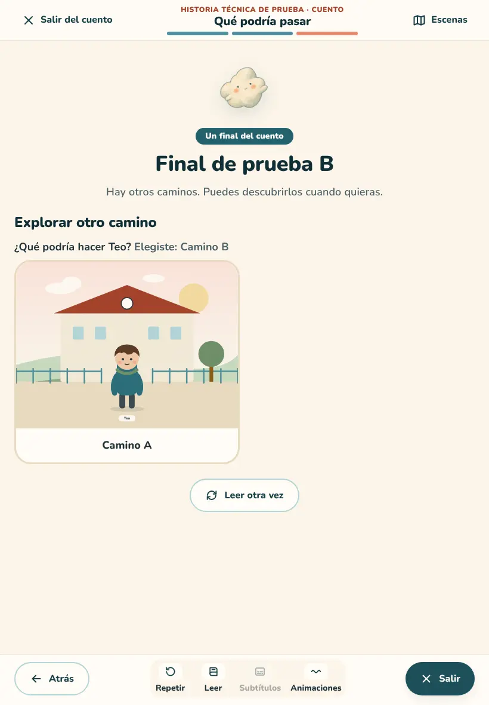

# NUBI · Motor de historias ramificadas · Fase 21

Rama: `feat/claude-nubi-branching-v1`, desde `feat/codex-nubi-visual-v1` (`737834e`). Sin merge a `main`, sin despliegue. Ningún contenido se marca como validado. Plan de partida: [PHASE_21_BRANCHING_PLAN.md](PHASE_21_BRANCHING_PLAN.md).

> «Una mañana diferente» funciona exactamente igual: mismas seis opciones, consecuencias, escenas, cuento, cómic, ilustraciones y partidas guardadas. La historia ramificada de esta fase es **técnica**, solo para pruebas, y **no** está en la biblioteca.

## 1. Revisión del plan antes de programar

El plan de la fase 20 era coherente. Al revisarlo se ajustaron cuatro puntos:

| Punto del plan | Problema | Decisión |
|---|---|---|
| `revisit` como acción nueva | Si «volver a una decisión» apila una posición más, después «Atrás» recorre la rama abandonada y mezcla dos caminos | Acción **`rewind`**: vuelve a un punto **ya recorrido** y **recorta** `history` y `path` desde ahí. Sirve para decisiones y para el índice |
| `Scene.ending` | El motor sigue el orden del array cuando una escena no tiene `next`: tras un final se colaría la escena siguiente | Un final **nunca** continúa por el array. En historias ramificadas, el validador exige que cada escena declare cómo sigue (`next`, una decisión o `ending`) |
| Pantalla final y oferta de Nubi | Añadirlas como pasos de contenido obligaría a escribirlas en cada historia | Son **pasos generados por el motor** (`offer`, `ending`) a partir de `scene.offer` y `scene.ending`. No añaden texto pedagógico, solo controles |
| `ChoiceOption.consequence` | En una historia ramificada, la consecuencia son las escenas de la rama, no un bloque de texto | `consequence` pasa a ser **opcional**. El validador la sigue exigiendo cuando la opción no tiene `next` (modelo del piloto) |

## 2. Motor

| Pieza | Cambio |
|---|---|
| `types.ts` | Opcionales: `ChoiceOption.next`, `Scene.role`, `Scene.ending`, `Scene.offer`, `Story.engineVersion`. Ninguno se renombra ni se elimina |
| `storyEngine.ts` | `next` en una decisión va a `option.next ?? step.next` y anota `path`. `prev` quita del camino las decisiones del tramo deshecho. **`rewind`** vuelve a un punto recorrido y recorta `history` y `path`. `endingsSeen` registra los finales descubiertos. Un final termina el cuento (`completed`, `isAtEnd`) |
| `RunState` | `path` (decisiones del camino actual con su posición en `history`) y `endingsSeen`, opcionales |
| `restoreRun.ts` | Partidas anteriores sin esos campos se restauran con `[]`. Un `path` malformado descarta la partida en lugar de usarla |
| `validate.ts` | Para `engineVersion: 2`: escenas alcanzables, al menos un final, finales que no continúan, escenas que no se quedan sin salida, **sin ciclos accidentales** e ids de final únicos. Mínimo de dos opciones (tres en el modelo anterior). `branchWarnings`: más de dos opciones es un **aviso**, no un error |
| `moments.ts` | Si la historia declara `role`, el momento del lector («Qué está pasando», «¿Qué podría hacer…?», «Qué podría pasar») sale del papel de la escena, no de su posición |

Lo explorado (`explored`), las respuestas (`responses`) y los finales descubiertos **no se borran** al volver o explorar otro camino. Lo que se recorta es el camino actual, para que «Atrás», el índice y el final reflejen solo una rama.

## 3. Experiencia infantil (pantallas nuevas)

| Situación + emoción opcional → | Dos opciones ilustradas → | Nubi: «¿Quieres probar otra forma?» → | Final |
|---|---|---|---|
| (sin cambios respecto al piloto) |  |  |  |
| Tableta |  |  |  |

Capturas con los placeholders técnicos de la historia de prueba: no son ilustraciones del proyecto.

- **Dos opciones**: tarjetas iguales, una junto a otra en móvil y en tableta (también en horizontal), con ilustración y frase breve.
- **Nubi como acompañante** (solo en escenas marcadas con `offer`): «¿Quieres probar otra forma? Puedes seguir con tu elección o mirar otra.» Muestra las otras opciones de la última decisión como tarjetas ilustradas. Las cuatro salidas son equivalentes:
  - **Seguir con mi elección** (botón principal, para no empujar a cambiar);
  - probar otra opción (tocar su tarjeta);
  - **Volver atrás**;
  - **Terminar**.
- **Final**: «Un final del cuento», su nombre y «Hay otros caminos. Puedes descubrirlos cuando quieras».
  - **Explorar otro camino** muestra cada decisión del recorrido («Elegiste: …») con sus otras opciones.
  - **Finales que has descubierto** aparece si hay más de uno, con nombres neutros, sin «buenos/malos» ni recuentos de lo que falta.
  - **Leer otra vez** y **Salir**.
- **Índice «Escenas»**: en una historia ramificada solo muestra el camino recorrido. Elegir una escena vuelve a ella rebobinando, sin saltar a ramas no visitadas.
- La **emoción** sigue siendo una pregunta opcional y **no influye** en la rama (probado). No hay puntos, recompensas ni castigos.
- Voz, lectura, ajustes y cómic: los pasos nuevos tienen su texto para la voz y el anuncio a lectores de pantalla. El cómic ramifica igual que el cuento.

## 4. Historia técnica de prueba

`src/content/stories/__dev__/branching-test.ts`. **No es contenido educativo**: texto técnico («Prueba: rama B…»), placeholders sin ilustraciones definitivas y `validation.status: 'borrador'` con la nota «Solo para pruebas automatizadas».

```
t-situacion (+ emoción opcional) ─▶ t-decision-1 ─┬─ Camino A ─▶ t-rama-a ─▶ t-decision-2 ─┬─ A1 ─▶ final A1
                                                   │                                         └─ A2 ─▶ final A2
                                                   └─ Camino B ─▶ t-rama-b (Nubi ofrece otra forma) ─▶ final B
```

- No está en `storyList`: no aparece en la biblioteca, el carrusel ni la guía adulta (test unitario).
- Sus recursos no entran en el registro oficial (siguen siendo 72). Se registran **solo en desarrollo** desde la ruta `/dev/historia-ramificada/{cuento,comic}`.
- La ruta solo existe con `import.meta.env.DEV` y se carga de forma diferida. Comprobado que el paquete de producción **no contiene** la historia de prueba (`grep` sobre `dist/`).

## 5. Pruebas

- `npm run check`: TypeScript + Vitest (**17 archivos, 115 tests**: 99 de la fase 20 + 16 de `branching.test.ts`) + build. Correcto.
- **Navegador, código final: 24 suites, 24 PASS.** Evidencias en el scratchpad; las versionadas de `docs/` sin tocar.

| Suite | Qué cubre |
|---|---|
| `branching.mjs` (nueva) · 390×844, 820×1180, 1180×820 | Emoción opcional; dos opciones del mismo tamaño elegidas con **teclado** y foco visible; cada opción a su rama; oferta de Nubi con sus cuatro salidas, anuncio para voz y lector de pantalla, sin valoraciones; final con salida; **explorar otro camino**; segunda decisión y tres finales; «Finales que has descubierto»; **reanudar** con `?continuar=1`; **Atrás nunca pasa por la rama abandonada**; índice solo del camino recorrido; **cómic** ramificado; **axe** en la oferta y el final; sin desbordamiento; consola limpia |
| `branching.test.ts` (unitaria) | Grafo válido, tres finales alcanzables, detección de **ciclos**, escenas inalcanzables y sin salida; aviso con más de dos opciones; la historia de prueba fuera de la biblioteca y del registro; la emoción no decide la rama; `rewind` y `prev` recortan el camino y conservan lo explorado y los finales; un final no continúa por el array; cómic; **partidas de la fase 20 sin `path`/`endingsSeen` se restauran igual**; camino malformado descartado; el piloto conserva seis opciones y su escena común de consecuencias |
| `journeys`, `voice`, `homepage`, `consequence-routes`, `ux-redesign`, `quality`, `screens`, `story-fit`, `focus-obscured`, `reflow`, `reflow-probe`, `short-text`, `comic-flow`, `comic-sizes`, `story-preload`, `narration`, `art-files`, `art-layout`, `art-batch-2` a `art-batch-6` | **PASS × 23**: el piloto, la navegación, la voz, la accesibilidad, el zoom y los 72 recursos siguen igual |

## 6. Correcciones editoriales pendientes (no aplicadas)

Ningún texto educativo ha cambiado. Referencias antiguas que siguen pendientes de aprobación (texto exacto en [PHASE_20_VISUAL_REPORT.md §6](PHASE_20_VISUAL_REPORT.md#6-propuestas-editoriales-no-aplicadas)):

| # | Dónde | Problema | Prioridad |
|---|---|---|---|
| **P-1** | «Mi resumen» → herramientas, texto si no se eligió ninguna | Dice «…en Mis herramientas», una sección que ya no existe. **Lo lee el niño o la niña** | **Alta** |
| P-2 | Guía, «Para hablar después» | «…tarjeta preferida de Mis herramientas» | Alta |
| P-3a / P-3b | Guía, «Más ideas» | «escena 4», «escena 6»: el lector habla de momentos | Media |

Siguen abiertas también P-4/P-5 (textos nuevos de la guía), P-6 (paso de estrategias, revisión pedagógica), P-7 (etiquetas de rutas), P-8 (nombre del producto) y P-9/P-10 (simplificar consecuencias).

## 7. Propuesta: convertir «Una mañana diferente» en un cuento ramificado real

**No se escribe ni se aplica ningún guion.** Esta es la forma de trabajar propuesta para que el equipo pedagógico decida.

1. **No partir las seis opciones en tres decisiones de dos.** Las seis posibilidades son alternativas ante el **mismo** momento: preguntar, pedir el horario, buscar a un adulto, usar un recurso, pedir tiempo y salir sin avisar. Encadenarlas cambiaría la causalidad («primero pregunta, luego…») y el sentido pedagógico.
2. **Opción A · Conservar el nodo de seis** y ramificar **después**. Cada opción (o grupos aprobados de opciones) lleva a una escena propia (`option.next`) que muestra cómo sigue la mañana. Las ramas pueden reunirse en un tronco común antes del cierre: `next` a «estrategias» / «cierre», que ya existen. El motor ya lo admite: seis opciones son válidas (solo un aviso de diseño).
3. **Opción B · Una nueva versión de dos opciones por nodo**, escrita desde cero como **otro episodio** (p. ej. «Una mañana diferente · camino a camino»), sin sustituir al piloto. Requiere:
   - guion con 2–3 nodos y 2–4 finales;
   - ilustraciones nuevas para cada escena de rama y cada final;
   - versión de cómic;
   - textos cortos;
   - revisión de que **ningún final se lea como premio o castigo**, en especial el de «salir sin avisar», que hoy se trata sin culpa y con una alternativa;
   - aprobación pedagógica y, después, pruebas con niños y niñas.
4. **Dónde activar a Nubi** (`offer`): solo en escenas donde el guion muestre una dificultad (p. ej. tras «salir sin avisar»). Su pregunta es siempre una invitación, nunca una corrección.
5. **Migración sin pérdida**: el piloto actual se queda como `engineVersion` 1. Una versión ramificada sería **otra historia con otro `id`**, así que las partidas guardadas del piloto siguen intactas.

Pasos sugeridos:

1. Decidir entre A y B.
2. Escribir el guion (equipo pedagógico).
3. Encargar ilustraciones.
4. Cargar la historia con `engineVersion: 2` (el validador comprueba el grafo).
5. Ampliar `branching.mjs` con la historia real.
6. Revisión y validación.

## 8. Archivos

- Motor: `src/engine/{types,storyEngine,restoreRun,validate}.ts`. Tests en `src/engine/branching.test.ts` (16).
- Presentación: `src/components/player/{BranchViews.tsx,StoryPlayer.tsx,moments.ts,presentation.ts,interactions.tsx}` e `index.css` (pareja de tarjetas).
- Desarrollo: `src/content/stories/__dev__/branching-test.ts`, `src/screens/DevBranchingScreen.tsx`, `registerDevAssets` en `src/content/assets/index.ts` y rutas `DEV` en `src/App.tsx`.
- Progreso: `loadRun` acepta la historia, para la de prueba.
- Prueba de navegador nueva: `tests/browser/branching.mjs`.
- Ajustes de tipos en tests existentes (`consequence!`), por `consequence` opcional; ninguna aserción cambia.
